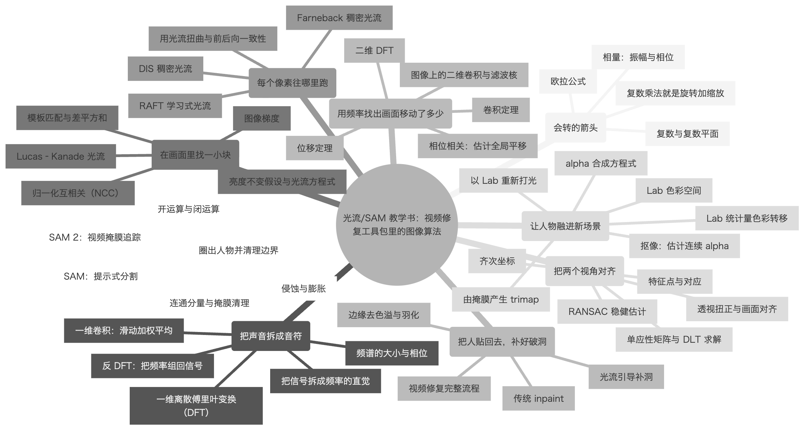

从「学习者起点」所列的基础出发（需要的基础章节由起点决定），沿途学会二维 DFT 与位移定理，再依序学会相位相关、模板匹配、光流（Lucas–Kanade、Farneback、DIS、RAFT）、单应性与 RANSAC、形态学、SAM／SAM 2 分割、抠像、Lab 重新打光、合成与 inpaint，最后串成视频修复工具包（把来源视频的真人贴回 AI 换背景后的画面并重新打光）的完整流程。

文字说明
思维导图：中心为「光流/SAM 教学书：视频修复工具包里的图像算法」，分支为 会转的箭头（复数与复数平面、复数乘法就是旋转加缩放、欧拉公式、相量：振幅与相位）；把声音拆成音符（把信号拆成频率的直觉、一维离散傅里叶变换（DFT）、反 DFT：把频率组回信号、频谱的大小与相位、一维卷积：滑动加权平均）；用频率找出画面移动了多少（卷积定理、图像上的二维卷积与滤波核、二维 DFT、位移定理、相位相关：估计全局平移）；在画面里找一小块（模板匹配与差平方和、归一化互相关（NCC）、图像梯度、亮度不变假设与光流方程式、Lucas–Kanade 光流）；每个像素往哪里跑（Farneback 稠密光流、DIS 稠密光流、RAFT 学习式光流、用光流扭曲与前后向一致性）；把两个视角对齐（齐次坐标、单应性矩阵与 DLT 求解、特征点与对应、RANSAC 稳健估计、透视扭正与画面对齐）；圈出人物并清理边界（侵蚀与膨胀、开运算与闭运算、连通分量与掩膜清理、SAM：提示式分割、SAM 2：视频掩膜追踪）；让人物融进新场景（alpha 合成方程式、由掩膜产生 trimap、抠像：估计连续 alpha、Lab 色彩空间、Lab 统计量色彩转移、以 Lab 重新打光）；把人贴回去，补好破洞（边缘去色溢与羽化、传统 inpaint、光流引导补洞、视频修复完整流程）。

*图 0-1：全书知识点总览：9 章、43 个知识点（由先修图与课纲自动生成）。*

> 全书导图见 [图 0-1](#fig-mindmap-overview)。学习者起点：已会：Python、numpy 阵列基本操作；待学：复数与欧拉公式、傅里叶变换与 DFT、卷积与线性系统、电脑图形学。

## 章节

1. [会转的箭头](/blog/tech/optical-flow-sam/01.complex-phase)（约 150 分钟）：用平面上的箭头与时钟指针建立复数、旋转与相位的直觉，为后面的傅里叶变换铺路。
2. [把声音拆成音符](/blog/tech/optical-flow-sam/02.dft-1d)（约 190 分钟）：以和弦拆音的比喻理解『信号由频率组成』，再引入一维 DFT、反变换与频谱，并认识卷积。
3. [用频率找出画面移动了多少](/blog/tech/optical-flow-sam/03.dft-2d-phase-corr)（约 200 分钟）：把一维概念推到图像：认识二维卷积与二维 DFT，推导位移定理，并实现相位相关估计全局平移。
4. [在画面里找一小块](/blog/tech/optical-flow-sam/04.template-flow-basics)（约 190 分钟）：从滑动比对小块出发，延伸到亮度不变假设与局部光流。
5. [每个像素往哪里跑](/blog/tech/optical-flow-sam/05.dense-flow)（约 180 分钟）：比较三种稠密光流的想法与使用方式，并学会用光流扭曲画面与检查可靠度。
6. [把两个视角对齐](/blog/tech/optical-flow-sam/06.homography-ransac)（约 190 分钟）：以平面透视变换加稳健估计，在含大量错误对应时仍能对齐两个画面。
7. [圈出人物并清理边界](/blog/tech/optical-flow-sam/07.mask-morphology-sam)（约 190 分钟）：以形态学清理二值掩膜，再用 SAM 取得人物掩膜，并以 SAM 2 在视频中追踪。
8. [让人物融进新场景](/blog/tech/optical-flow-sam/08.matting-relight)（约 200 分钟）：由掩膜得到连续 alpha，再在 Lab 空间调整前景的光线与色调。
9. [把人贴回去，补好破洞](/blog/tech/optical-flow-sam/09.composite-inpaint-pipeline)（约 170 分钟）：完成去色溢、合成与补洞，并把前面所有算法串成视频修复流程。
