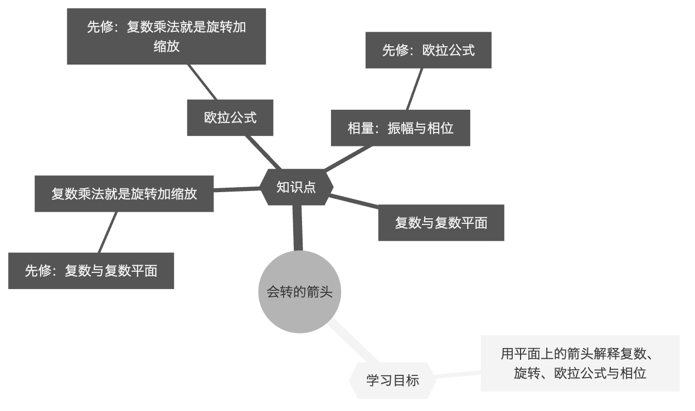
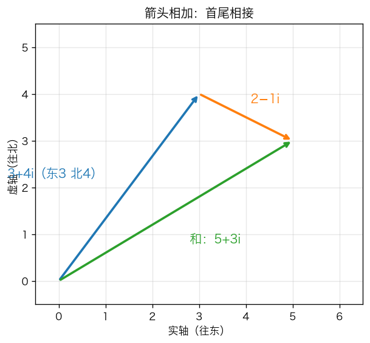
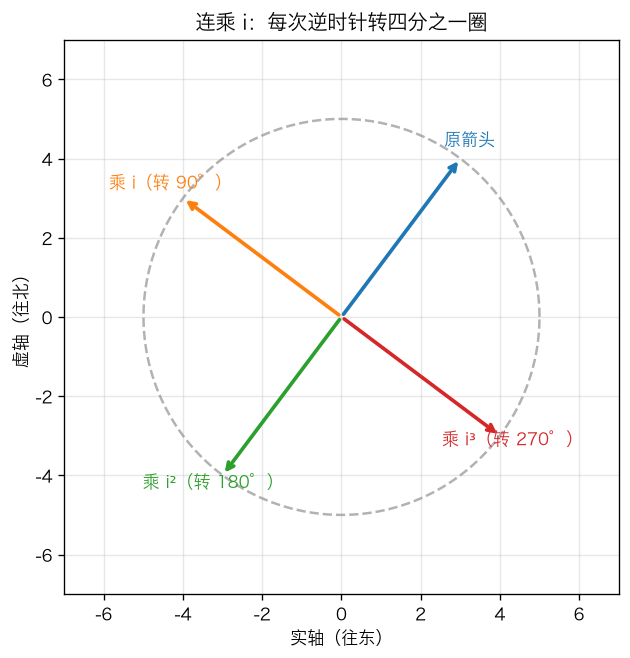
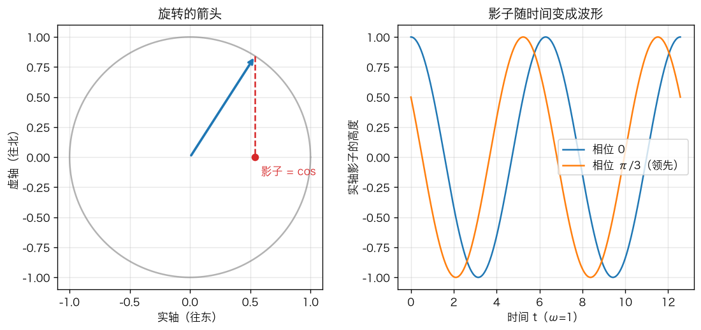

<a id="ch-complex-phase"></a>

用平面上的箭头与时钟指针建立复数、旋转与相位的直觉，为后面的傅里叶变换铺路。

<a id="fig-mindmap-ch-complex-phase"></a>



<details><summary>文字说明</summary>思维导图：中心为「会转的箭头」，分支为 学习目标（用平面上的箭头解释复数、旋转、欧拉公式与相位）；知识点（复数与复数平面、复数乘法就是旋转加缩放、欧拉公式、相量：振幅与相位）。</details>

*图 1-1：会转的箭头：本章 4 个知识点、学习目标与各知识点的直接先修（由先修图自动生成）。*

> 本章导图见 [图 1-1](#fig-mindmap-ch-complex-phase)。本章假设已会：（无）。

<a id="ch-complex-phase--arrow-as-number"></a>

## 1. 把平面上的箭头当成一种数

想像你站在方格地图的原点，收到一道指令：往东走 3 格、再往北走 4 格。这趟旅程可以画成一支从原点指向目的地的箭头，也可以记成一对数字 (3, 4)。两种记法描述的是同一件事。[^c-arrow-pair]

只要长度相同、方向相同，两支箭头就是同一趟旅程，不管画在地图的哪里。[^c-same-arrow]

这支箭头有多长？往东 3、往北 4 构成一个直角三角形，两股平方和是 3²+4²=25，所以斜边（箭头长度）是 5。[^c-length-5]

现在给这种箭头一个名字。我们用一个符号 i 代表「往北走 1 格」，而「往东走 1 格」就是普通的 1。于是往东 3、往北 4 就写成 3+4i，称为复数；3 叫实部（东西方向的分量），4 叫虚部（南北方向的分量）。复数 3+4i 就是平面（复数平面）上的一个地址，走法是往东 3、往北 4。[^c-complex-def]

两支箭头怎么相加？把两趟旅程依序走完：先走第一趟，再从落脚点出发走第二趟，总和就是从原点直接指向最后目的地的那支箭头。换成数字，就是实部加实部、虚部加虚部。例如 (3+4i)+(2−1i)=5+3i：东西共走 5，南北共走 3。[^c-add]

上面的加法可以用程式验算，结果和手算一致，[图 1-2](#fig-fig-arrow-add) 把它画了出来。[^c-add-num]

<a id="fig-fig-arrow-add"></a>



*图 1-2：3+4i 与 2−1i 首尾相接，和是从原点直接指到终点的 5+3i。*

<a id="ch-complex-phase--multiply-is-rotate"></a>

## 2. 乘法就是转动加伸缩

先看一个具体例子。拿 3+4i（往东 3、往北 4）乘以 i：3i+4i²。这里用到 i 的定义 i²=−1（往北的单位连乘两次，会变成往西的单位）。结果是 −4+3i，也就是往西 4、往北 3。把它和原箭头并排看，就是原箭头逆时针转了四分之一圈。想像时钟指针原本指向一点多钟的方向，乘 i 就是把指针拨过 90 度。[^c-times-i]

刚才的算术可以在 Python 里重做验证：(3+4j)*1j 恰好等于 −4+3j。[^c-times-i-num]

既然乘 i 是转 90 度，连乘 i 两次就是转 180 度，也就是乘 −1，箭头掉头；连乘三次转 270 度，等于乘 −i（顺时针转 90 度）；连乘四次回到原位。[^c-i-powers]

只乘普通实数时，箭头只会伸缩：乘 2 变两倍长，乘 −1 则反向，长度不变、方向相反。负数可以看成在数线上转 180 度，复数则允许任意角度的转动。[^c-real-scale]

要把「任意角度」说清楚，需要用长度加角度来描述箭头：长度叫做模，角度（从正东方起、逆时针量到箭头的夹角）叫做辐角。3+4i 的长度是 5，角度的正切是 4/3，约 53 度。[^c-polar-terms]

有了这两个量，乘法规则就能一句话说完：两个复数相乘，长度相乘、角度相加。例如 1+i 长度 √2、角度 45 度；自己乘自己，长度变 2、角度变 90 度，刚好是 2i。[^c-mul-rule]

用程式检查：(1+1j)**2 等于 2j，长度 2、角度 90 度，与规则吻合。[^c-mul-num]

归纳起来：乘以任何一个复数，就是把整个平面转一个角度，再放大或缩小一个倍数。乘 i 只是其中「转 90 度、不缩放」的特例。[图 1-3](#fig-fig-rotate-i) 把 3+4i 连续乘 i 的轨迹画在圆上。[^c-mul-general]

<a id="fig-fig-rotate-i"></a>



*图 1-3：3+4i 依序乘 i，箭头在圆上逆时针每次转四分之一圈，长度始终是 5，四次回到原位。*

<a id="ch-complex-phase--euler-formula"></a>

## 3. 欧拉公式：转 θ 的单位箭头

要谈「转任意角度」，先要有一把量角的尺。大家熟悉的是度：一圈 360 度。数学上更方便的是弧度：圆心角所对的弧长等于半径时，就是 1 弧度。一整圈的弧长是 2π 倍半径，所以一圈是 2π 弧度，半圈 π 弧度就是 180 度。度换弧度，乘以 π/180。[^c-radian]

现在取一支长度为 1 的箭头，从正东方转 θ。它的目的地在单位圆上：往东 cosθ、往北 sinθ，也就是余弦是它的东向坐标，正弦是北向坐标。[^c-unit-xy]

用复数写，这支单位箭头就是 cosθ + i sinθ；长度为 r 的箭头则是 r(cosθ + i sinθ)，即把单位箭头放大 r 倍。[^c-polar-form]

欧拉公式给这支箭头一个简短的名字：e^{iθ} = cosθ + i sinθ。意思是「e 的 iθ 次方」就是「转了 θ 弧度的单位箭头」，所以任何长度为 r、角度为 θ 的复数都可写成 r·e^{iθ}。这里不证明它背后的级数，只当作定义般的记号，后面用数值检查它的行为。[^c-euler]

用几个具体角度检验：θ=0 时 e^{i0}=1（指向正东）；θ=π/2（90 度）时是 i（正北）；θ=π（180 度）时是 −1（正西）；θ=3π/2 时是 −i。例如 e^{iπ}=−1，程式算出的实部是 −1、虚部只剩浮点误差等级的 0。[^c-euler-points]

这个记号最大的好处是：角度相加变成指数相加。因为「乘法＝长度相乘、角度相加」，单位箭头相乘时长度仍是 1，所以 e^{iα}·e^{iβ}=e^{i(α+β)}。先转 α 再转 β，就是一共转 α+β。[^c-angle-add]

[图 1-3](#fig-fig-rotate-i) 之外，可以直接执行下面的范例来验算这些性质。角度再转一整圈（加 2π）会回到同一个位置，就像时钟的 1:00 和 13:00 指针位置相同，所以 e^{iθ} 与 e^{i(θ+2π)} 是同一个箭头。[^c-wrap]

### 范例：`complex_check.py`

验算乘 i 转 90 度、欧拉公式在 θ=π 的值，以及角度相加；其中 e^{iπ} 的实部为 −1、虚部只剩浮点误差。[^c-euler-points]

档案：[`complex_check.py`](/optical-flow-sam/examples/ch-complex-phase/complex_check.py)（执行：`python complex_check.py`）

```python
import cmath
import math

z = 3 + 4j
print('乘 i 结果:', z * 1j)

e = cmath.exp(1j * math.pi)
print(f'e^(i*pi) 的实部 {e.real:.6f} 虚部 {e.imag:.6f}')

alpha, beta = 0.7, 1.9
left = cmath.exp(1j * alpha) * cmath.exp(1j * beta)
right = cmath.exp(1j * (alpha + beta))
print('角度相加检查:', abs(left - right) < 1e-12)
```

预期输出（节录）：

```text
e^(i*pi) 的实部 -1.000000 虚部 0.000000
```

<a id="ch-complex-phase--phasor"></a>

## 4. 相量：振幅与相位，以及摩天轮的影子

一支箭头由两件事决定：长度与角度。我们把长度叫做振幅，把角度叫做相位，这样的复数 z = A·e^{iφ}（A 是振幅、φ 是相位）称为相量。它在某个时刻的样子，就是一支长 A、指向 φ 方向的箭头。[^c-phasor-def]

现在让箭头转起来。把 e^{iωt} 想成摩天轮上的一个座舱：t 是时间，ω 是每秒转过的弧度（角速度），所以时刻 t 的角度是 ωt，等速增加，就像时钟指针。太阳从正上方照下来，座舱在地上的影子，就是箭头在实轴（东西）上的影子 cos(ωt)；从侧面照，墙上的影子是虚轴（南北）的 sin(ωt)。因此旋转箭头的影子随时间画出来，就是余弦与正弦波。[^c-shadow]

转一圈要多久？角度走完 2π 需要的时间 T 满足 ωT=2π，所以周期 T=2π/ω：转得越快，周期越短。[^c-omega-period]

相位是「起点在哪里」。如果摩天轮的座舱在 t=0 时不是在正东，而是已经位于角度 φ，那么箭头是 A·e^{i(ωt+φ)}，它的实轴影子是 A·cos(ωt+φ)：整条余弦波往左挪了 φ/ω 的时间。[^c-phase-start]

两个同步转动的箭头，若夹角不为零，就有相位差；它就是两支箭头的夹角，做法是把一方的相位减去另一方的相位。正的相位差代表前者领先，负的代表落后，就像两根转速相同但起跑线不同的时钟指针。[^c-lead-lag]

相位是角度，所以会绕圈：「完全重复一次周期振荡」就是箭头转了一整圈，转完回到原位，相位 φ 与 φ+2π 描述同一个状态。这也表示相位不是唯一的；实务上常把它收进 −π 到 π 之间，所以数值可能在 π 附近突然跳到 −π，其实只是箭头跨过了正西方，并没有真的变化很大。[^c-phase-wrap]

总结三个旋钮：振幅决定箭头多长，相位决定它从哪个角度出发，转速 ω 决定它转得多快。三者各自独立，改一个不影响另外两个；[图 1-4](#fig-fig-phasor-shadow) 左图是箭头，右图是两个不同相位的影子波形。下一章会用这些旋转的箭头去「量」一段信号里含有多少某种转速的成分。[^c-three-knobs]

<a id="fig-fig-phasor-shadow"></a>



*图 1-4：左：单位箭头在实轴上的影子（虚线）是余弦值。右：起点角度不同的两个箭头，影子波形只差一个平移，这个平移就是相位差。*

<a id="ch-complex-phase--practice-arrows"></a>

## 5. 练习：动手转箭头

请动手做下列练习，并用 Python 的复数（如 3+4j）验算。

**练习 1**（`ex-q1`）：把 2+1i 与 −1+3i 相加，并求和的长度（可用计算机）。

<details><summary>解答</summary>

和为 1+4i；长度为 sqrt(1²+4²)=sqrt(17)，约 4.12。

</details>

**练习 2**（`ex-q2`）：2+0i 乘以 (1+i)，结果的长度与角度各是多少？先用「长度相乘、角度相加」推，再用 Python 验算。

<details><summary>解答</summary>

1+i 长 √2、角 45 度；2 长 2、角 0 度。乘积长 2√2、角 45 度，即 2+2i。

</details>

**练习 3**（`ex-q3`）：不用查表，写出 e^{iπ/2}、e^{i3π/2}、e^{i2π} 的值。再回答：两支相位分别为 π/6 与 π/2 的同转速箭头，谁领先、领先多少？

<details><summary>解答</summary>

分别为 i、−i、1。相位 π/2 的领先，领先 π/2−π/6=π/3（60 度）。

</details>

<a id="ch-complex-phase--references"></a>

## 章末引用

### 主张与证据

[^c-arrow-pair]: 位移同时需要距离与方向；「往东 3、再往北 4」可记成 (3, 4)，与一支长度为距离、方向为航向的箭头是同一件事的两种记法。 —— 证据：[mathzennd〔未核实〕](<https://math-zen.com/zh-Hant/blog/understanding-vectors-intuitively>)（`ev-d38c7d8c0e8b`）；[mathzennd〔未核实〕](<https://math-zen.com/zh-Hant/blog/understanding-vectors-intuitively>)（`ev-c14b275ea953`）
[^c-same-arrow]: 长度相同、方向相同的两支箭头是同一个向量，与画在哪里无关。 —— 证据：[mathzennd〔未核实〕](<https://math-zen.com/zh-Hant/blog/understanding-vectors-intuitively>)（`ev-dc39468c586d`）
[^c-length-5]: 往东 3、往北 4 的箭头长度为 sqrt(3²+4²)=5。 —— 证据：[mathzennda〔未核实〕](<https://math-zen.com/zh-Hant/blog/understanding-polar-coordinates-intuitively>)（`ev-ce1f1c80e192`）
[^c-complex-def]: 复数 3+4i 是平面上的一个地址，走法是往东 3、往北 4；实部是横向分量、虚部是纵向分量。 —— 证据：[mathzennd〔未核实〕](<https://math-zen.com/zh-Hant/blog/understanding-vectors-intuitively>)（`ev-42cd8dd9174e`）；[cnblogsndmysticbinary〔未核实〕](<https://www.cnblogs.com/mysticbinary/p/19325162>)（`ev-0f4245279ff2`）
[^c-add]: 两支箭头相加是把两趟旅程首尾相接，和为起点到终点的直线；复数加法即实部加实部、虚部加虚部，如 (3+4i)+(2−1i)=5+3i。 —— 证据：[mathzennd〔未核实〕](<https://math-zen.com/zh-Hant/blog/understanding-vectors-intuitively>)（`ev-53e844fcf628`）；[cnblogsndmysticbinary〔未核实〕](<https://www.cnblogs.com/mysticbinary/p/19325162>)（`ev-0f4245279ff2`）；[cnblogsndmysticbinary〔未核实〕](<https://www.cnblogs.com/mysticbinary/p/19325162>)（`ev-24832a8fd276`）
[^c-add-num]: Python 验算 (3+4j)+(2-1j) 的结果为 (5+3j)。 —— 证据：[mathzennd〔未核实〕](<https://math-zen.com/zh-Hant/blog/understanding-vectors-intuitively>)（`ev-53e844fcf628`）
[^c-times-i]: i 由 i²=−1 定义，乘以 i 在复数平面上是逆时针转四分之一圈（90 度）；3+4i 乘 i 得 −4+3i。 —— 证据：[mathzennd〔未核实〕](<https://math-zen.com/zh-Hant/blog/understanding-vectors-intuitively>)（`ev-c637527d4f97`）；[uedund〔未核实〕](<https://uedu.tw/math/a/complex-numbers-adv>)（`ev-f7a5fe935bfc`）
[^c-times-i-num]: Python 验算 (3+4j)*1j 等于 (-4+3j)。 —— 证据：[mathzennd〔未核实〕](<https://math-zen.com/zh-Hant/blog/understanding-vectors-intuitively>)（`ev-c637527d4f97`）
[^c-i-powers]: 乘 i 三次等于逆时针转 3π/2，即乘 −i 为顺时针转 90 度；乘 i 两次为乘 −1（转 180 度）。 —— 证据：[redditndi〔未核实〕](<https://www.reddit.com/r/learnmath/comments/1inzkow/multiplying_by_imaginary_number_i?tl=zh-hant>)（`ev-50ceed3cedd8`）；[redditndi〔未核实〕](<https://www.reddit.com/r/learnmath/comments/1inzkow/multiplying_by_imaginary_number_i?tl=zh-hant>)（`ev-4b3bf8eedfac`）；[redditndrb〔未核实〕](<https://www.reddit.com/r/math/comments/qcv14g/why_does_the_imaginary_number_work?tl=zh-hant>)（`ev-07b03176ac96`）
[^c-real-scale]: 乘以实数只会伸缩箭头，乘 −1 让箭头反向（长度相同、方向相反），可视为转 180 度。 —— 证据：[mathzennd〔未核实〕](<https://math-zen.com/zh-Hant/blog/understanding-vectors-intuitively>)（`ev-2f4a6a942e73`）；[redditndrb〔未核实〕](<https://www.reddit.com/r/math/comments/qcv14g/why_does_the_imaginary_number_work?tl=zh-hant>)（`ev-599baf763fde`）
[^c-polar-terms]: 复数有长度（模）与从正实轴量起的角度（辐角）两个图形属性；3+4i 长度 5，角度正切 4/3。 —— 证据：[zhnd〔未核实〕](<https://zh.khanacademy.org/math/precalculus/imaginary-and-complex-numbers/polar-form-of-complex-numbers/a/complex-number-forms-review>)（`ev-febbc34fb386`）；[mathzennda〔未核实〕](<https://math-zen.com/zh-Hant/blog/understanding-polar-coordinates-intuitively>)（`ev-ce1f1c80e192`）
[^c-mul-rule]: 两个复数相乘，长度相乘、角度相加；1+i（长 √2、45 度）自乘得长 2、90 度。 —— 证据：[zhnd〔未核实〕](<https://zh.khanacademy.org/math/precalculus/imaginary-and-complex-numbers/polar-form-of-complex-numbers/a/complex-number-forms-review>)（`ev-cf968188321c`）；[uedund〔未核实〕](<https://uedu.tw/math/a/complex-numbers-adv>)（`ev-8eec5fab51e4`）；[cnblogsndmysticbinary〔未核实〕](<https://www.cnblogs.com/mysticbinary/p/19325162>)（`ev-6f8d67485ccd`）；[uedund〔未核实〕](<https://uedu.tw/math/a/complex-numbers-adv>)（`ev-acd482605aea`）
[^c-mul-num]: (1+1j)**2 等于 2j，长度 2、角度 90 度。 —— 证据：[zhnd〔未核实〕](<https://zh.khanacademy.org/math/precalculus/imaginary-and-complex-numbers/polar-form-of-complex-numbers/a/complex-number-forms-review>)（`ev-cf968188321c`）
[^c-mul-general]: 乘以任一复数，等于把平面旋转一个角度再放大一个倍数（旋转加缩放）；乘 i 是其中不缩放、转 90 度的特例。 —— 证据：[uedund〔未核实〕](<https://uedu.tw/math/a/complex-numbers-adv>)（`ev-5c05a572cba2`）；[redditndr〔未核实〕](<https://www.reddit.com/r/learnmath/comments/1diawdx/the_geometry_of_complex_numbers_visualizing?tl=zh-hant>)（`ev-8b28aa9f379c`）；[redditndr〔未核实〕](<https://www.reddit.com/r/learnmath/comments/1diawdx/the_geometry_of_complex_numbers_visualizing?tl=zh-hant>)（`ev-34790a7ac6c3`）
[^c-radian]: 弧长等于半径时的圆心角为 1 弧度；一圈为 2π 弧度、π 弧度为 180 度；度乘 π/180 换成弧度。 —— 证据：[zhnda〔未核实〕](<https://zh.wikipedia.org/zh-cn/%E5%BC%A7%E5%BA%A6>)（`ev-951dfa45aa4f`）；[zhnda〔未核实〕](<https://zh.wikipedia.org/zh-cn/%E5%BC%A7%E5%BA%A6>)（`ev-d25c3037bf34`）；[zhnda〔未核实〕](<https://zh.wikipedia.org/zh-cn/%E5%BC%A7%E5%BA%A6>)（`ev-249137dff8f6`）
[^c-unit-xy]: 单位圆上方向角为 θ 的点，东向坐标是 cosθ、北向坐标是 sinθ；距离为 r 时各自乘 r。 —— 证据：[mathzennda〔未核实〕](<https://math-zen.com/zh-Hant/blog/understanding-polar-coordinates-intuitively>)（`ev-38772f678f1c`）；[mathzennd〔未核实〕](<https://math-zen.com/zh-Hant/blog/understanding-vectors-intuitively>)（`ev-746da4e7d541`）
[^c-polar-form]: 复数可写成 r(cosθ + i sinθ)，即长度加方向的图像。 —— 证据：[zhnd〔未核实〕](<https://zh.khanacademy.org/math/precalculus/imaginary-and-complex-numbers/polar-form-of-complex-numbers/a/complex-number-forms-review>)（`ev-4d33b7840bde`）；[mathzennda〔未核实〕](<https://math-zen.com/zh-Hant/blog/understanding-polar-coordinates-intuitively>)（`ev-167c4301008f`）
[^c-euler]: 欧拉公式 e^{iθ}=cosθ+i sinθ：e^{iθ} 是转 θ 弧度的单位箭头，复数可写成 r·e^{iθ}。 —— 证据：[uedund〔未核实〕](<https://uedu.tw/math/a/complex-numbers-adv>)（`ev-bfae5e6892e3`）；[uedund〔未核实〕](<https://uedu.tw/math/a/complex-numbers-adv>)（`ev-bdd671743b9a`）
[^c-euler-points]: e^{i0}=1、e^{iπ/2}=i、e^{iπ}=−1、e^{i3π/2}=−i；程式计算 e^{iπ} 的实部为 −1、虚部约 0（仅浮点误差）。 —— 证据：[redditndrb〔未核实〕](<https://www.reddit.com/r/math/comments/qcv14g/why_does_the_imaginary_number_work?tl=zh-hant>)（`ev-cf0e6bebe124`）
[^c-angle-add]: e^{iα}·e^{iβ}=e^{i(α+β)}：单位箭头相乘即角度相加。 —— 证据：[uedund〔未核实〕](<https://uedu.tw/math/a/complex-numbers-adv>)（`ev-bdd671743b9a`）；[redditndrb〔未核实〕](<https://www.reddit.com/r/math/comments/qcv14g/why_does_the_imaginary_number_work?tl=zh-hant>)（`ev-faef59da76f0`）
[^c-wrap]: 转整整一圈（2π 或 360 度）后方向不变，所以 θ 与 θ+2π 是同一个位置，如时钟 1:00 与 13:00。 —— 证据：[mathzennda〔未核实〕](<https://math-zen.com/zh-Hant/blog/understanding-polar-coordinates-intuitively>)（`ev-cc64f0996aa4`）
[^c-phasor-def]: 相量 z=A·e^{iφ} 的长度 A 是振幅、角度 φ 是相位。 —— 证据：[zhnd〔未核实〕](<https://zh.khanacademy.org/math/precalculus/imaginary-and-complex-numbers/polar-form-of-complex-numbers/a/complex-number-forms-review>)（`ev-febbc34fb386`）；[uedund〔未核实〕](<https://uedu.tw/math/a/complex-numbers-adv>)（`ev-bfae5e6892e3`）
[^c-shadow]: 旋转箭头在实轴上的影子是余弦、在虚轴上的影子是正弦，所以 e^{iωt} 的影子随时间画出来就是余弦与正弦波。 —— 证据：[mathzennd〔未核实〕](<https://math-zen.com/zh-Hant/blog/understanding-vectors-intuitively>)（`ev-46c68ff9ce07`）；[mathzennda〔未核实〕](<https://math-zen.com/zh-Hant/blog/understanding-polar-coordinates-intuitively>)（`ev-38772f678f1c`）
[^c-omega-period]: 角速度 ω（弧度／秒）的箭头转一圈需要周期 T=2π/ω。 —— 证据：[zhnda〔未核实〕](<https://zh.wikipedia.org/zh-cn/%E5%BC%A7%E5%BA%A6>)（`ev-d25c3037bf34`）
[^c-phase-start]: A·e^{i(ωt+φ)} 的实轴影子是 A·cos(ωt+φ)，相位 φ 是 t=0 时箭头的起始角度，使波形平移 φ/ω 的时间。 —— 证据：[uedund〔未核实〕](<https://uedu.tw/math/a/complex-numbers-adv>)（`ev-bfae5e6892e3`）
[^c-lead-lag]: 相位差是两者相位相减；正的相位差表示前者领先、负的表示落后。 —— 证据：[doindspatial〔未核实〕](<https://doi.org/10.1371/journal.pbio.1002257.g003>)（`ev-2b618cf97402`）；[doindspatial〔未核实〕](<https://doi.org/10.1371/journal.pbio.1002257.g003>)（`ev-97c5b3bbf2cd`）
[^c-phase-wrap]: 完整重复一次振荡等于转一圈，相位 φ 与 φ+2π 是同一状态，因此相位不唯一、可能在 ±π 附近跳变。 —— 证据：[zhyuend〔未核实〕](<https://zh-yue.wikipedia.org/wiki/%E8%A7%92%E9%A0%BB%E7%8E%87>)（`ev-28c8e805444a`）；[mathzennda〔未核实〕](<https://math-zen.com/zh-Hant/blog/understanding-polar-coordinates-intuitively>)（`ev-cc64f0996aa4`）
[^c-three-knobs]: 振幅决定箭头长度、相位决定起始角度、转速 ω 决定转动快慢，三者各自独立。 —— 证据：[uedund〔未核实〕](<https://uedu.tw/math/a/complex-numbers-adv>)（`ev-bfae5e6892e3`）；[mathzennd〔未核实〕](<https://math-zen.com/zh-Hant/blog/understanding-vectors-intuitively>)（`ev-46c68ff9ce07`）

### 参考文献

#### 已核实引用

（无）

#### 未核实来源（仅供查找，不得当作已验证引用）

- 〔未核实〕[cnblogsndmysticbinary] (n.d.). *向量概念和运算规则笔记- Mysticbinary*. <https://www.cnblogs.com/mysticbinary/p/19325162> 授权：unknown；可靠度：不明
- 〔未核实〕[doindspatial] (n.d.). *Spatial phase shifts*. <https://doi.org/10.1371/journal.pbio.1002257.g003> 授权：unknown；可靠度：高
- 〔未核实〕[mathzennd] (n.d.). *向量是什么？直觉理解向量（会做算术的箭头）*. <https://math-zen.com/zh-Hant/blog/understanding-vectors-intuitively> 授权：unknown；可靠度：不明
- 〔未核实〕[mathzennda] (n.d.). *极坐标直观入门（一段距离加一个转向）*. <https://math-zen.com/zh-Hant/blog/understanding-polar-coordinates-intuitively> 授权：unknown；可靠度：不明
- 〔未核实〕[redditndi] (n.d.). *乘以虚数-i : r/learnmath*. <https://www.reddit.com/r/learnmath/comments/1inzkow/multiplying_by_imaginary_number_i?tl=zh-hant> 授权：unknown；可靠度：低
- 〔未核实〕[redditndr] (n.d.). *复数的几何形状：将乘法视觉化为旋转: r/learnmath*. <https://www.reddit.com/r/learnmath/comments/1diawdx/the_geometry_of_complex_numbers_visualizing?tl=zh-hant> 授权：unknown；可靠度：低
- 〔未核实〕[redditndrb] (n.d.). *为什么虚数可以运作？ : r/math*. <https://www.reddit.com/r/math/comments/qcv14g/why_does_the_imaginary_number_work?tl=zh-hant> 授权：unknown；可靠度：低
- 〔未核实〕[uedund] (n.d.). *当乘法就是旋转：用指数形式驾驭复数的进阶机制*. <https://uedu.tw/math/a/complex-numbers-adv> 授权：unknown；可靠度：不明
- 〔未核实〕[zhnd] (n.d.). *复数形式复习(文章) | 复数的极坐标形式*. <https://zh.khanacademy.org/math/precalculus/imaginary-and-complex-numbers/polar-form-of-complex-numbers/a/complex-number-forms-review> 授权：unknown；可靠度：不明
- 〔未核实〕[zhnda] (n.d.). *弧度- 维基百科，自由的百科全书*. <https://zh.wikipedia.org/zh-cn/%E5%BC%A7%E5%BA%A6> 授权：unknown；可靠度：中
- 〔未核实〕[zhyuend] (n.d.). *角频率*. <https://zh-yue.wikipedia.org/wiki/%E8%A7%92%E9%A0%BB%E7%8E%87> 授权：unknown；可靠度：中
