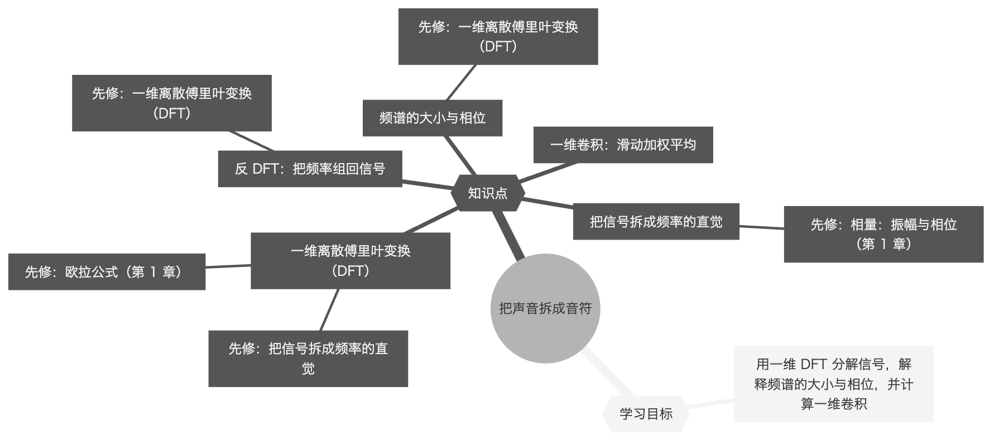
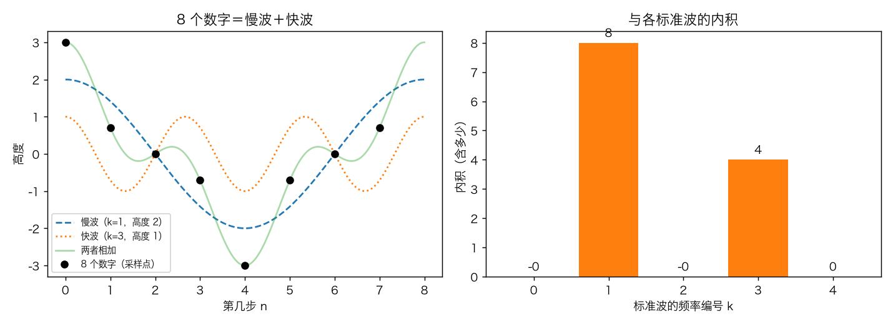
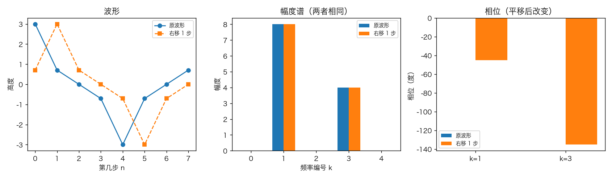

<a id="ch-dft-1d"></a>

以和弦拆音的比喻理解『信号由频率组成』，再引入一维 DFT、反变换与频谱，并认识卷积。

<a id="fig-mindmap-ch-dft-1d"></a>



<details><summary>文字说明</summary>思维导图：中心为「把声音拆成音符」，分支为 学习目标（用一维 DFT 分解信号，解释频谱的大小与相位，并计算一维卷积）；知识点（把信号拆成频率的直觉、一维离散傅里叶变换（DFT）、反 DFT：把频率组回信号、频谱的大小与相位、一维卷积：滑动加权平均）。</details>

*图 2-1：把声音拆成音符：本章 5 个知识点、学习目标与各知识点的直接先修（由先修图自动生成）。*

> 本章导图见 [图 2-1](#fig-mindmap-ch-dft-1d)。本章假设已会：相量：振幅与相位（`phasor-phase-amplitude`）、欧拉公式（`euler-formula`）。

<a id="ch-dft-1d--s-chord"></a>

## 1. 和弦与调音器：一串数字里含多少快慢不同的波

想像有人在钢琴上同时按下 C、E、G 三个键。你听到的是混在一起的一团声音，但受过训练的耳朵或手机上的调音器，却能说出「里面有这三个音」。每个音对应一种振动的快慢（频率），和弦就是好几种快慢的振动叠在一起。把声音拆回音符，就是找出有哪些快慢成分、各占多少。[^c-chord]

我们用 8 个数字当迷你声音：$$x=[3,\ 0.71,\ 0,\ -0.71,\ -3,\ -0.71,\ 0,\ 0.71]$$。它其实是两个波叠起来的。一个是「慢波」，每走 8 步刚好起伏 1 次，高度 2。另一个是「快波」，每走 8 步起伏 3 次，高度 1。第 $$n$$ 步的高度写成 $$\cos(2\pi k n/8)$$，其中 $$k$$ 就是 8 步内起伏的次数，我们叫它频率编号。于是 $$x[n]=2\cos(2\pi n/8)+\cos(2\pi\cdot 3n/8)$$。[^c-sig8]

<a id="fig-fig-chord-decompose"></a>



*图 2-2：左：8 个采样点（黑点）是高度 2 的慢波（k=1）与高度 1 的快波（k=3）相加的结果。右：用不同快慢的标准波与这 8 个数字做内积，只有 k=1（8）与 k=3（4）不为 0。*

[图 2-2](#fig-fig-chord-decompose) 左图是两个波与它们相加后采样的 8 个点。要问「里面含多少慢波」，可以拿一把标准尺：把标准慢波 $$[1,\ 0.71,\ 0,\ -0.71,\ -1,\ -0.71,\ 0,\ 0.71]$$ 与 $$x$$ 在对应位置相乘，再全部加起来。这个「对应相乘再加总」叫内积。波形同步时乘积几乎都是正的，加起来很大；不同步时正负互相抵消，加起来接近 0。实际算出，与 $$k=1$$ 的标准波内积为 8，与 $$k=3$$ 的为 4，与 $$k=2$$、$$k=4$$ 的都是 0（右图）。[^c-inner]

为什么刚好是 8 和 4？一个高度为 1 的标准波与自己做内积，结果是 $$N/2=4$$。所以内积除以 4 就是高度：$$8/4=2$$、$$4/4=1$$，正好是我们混进去的高度。不同频率编号的标准波彼此内积为 0，所以每把尺只量到自己那一种快慢，不会被别的成分干扰。[^c-orth]

这把尺有个弱点：若慢波整个往右挪、起点不同，例如变成 $$\sin(2\pi n/8)$$，它与 $$\cos$$ 标准波的内积就变成 0，看起来像「完全不含」。所以只用 cos 一把尺不够，需要 cos 与 sin 两把尺。能同时带着这两把尺的工具，就是上一章学过的旋转箭头，下一节就用它。[^c-needsin]

<a id="ch-dft-1d--s-dft4"></a>

## 2. 旋转箭头当尺：手算 N=4 的 DFT

回顾上一章：$$e^{i\theta}$$ 是单位圆上从东方起算、逆时针转 $$\theta$$ 的那一点，坐标是 $$(\cos\theta,\sin\theta)$$，也就是 $$e^{i\theta}=\cos\theta+i\sin\theta$$。把一个复数乘以 $$i$$，大小不变，方向逆时针转 90°。反过来，$$e^{-i\theta}$$ 就是顺时针转。把标准尺升级成「每走一步就转固定角度的箭头」，它就同时含有 cos 与 sin。[^c-euler-recall][^c-rot-i]

现在手算 4 个数字 $$x=[1,\ 2,\ 0,\ -1]$$（$$N=4$$）。频率编号 $$k$$ 的箭头每步顺时针转 $$90°\times k$$。$$k=0$$ 的箭头一直是 $$1,1,1,1$$。$$k=1$$ 的箭头依序是 $$1,\,-i,\,-1,\,i$$。$$k=2$$ 的箭头是 $$1,-1,1,-1$$。$$k=3$$ 的箭头是 $$1,\,i,\,-1,\,-i$$。[^c-powers]

每个 $$k$$ 都做同样的事：把 $$x$$ 的每个数字乘上同一步的箭头，再加起来，记作 $$X[k]$$。结果是 $$X[0]=1+2+0-1=2$$。$$X[1]=1\cdot 1+2\cdot(-i)+0\cdot(-1)+(-1)\cdot i=1-3i$$。$$X[2]=1-2+0+1=0$$。$$X[3]=1+2i+0+(-1)(-i)=1+3i$$。四个结果合起来 $$X=[2,\ 1-3i,\ 0,\ 1+3i]$$。[^c-n4]

把这个动作写成一般公式，就是一维离散傅里叶变换（DFT）。对长度为 $$N$$ 的数列 $$x[0],\dots,x[N-1]$$：

$$
X[k]=\sum_{n=0}^{N-1} x[n]\,e^{-i2\pi kn/N},\quad k=0,1,\dots,N-1
$$

符号的意思是：$$n$$ 是第几个数字；$$k$$ 是频率编号（$$N$$ 步内转几圈）；$$e^{-i2\pi kn/N}$$ 是第 $$k$$ 种箭头在第 $$n$$ 步的位置，每步顺时针转 $$2\pi k/N$$；$$\sum$$ 是全部加起来。$$X[k]$$ 是一个复数，记录「含多少、起点在哪」。[^c-dft-def]

$$X[k]$$ 为什么同时含 cos 与 sin 两把尺？因为 $$e^{-i\theta}=\cos\theta-i\sin\theta$$，所以 $$X[k]=\sum x[n]\cos\tfrac{2\pi kn}{N}-i\sum x[n]\sin\tfrac{2\pi kn}{N}$$。实部就是上一节的 cos 内积，虚部是 sin 内积的负值。验算 $$k=1$$：cos 内积 $$=1\cdot1+2\cdot0+0\cdot(-1)+(-1)\cdot 0=1$$，sin 内积 $$=0+2\cdot1+0+(-1)(-1)=3$$，得 $$X[1]=1-3i$$，与手算相符。[^c-realimag]

两个观察。第一，$$X[0]$$ 的箭头不转，所以 $$X[0]$$ 就是所有数字的总和（2），也就是「零频率」的平均水位乘上 $$N$$。第二，$$X[3]=1+3i$$ 是 $$X[1]=1-3i$$ 的共轭（实部相同、虚部变号）。对实数数列一般成立 $$X[N-k]=\overline{X[k]}$$，所以只有一半的 $$X$$ 是独立的。[^c-conj]

### 范例：`dft4_check.py`

用公式直接求和算 N=4 的 DFT，与 np.fft.fft 比对，再用反变换还原。[^c-n4]

档案：[`dft4_check.py`](/optical-flow-sam/examples/ch-dft-1d/dft4_check.py)（执行：`python dft4_check.py`）

```python
import numpy as np

x = np.array([1, 2, 0, -1])
N = len(x)


def fmt(z):
    re = round(float(z.real), 6) + 0.0
    im = round(float(z.imag), 6) + 0.0
    return f'{re:.1f}{im:+.1f}i'


X = np.array([sum(x[n] * np.exp(-2j * np.pi * k * n / N) for n in range(N)) for k in range(N)])
for k in range(N):
    print(f'X[{k}] = {fmt(X[k])}')
print('与 np.fft.fft 相符:', bool(np.allclose(X, np.fft.fft(x))))
back = np.fft.ifft(X).real
print('反变换还原:', (np.round(back, 6) + 0.0).tolist())
```

预期输出（节录）：

```text
X[1] = 1.0-3.0i
X[2] = 0.0+0.0i
X[3] = 1.0+3.0i
```

<a id="ch-dft-1d--s-inverse4"></a>

## 3. 把各频率加回去：反 DFT

拆开是为了能组回来。沿用 $$X=[2,\ 1-3i,\ 0,\ 1+3i]$$，把各频率的贡献逐一加回去。$$k=0$$ 每一步贡献 $$X[0]/4=0.5$$。$$k=2$$ 贡献 0。$$k=1$$ 与 $$k=3$$ 的箭头互为共轭，合起来每步贡献 $$\tfrac12\mathrm{Re}\big(X[1]\,i^{\,n}\big)$$，也就是 $$0.5,\ 1.5,\ -0.5,\ -1.5$$。逐步相加得 $$0.5+0.5=1$$、$$0.5+1.5=2$$、$$0.5-0.5=0$$、$$0.5-1.5=-1$$，正好是原来的 $$[1,2,0,-1]$$。[^c-recon]

这个过程写成一般公式，就是反 DFT（IDFT）：

$$
x[n]=\frac1N\sum_{k=0}^{N-1}X[k]\,e^{+i2\pi kn/N}
$$

和 DFT 相比，箭头的转向反过来：分解时顺时针去量，组回时逆时针放回去。另外前面多了 $$1/N$$。[^c-idft-def]

$$1/N$$ 从哪来？把 DFT 代进右式，会出现 $$\sum_{k}e^{i2\pi k(n-m)/N}$$ 这种「同一种箭头转一整圈的和」。它在 $$n=m$$ 时每项都是 1，总和为 $$N$$；在 $$n\neq m$$ 时箭头均匀绕圈而互相抵消，总和为 0。所以每个 $$x[n]$$ 被多数了 $$N$$ 倍，要除掉。验算 $$n=0$$：$$X$$ 四项相加是 $$4$$，除以 $$N=4$$ 得 $$x[0]=1$$。[^c-why-1n]

<a id="ch-dft-1d--s-spectrum"></a>

## 4. 读频谱：幅度是含多少，相位是起点在哪

$$X[k]$$ 是复数，可以像上一章那样写成「长度＋角度」：$$X[k]=|X[k]|\,e^{i\varphi_k}$$。长度 $$|X[k]|=\sqrt{\mathrm{Re}^2+\mathrm{Im}^2}$$ 叫幅度，角度 $$\varphi_k$$ 叫相位。把所有 $$k$$ 的幅度画出来叫幅度谱，相位画出来叫相位谱。例如 $$X[1]=1-3i$$ 的幅度是 $$\sqrt{10}\approx3.16$$，相位是 $$\arctan(-3/1)\approx-71.6°$$。[^c-polar]

这两个数的白话意思是：幅度表示「这种快慢的波含多少」，相位表示「这个波的起点在哪」。把 $$k$$ 与 $$N-k$$ 两项合并，实数信号就是一个调好高度与起点的 cos 波：$$\tfrac{2}{N}|X[k]|\cos\!\big(2\pi kn/N+\varphi_k\big)$$。以 $$k=1$$、$$N=4$$ 验算，$$n=0$$ 时 $$\tfrac24\cdot3.16\cdot\cos(-71.6°)=0.5$$，与上一节的 $$0.5$$ 一致。[^c-cos-form]

把 8 个数字的波形整个往右平移 1 步，会发生什么？[图 2-3](#fig-fig-shift-phase) 的左图是平移前后的波形，中图是幅度谱，右图是相位。幅度完全没变（$$k=1$$ 仍是 8、$$k=3$$ 仍是 4），变的只有相位：$$k=1$$ 从 0° 变成 −45°，$$k=3$$ 从 0° 变成 −135°。[^c-shift-obs]

<a id="fig-fig-shift-phase"></a>



*图 2-3：左：原波形与右移 1 步的波形。中：两者的幅度谱完全相同。右：k=1 与 k=3 的相位，平移后分别变成 −45° 与 −135°。*

规律是：把波形右移 $$s$$ 步，每个 $$X[k]$$ 乘上 $$e^{-i2\pi ks/N}$$。乘上单位长度的箭头只转角度、不改长度，所以幅度不变，相位减少 $$2\pi ks/N$$。这个量与 $$k$$ 和 $$s$$ 成正比：频率越高的成分，同样的平移让它转得越多。推导只要换个索引：$$\sum_n x[n-s]e^{-i2\pi kn/N}=e^{-i2\pi ks/N}\sum_m x[m]e^{-i2\pi km/N}$$（这里的平移是头尾相接的循环平移）。这个「平移只动相位」的现象之后会很有用。[^c-shift-gen]

### 范例：`shift_phase.py`

把波形右移 1 步，观察幅度不变、相位改变。[^c-shift-obs]

档案：[`shift_phase.py`](/optical-flow-sam/examples/ch-dft-1d/shift_phase.py)（执行：`python shift_phase.py`）

```python
import numpy as np

n = np.arange(8)
x = 2 * np.cos(2 * np.pi * n / 8) + np.cos(2 * np.pi * 3 * n / 8)


def ph(z):
    return round(float(np.degrees(np.angle(z))), 1) + 0.0


for s in (0, 1):
    X = np.fft.fft(np.roll(x, s))
    print(f'平移 {s}: 幅度 k=1,3 = {abs(X[1]):.1f}, {abs(X[3]):.1f}；相位(度) k=1,3 = {ph(X[1]):.1f}, {ph(X[3]):.1f}')
```

预期输出（节录）：

```text
平移 1: 幅度 k=1,3 = 8.0, 4.0；相位(度) k=1,3 = -45.0, -135.0
```

<a id="ch-dft-1d--s-conv"></a>

## 5. 卷积：滑动加权平均

换一个场景。某店连续 6 天的销量是 $$x=[2,8,5,5,11,2]$$。为了看趋势，我们算「三日移动平均」：每天取前后共三天的平均。第 2、3、4、5 天分别是 $$(2+8+5)/3=5$$、$$(8+5+5)/3=6$$、$$(5+5+11)/3=7$$、$$(5+11+2)/3=6$$，得到 $$[5,6,7,6]$$，起伏被抹平了。[^c-ma]

换个角度看：三日平均就是拿一个权重表 $$h=[\tfrac13,\tfrac13,\tfrac13]$$ 在数列上滑动，每到一处就「对应相乘再加总」。权重可以换。若用 $$h=[1,-1]$$，每处算出的是今天减昨天，得到 $$[6,-3,0,6,-9]$$，这是差分，反映变化量而非趋势。[^c-diff]

把这个动作写成公式，就是一维卷积。权重表 $$h$$ 长 $$M$$，则

$$
y[n]=\sum_{m=0}^{M-1}h[m]\,x[n-m]
$$

$$m$$ 变大时，$$x$$ 的索引往回走，所以权重表等于先左右翻转再滑动。平均用的 $$h$$ 左右对称，翻不翻都一样。差分的 $$[1,-1]$$ 就要注意：$$h[0]=1$$ 乘到的是今天，$$h[1]=-1$$ 乘到的是昨天。[^c-conv-def]

边界怎么办？权重表滑到数列两端时，会有一部分盖在数列外面。常见三种做法。一是只算完全盖住的位置（valid），输出长 $$N-M+1$$，例子中是 4。二是把外面当 0，每个重叠位置都算（full），输出长 $$N+M-1$$，例子中是 8：$$[\tfrac23,\tfrac{10}{3},5,6,7,6,\tfrac{13}{3},\tfrac23]$$，头尾偏小是因为缺的邻居被当成 0。三是只取与输入同长的中间部分（same），或把边缘的值向外复制来补。选哪种取决于你要不要保持长度，以及能不能接受边缘失真。[^c-boundary]

平滑与差分用的是同一个公式，只差在权重表：全为正的权重得到平滑，正负相消的权重得到变化量。这个「换权重表就换功能」的想法，是卷积的核心。[^c-unify]

### 范例：`conv_basic.py`

用 np.convolve 重现三日移动平均与差分，并比较 full 与 valid 的长度。[^c-boundary]

档案：[`conv_basic.py`](/optical-flow-sam/examples/ch-dft-1d/conv_basic.py)（执行：`python conv_basic.py`）

```python
import numpy as np

x = np.array([2, 8, 5, 5, 11, 2])
print('三日移动平均(valid):', (np.convolve(x, np.ones(3), 'valid') / 3).round(6).tolist())
print('差分(valid):', np.convolve(x, [1, -1], 'valid').tolist())
print('full 长度:', len(np.convolve(x, np.ones(3))))
print('valid 长度:', len(np.convolve(x, np.ones(3), 'valid')))
```

预期输出（节录）：

```text
三日移动平均(valid): [5.0, 6.0, 7.0, 6.0]
差分(valid): [6, -3, 0, 6, -9]
full 长度: 8
valid 长度: 4
```

<a id="ch-dft-1d--s-practice"></a>

## 6. 练习

请试着自己动手算，再与解答对照。

**练习 1**（`ex-q-impulse`）：手算 $$x=[1,0,0,0]$$ 的 4 点 DFT。再算 $$x=[2,2,2,2]$$ 的 DFT。各自说明结果的意思。

<details><summary>解答</summary>

第一个：每个 $$k$$ 只有 $$n=0$$ 那项不为 0，而 $$e^{0}=1$$，所以 $$X=[1,1,1,1]$$。一个只出现在起点的尖脉冲含有所有频率，且大小相同。第二个：$$X[0]=8$$。$$k\neq0$$ 时箭头一圈加起来为 0，所以 $$X=[8,0,0,0]$$。不变的常数只含零频率（平均水位）。

</details>

**练习 2**（`ex-q-shift4`）：把 $$x=[1,2,0,-1]$$ 循环右移 1 步得到 $$[-1,1,2,0]$$。不直接算，用「右移 $$s$$ 步就乘上 $$e^{-i2\pi ks/N}$$」预测新的 $$X[1]$$，再直接用定义验证。

<details><summary>解答</summary>

原 $$X[1]=1-3i$$，$$k=1$$、$$s=1$$、$$N=4$$ 时乘上 $$e^{-i\pi/2}=-i$$：$$(-i)(1-3i)=-i-3=-3-i$$。直接算：$$-1+1\cdot(-i)+2\cdot(-1)+0\cdot i=-3-i$$，相符。幅度 $$\sqrt{10}$$ 不变。

</details>

**练习 3**（`ex-q-conv`）：用卷积公式手算 $$x=[1,2,3]$$ 与 $$h=[1,1]$$ 的 full 结果。再说明若 $$h=[1,-1]$$，full 结果的中间两项各代表什么。

<details><summary>解答</summary>

$$h=[1,1]$$：$$y=[1,\,1+2,\,2+3,\,3]=[1,3,5,3]$$，长度 $$3+2-1=4$$。$$h=[1,-1]$$：$$y=[1,\,2-1,\,3-2,\,-3]=[1,1,1,-3]$$，中间两项是「今天减昨天」的差，头尾两项受补 0 边界影响。

</details>

<a id="ch-dft-1d--references"></a>

## 章末引用

### 主张与证据

[^c-chord]: 和弦是多个频率的组合；傅里叶变换能找出一段声音中哪些频率占优势，也就是把声音拆回音符。 —— 证据：[doinddevelopment〔未核实〕](<https://doi.org/10.20448/808.3.1.15.22>)（`ev-f4a204d2f7e9`）
[^c-sig8]: 8 个数字 [3,0.71,0,-0.71,-3,-0.71,0,0.71] 等于 2cos(2πn/8)+cos(2π·3n/8) 在 n=0..7 的采样；即一段信号可视为多个频率成分的叠加。 —— 证据：[doinddevelopment〔未核实〕](<https://doi.org/10.20448/808.3.1.15.22>)（`ev-f4a204d2f7e9`）
[^c-inner]: 上述 x 与 cos(2πkn/8) 的内积在 k=1 为 8、k=3 为 4、k=2 与 k=4 为 0。 —— 证据：[doinddevelopment〔未核实〕](<https://doi.org/10.20448/808.3.1.15.22>)（`ev-f4a204d2f7e9`）
[^c-orth]: 当 0<k,l<N/2 为整数时，Σ cos(2πkn/N)cos(2πln/N) 在 k=l 时为 N/2，k≠l 时为 0；所以内积除以 N/2 得到该频率成分的高度。 —— 证据：[doinddevelopment〔未核实〕](<https://doi.org/10.20448/808.3.1.15.22>)（`ev-f4a204d2f7e9`）
[^c-needsin]: 若波形平移成 sin(2πn/8)，它与 cos(2πn/8) 的内积为 0，因此只用 cos 尺会漏掉相位不同的成分，需要同时有 cos 与 sin。 —— 证据：[doinddevelopment〔未核实〕](<https://doi.org/10.20448/808.3.1.15.22>)（`ev-f4a204d2f7e9`）；[betterexplainedndintuitive〔未核实〕](<https://betterexplained.com/articles/intuitive-understanding-of-eulers-formula>)（`ev-ec2629d21456`）
[^c-euler-recall]: e^{iθ}=cosθ+i sinθ：它是单位圆上转过 θ 的点，cosθ 是水平坐标、sinθ 是垂直坐标。 —— 证据：[betterexplainedndintuitive〔未核实〕](<https://betterexplained.com/articles/intuitive-understanding-of-eulers-formula>)（`ev-a99b06469c61`）；[betterexplainedndintuitive〔未核实〕](<https://betterexplained.com/articles/intuitive-understanding-of-eulers-formula>)（`ev-ec2629d21456`）；[betterexplainedndintuitive〔未核实〕](<https://betterexplained.com/articles/intuitive-understanding-of-eulers-formula>)（`ev-0fe96ec897d7`）
[^c-rot-i]: 把一个数乘以 i 不改变大小，只让方向转 90°。 —— 证据：[betterexplainedndintuitive〔未核实〕](<https://betterexplained.com/articles/intuitive-understanding-of-eulers-formula>)（`ev-6419c240699b`）
[^c-powers]: N=4 时，k=0,1,2,3 的箭头 e^{-i2πkn/4}（n=0..3）依序为 [1,1,1,1]、[1,-i,-1,i]、[1,-1,1,-1]、[1,i,-1,-i]。 —— 证据：[doinddiskrete〔未核实〕](<https://doi.org/10.1007/978-3-322-83936-7_7>)（`ev-0e0b0cdea3c6`）
[^c-n4]: x=[1,2,0,-1] 的 4 点 DFT 为 X=[2,1-3i,0,1+3i]。 —— 证据：[doinddiskrete〔未核实〕](<https://doi.org/10.1007/978-3-322-83936-7_7>)（`ev-0e0b0cdea3c6`）
[^c-dft-def]: 一维 DFT 的定义为 X[k]=Σ_{n=0}^{N-1} x[n]e^{-i2πkn/N}，k=0..N-1。 —— 证据：[doinddiskrete〔未核实〕](<https://doi.org/10.1007/978-3-322-83936-7_7>)（`ev-0e0b0cdea3c6`）
[^c-realimag]: X[k] 的实部是 x 与 cos(2πkn/N) 的内积，虚部是 x 与 sin(2πkn/N) 内积的负值。 —— 证据：[doinddiskrete〔未核实〕](<https://doi.org/10.1007/978-3-322-83936-7_7>)（`ev-0e0b0cdea3c6`）；[betterexplainedndintuitive〔未核实〕](<https://betterexplained.com/articles/intuitive-understanding-of-eulers-formula>)（`ev-a99b06469c61`）
[^c-conj]: X[0] 等于所有数字的总和；若 x 为实数，则 X[N−k]=conj(X[k])，所以只有一半的 X 是独立的。 —— 证据：[doinddiskrete〔未核实〕](<https://doi.org/10.1007/978-3-322-83936-7_7>)（`ev-0e0b0cdea3c6`）
[^c-recon]: 对 X=[2,1-3i,0,1+3i]，k=0 每步贡献 0.5，k=1 与 k=3 合起来贡献 [0.5,1.5,-0.5,-1.5]，k=2 贡献 0，加总还原为 [1,2,0,-1]。 —— 证据：[doinddiskrete〔未核实〕](<https://doi.org/10.1007/978-3-322-83936-7_7>)（`ev-a8999eb93841`）
[^c-idft-def]: 反 DFT 为 x[n]=(1/N)Σ_{k=0}^{N-1} X[k]e^{+i2πkn/N}：箭头转向与 DFT 相反，并多一个 1/N。 —— 证据：[doinddiskrete〔未核实〕](<https://doi.org/10.1007/978-3-322-83936-7_7>)（`ev-a8999eb93841`）；[doinddiskrete〔未核实〕](<https://doi.org/10.1007/978-3-322-83936-7_7>)（`ev-0e0b0cdea3c6`）
[^c-why-1n]: Σ_{k=0}^{N-1} e^{i2πk(n−m)/N} 在 n=m 时等于 N，其他情况等于 0，所以代入 DFT 后每个 x[n] 被多算 N 倍，需除以 N。 —— 证据：[doinddiskrete〔未核实〕](<https://doi.org/10.1007/978-3-322-83936-7_7>)（`ev-a8999eb93841`）
[^c-polar]: X[k] 可写成 |X[k]|e^{iφ_k}，|X[k]| 为幅度、φ_k 为相位；X[1]=1−3i 的幅度为 √10≈3.16，相位约 −71.6°。 —— 证据：[betterexplainedndintuitive〔未核实〕](<https://betterexplained.com/articles/intuitive-understanding-of-eulers-formula>)（`ev-0c2aad506513`）
[^c-cos-form]: 实数信号中 k 与 N−k 两项合并后等于 (2/N)|X[k]|cos(2πkn/N+φ_k)：幅度决定高度、相位决定起点。 —— 证据：[betterexplainedndintuitive〔未核实〕](<https://betterexplained.com/articles/intuitive-understanding-of-eulers-formula>)（`ev-0c2aad506513`）；[betterexplainedndintuitive〔未核实〕](<https://betterexplained.com/articles/intuitive-understanding-of-eulers-formula>)（`ev-6ebb34851ac8`）
[^c-shift-obs]: 把 2cos(2πn/8)+cos(2π·3n/8) 右移 1 步后，k=1、3 的幅度仍为 8、4，相位由 0° 变为 −45° 与 −135°。 —— 证据：[doinddiskrete〔未核实〕](<https://doi.org/10.1007/978-3-322-83936-7_7>)（`ev-0e0b0cdea3c6`）
[^c-shift-gen]: 把数列循环右移 s 步，每个 X[k] 乘上 e^{-i2πks/N}：幅度不变，相位减少 2πks/N。 —— 证据：[doinddiskrete〔未核实〕](<https://doi.org/10.1007/978-3-322-83936-7_7>)（`ev-0e0b0cdea3c6`）；[betterexplainedndintuitive〔未核实〕](<https://betterexplained.com/articles/intuitive-understanding-of-eulers-formula>)（`ev-6419c240699b`）
[^c-ma]: x=[2,8,5,5,11,2] 的三日移动平均（只取完整三天）为 [5,6,7,6]。 —— 证据：[doinddiskrete〔未核实〕](<https://doi.org/10.1007/978-3-322-83936-7_7>)（`ev-0e0b0cdea3c6`）
[^c-diff]: 以权重表 [1,−1] 滑动（今天减昨天）得到 x 的差分 [6,−3,0,6,−9]。 —— 证据：[doinddiskrete〔未核实〕](<https://doi.org/10.1007/978-3-322-83936-7_7>)（`ev-0e0b0cdea3c6`）
[^c-conv-def]: 一维卷积定义为 y[n]=Σ_{m=0}^{M−1} h[m]x[n−m]，等价于把权重表左右翻转后在 x 上滑动并做对应相乘加总。 —— 证据：[doinddiskrete〔未核实〕](<https://doi.org/10.1007/978-3-322-83936-7_7>)（`ev-0e0b0cdea3c6`）
[^c-boundary]: 长 N 的数列与长 M 的权重表：valid 输出长 N−M+1，full（外面补 0）输出长 N+M−1，same 输出长 N；例中 full 结果为 [2/3,10/3,5,6,7,6,13/3,2/3]，头尾偏小是因为缺的邻居被当成 0。 —— 证据：[doinddiskrete〔未核实〕](<https://doi.org/10.1007/978-3-322-83936-7_7>)（`ev-0e0b0cdea3c6`）
[^c-unify]: 平滑（全正权重）与差分（正负相消权重）使用同一个卷积公式，只是权重表不同。 —— 证据：[doinddiskrete〔未核实〕](<https://doi.org/10.1007/978-3-322-83936-7_7>)（`ev-0e0b0cdea3c6`）

### 参考文献

#### 已核实引用

（无）

#### 未核实来源（仅供查找，不得当作已验证引用）

- 〔未核实〕[betterexplainedndintuitive] (n.d.). *Intuitive Understanding Of Euler's Formula*. <https://betterexplained.com/articles/intuitive-understanding-of-eulers-formula> 授权：unknown；可靠度：不明
- 〔未核实〕[doinddevelopment] (n.d.). *Development of a Novel Method for Automatic Detection of Musical Chords*. <https://doi.org/10.20448/808.3.1.15.22> 授权：unknown；可靠度：高
- 〔未核实〕[doinddiskrete] (n.d.). *Diskrete FOURIER-Transformation (DFT)*. <https://doi.org/10.1007/978-3-322-83936-7_7> 授权：unknown；可靠度：高
