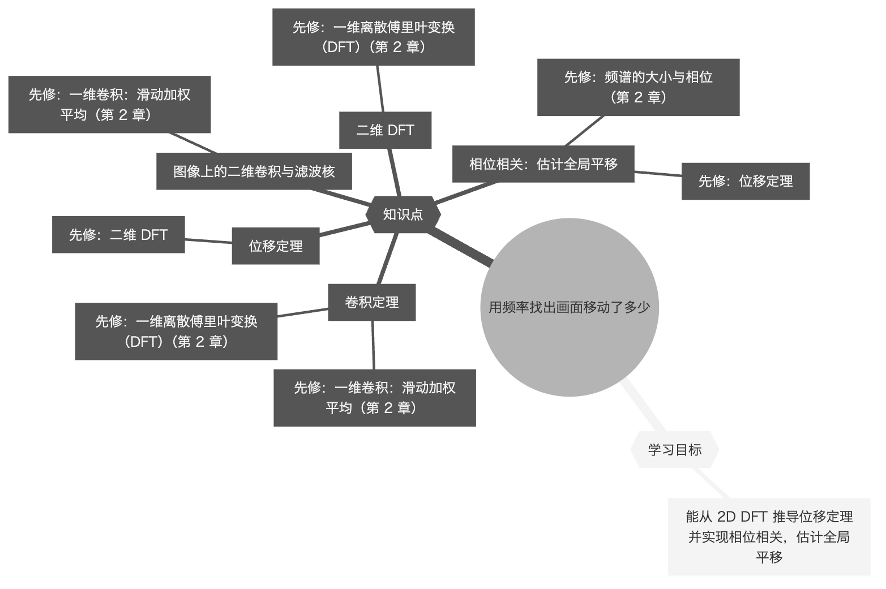
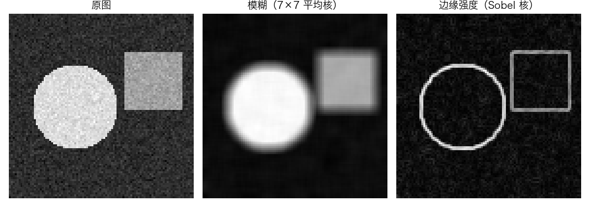
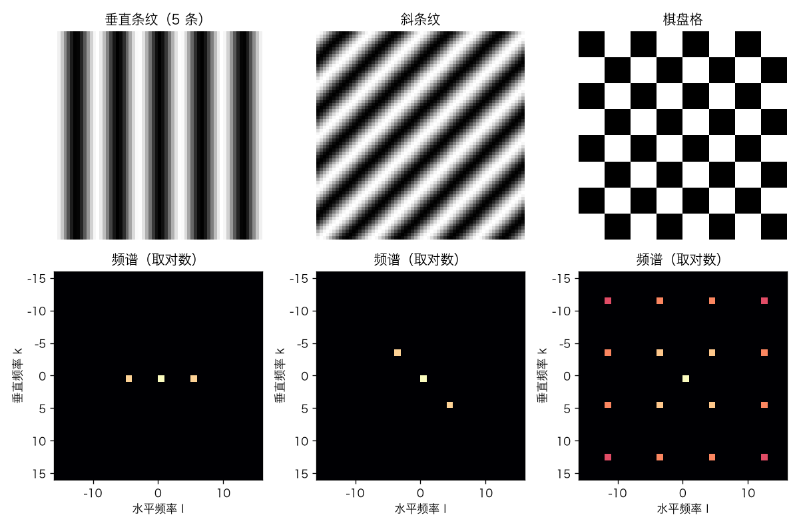
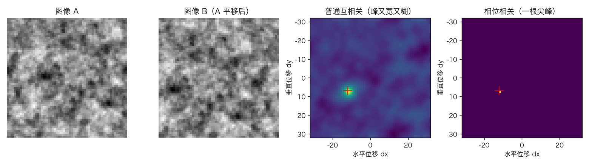

<a id="ch-dft-2d-phase-corr"></a>

把一维概念推到图像：认识二维卷积与二维 DFT，推导位移定理，并实现相位相关估计全局平移。

<a id="fig-mindmap-ch-dft-2d-phase-corr"></a>



<details><summary>文字说明</summary>思维导图：中心为「用频率找出画面移动了多少」，分支为 学习目标（能从 2D DFT 推导位移定理并实现相位相关，估计全局平移）；知识点（卷积定理、图像上的二维卷积与滤波核、二维 DFT、位移定理、相位相关：估计全局平移）。</details>

*图 3-1：用频率找出画面移动了多少：本章 5 个知识点、学习目标与各知识点的直接先修（由先修图自动生成）。*

> 本章导图见 [图 3-1](#fig-mindmap-ch-dft-2d-phase-corr)。本章假设已会：一维离散傅里叶变换（DFT）（`dft-1d`）、一维卷积：滑动加权平均（`convolution-1d`）、频谱的大小与相位（`spectrum-magnitude-phase`）。

<a id="ch-dft-2d-phase-corr--conv-theorem"></a>

## 1. 卷积在频率世界变成逐点相乘

先不谈任何定理，算一个小例子。四个人围成一圈，各自手上的数字是 `x = [1, 2, 3, 4]`。规则是：每个人把自己的数字加上「前一个人」的数字，第 0 个人的前一个是绕回去的最后一个人。算出来是 `[1+4, 2+1, 3+2, 4+3] = [5, 3, 5, 7]`。这种「拿一组权重滑过整串数字、每个位置做加权相加」的运算，就是上一章的卷积。这里的权重是 `h = [1, 1, 0, 0]`，也就是自己和前一个人各占 1。因为头尾接成圈，所以叫循环卷积。[^ch3-conv-def] 这个例子的结果是 `[5, 3, 5, 7]`。[^ch3-circ-example]

换一条路走。回想上一章的 DFT 定义 $$X[k]=\sum_{n=0}^{N-1} x[n]\,e^{-i2\pi kn/N}$$。[^ch3-dft1d-recall] 把 x 与 h 各做一次 DFT（numpy 的惯例是正变换不除 N、反变换才除 N），得到 $$X=[10,\,-2+2i,\,-2,\,-2-2i]$$ 与 $$H=[2,\,1-i,\,0,\,1+i]$$。两串逐点相乘得 $$XH=[20,\,4i,\,0,\,-4i]$$，再做反 DFT 就得到 $$[5,3,5,7]$$。结果与刚才绕圈加出来的完全相同，却只用了四次乘法，没有任何滑动。[^ch3-ct-numbers]

这不是巧合，而是卷积定理：两串长度为 N 的数字做循环卷积，其 DFT 等于两者各自 DFT 的逐点乘积，即 $$\mathrm{DFT}(x \ast h)[k]=X[k]\,H[k]$$。口诀是「空间里复杂的卷积，在频率世界只是普通乘法」。换成操作步骤：DFT、逐点相乘、反 DFT，这三步等于做了一次循环卷积。[^ch3-ct-statement]

为什么会这样？想成纯音。取单一频率的波 $$x[n]=e^{i2\pi kn/N}$$ 丢进滑动加权和，输出是 $$y[n]=\sum_m h[m]\,x[n-m]=\Big(\sum_m h[m]e^{-i2\pi km/N}\Big)e^{i2\pi kn/N}=H[k]\,x[n]$$。也就是说，纯音通过卷积后仍是同一个音，只被乘上一个复数 $$H[k]$$：它的大小是音量的变化，角度是相位的旋转。任何信号都是各频率纯音的叠加（反 DFT 就是这个意思），卷积又是线性的，所以每个频率各自乘上自己的 $$H[k]$$，这就是逐点相乘。[^ch3-ct-intuition]

这有什么用？直接卷积时，每个位置要做和核一样多次的乘法。走频率路线只要逐点相乘，而 DFT 本身有快速算法（FFT）。另外，取平均会让快速抖动的高频成分变小，所以「平均＝模糊」在频率世界里，就是把高频的音量调小。[^ch3-ct-benefit]

### 范例：`conv_theorem_check.py`

用四个数字同时算直接循环卷积与「DFT、逐点相乘、反 DFT」两条路，确认结果一致。[^ch3-ct-numbers]

档案：[`conv_theorem_check.py`](/optical-flow-sam/examples/ch-dft-2d-phase-corr/conv_theorem_check.py)（执行：`python conv_theorem_check.py`）

```python
import numpy as np

x = np.array([1, 2, 3, 4], dtype=float)
h = np.array([1, 1, 0, 0], dtype=float)
N = len(x)

# 直接做循环卷积：y[n] = sum_m h[m] * x[(n-m) mod N]
y = np.array([sum(h[m] * x[(n - m) % N] for m in range(N)) for n in range(N)])
print('直接循环卷积:', y.astype(int).tolist())

# 走频率路线：DFT、逐点相乘、反 DFT
X = np.fft.fft(x)
H = np.fft.fft(h)
y2 = np.fft.ifft(X * H).real
print('频率相乘再反变换:', np.round(y2).astype(int).tolist())
print('两者一致:', bool(np.allclose(y, y2)))
```

预期输出（节录）：

```text
直接循环卷积: [5, 3, 5, 7]
```

<a id="ch-dft-2d-phase-corr--image-conv"></a>

## 2. 用小核对图像做模糊与边缘侦测

把一维的滑动加权和搬到图像上：拿一个小方阵（称为核，里面的数字是权重）盖在图像某个像素周围，对应位置相乘后全部加起来，结果写成新图像在该像素的值。然后把核滑到下一个像素，重复同样的事。这就是二维卷积，也是修图软件里模糊、锐利化、轮廓等滤镜的共同做法。[^ch3-kernel-def]

手算一次。小图是 5×5，每一列都是 `0 0 9 9 9`，也就是左边两栏暗、右边三栏亮，第 1、2 栏之间有一条垂直边界。核用 3×3 全填 1/9 的平均核。把它盖在第 2 列第 2 栏（从 0 算起）：周围 3×3 范围每列取到 0、9、9，三列总和 54，乘 1/9 得 6。同一列的第 1、2、3 栏算出来依序是 3、6、9。原本一刀切的 0→9 变成缓缓爬升的 3→6→9，这就是模糊。[^ch3-blur-hand]

换一个核：`[[-1,0,1],[-2,0,2],[-1,0,1]]`，这是 Sobel 水平方向核，作用是「右边减左边」。盖在同样三个位置：第 1 栏是右 9 减左 0，每列得 9，加权 1、2、1 后得 36。第 2 栏同样得 36。第 3 栏左右都是 9，相减为 0。边界附近得到大值，平坦处得 0，这就是边缘侦测。[^ch3-sobel-hand]

有个细节。严格的卷积会把核上下左右翻转后再相乘，一维时是翻转其中一串。[^ch3-flip] 因此二维卷积写成 $$g[m,n]=\sum_{i,j}h[i,j]\,f[m-i,\,n-j]$$。真正做卷积时 Sobel 核的正负号会反过来，但左右对称的平均核没有差别。只在意边缘强度时，正负号不影响结论。[^ch3-conv2d-formula]

边界怎么办？在图像最外圈，核会有一部分伸到图像外面。常见做法是补零（当成黑色）或把边缘值向外延伸。边缘附近的结果因为缺少邻居而较不可靠。下一节的 DFT 做法则隐含「图像上下左右头尾相接」的循环假设。[^ch3-border]

[图 3-2](#fig-fig-filter-demo) 把这些想法用在一张合成图上。左为原图，中间用 7×7 平均核，画面变柔、细小杂讯被抹平。右边用 Sobel 核（水平与垂直方向合并成强度），只留下亮暗交界的轮廓，平坦处接近全黑。[^ch3-kernel-effects]

<a id="fig-fig-filter-demo"></a>



*图 3-2：左：合成原图（一个圆盘与一个方块，带少量杂讯）。中：用 7×7 平均核做模糊，杂讯被抹平、轮廓变柔。右：用 Sobel 核取边缘强度，只留下亮暗交界。*

<a id="ch-dft-2d-phase-corr--dft-2d"></a>

## 3. 二维 DFT：图像也能拆成各方向的波纹

先看图，再谈公式。想像墙上贴了垂直条纹壁纸：沿水平方向走，亮暗交替；沿垂直方向走，什么都不变。这就是一维的波在垂直方向「复制贴上」而成。对它做二维 DFT，频谱上除了代表整体平均亮度的中心点，只剩两个亮点，落在水平轴上、左右对称。离中心越远，条纹越密。[图 3-3](#fig-fig-spectra-2d) 的左栏就是这种情况：5 条条纹，亮点落在 ±5。[^ch3-stripe-spectrum]

条纹斜着贴，亮点也转到同一个斜向。棋盘格可以看成水平、垂直两组方波条纹相乘，频谱出现四个对称亮点，外加更暗的高次谐波。规则是：亮点所在的方向就是条纹「波前推进」的方向，也就是垂直于纹路的方向；亮点离中心的距离就是条纹疏密。[^ch3-checker-spectrum]

<a id="fig-fig-spectra-2d"></a>



*图 3-3：上排为图像，下排为对应的频谱（已把零频移到中央并取对数）。垂直条纹的亮点落在水平轴上；斜条纹的亮点落在斜线上；棋盘格有四个对称亮点。亮点离中心越远，条纹越密。*

把这个观察写成公式。设图像 $$f[m,n]$$ 有 M 列、N 栏（m 是列号、n 是栏号），二维 DFT 为 $$F[k,l]=\sum_{m=0}^{M-1}\sum_{n=0}^{N-1}f[m,n]\,e^{-i2\pi(km/M+ln/N)}$$。其中 $$e^{-i2\pi(km/M+ln/N)}$$ 是一张「垂直方向转 k 圈、水平方向转 l 圈」的复数条纹，$$F[k,l]$$ 衡量图像和这张条纹有多像。这和一维版本是同一个想法。[^ch3-dft2d-formula]

实际计算时可以拆开做。指数可拆成两个因子 $$e^{-i2\pi km/M}\cdot e^{-i2\pi ln/N}$$，所以先对每一列做一维 DFT，再对结果的每一栏做一维 DFT，就得到二维 DFT。这叫可分离性，是计算二维 DFT 的标准做法。[^ch3-dft2d-separable]

读频谱图有两个惯例。第一，`np.fft.fft2` 输出的零频在左上角，要用 `np.fft.fftshift` 搬到画面中心。第二，零频（整体亮度）的值远大于其他位置，直接显示只会看到一个亮点，所以常取 $$\log(1+|F|)$$ 来压缩。另外，实数图像的频谱是中心对称的，所以亮点总是成对出现。[^ch3-shift-display]

和一维一样，每个 $$F[k,l]$$ 都是复数：大小说这种条纹有多强，相位说条纹的波峰落在哪里。画频谱图时我们通常只看大小、不管相位。但下一节会看到，「东西移动了多少」全藏在相位里。[^ch3-mag-phase-2d]

卷积定理在二维照样成立：两张同大小的图像（或图像与补成同样大小的核）做二维循环卷积，等于各自做 `fft2` 后逐点相乘再反变换。所以模糊核的频谱在高频处数值很小，乘上去就把频谱外围压暗，细节因此被滤掉。[^ch3-ct-2d]

### 范例：`dft2d_check.py`

用定义、列行分解与 fft2 三种方式算二维 DFT 并互相比对，同时验证二维卷积定理。[^ch3-dft2d-formula]

档案：[`dft2d_check.py`](/optical-flow-sam/examples/ch-dft-2d-phase-corr/dft2d_check.py)（执行：`python dft2d_check.py`）

```python
import numpy as np

rng = np.random.default_rng(0)
f = rng.random((6, 8))
M, N = f.shape

# 依定义的四重回圈
F = np.zeros((M, N), dtype=complex)
for k in range(M):
    for l in range(N):
        s = 0j
        for m in range(M):
            for n in range(N):
                s += f[m, n] * np.exp(-2j * np.pi * (k * m / M + l * n / N))
        F[k, l] = s

ref = np.fft.fft2(f)
rowcol = np.fft.fft(np.fft.fft(f, axis=1), axis=0)
print('依定义计算与 fft2 最大误差小于 1e-9:', bool(np.max(np.abs(F - ref)) < 1e-9))
print('先列后行与 fft2 最大误差小于 1e-9:', bool(np.max(np.abs(rowcol - ref)) < 1e-9))

# 二维卷积定理：核 h 只有三个非零权重
h = np.zeros((M, N))
h[0, 0] = 0.5
h[0, 1] = 0.25
h[1, 0] = 0.25
direct = 0.5 * f + 0.25 * np.roll(f, 1, axis=1) + 0.25 * np.roll(f, 1, axis=0)
viafft = np.real(np.fft.ifft2(np.fft.fft2(f) * np.fft.fft2(h)))
print('二维卷积定理成立:', bool(np.allclose(direct, viafft)))
```

预期输出（节录）：

```text
依定义计算与 fft2 最大误差小于 1e-9: True
```

<a id="ch-dft-2d-phase-corr--shift-theorem"></a>

## 4. 推导位移定理：平移只改变相位

先拿一维、四个数字验证。`x=[1,2,3,4]` 的 DFT 是 $$[10,\,-2+2i,\,-2,\,-2-2i]$$。把它循环右移一格得 `[4,1,2,3]`，直接算 DFT 得 $$[10,\,2+2i,\,2,\,2-2i]$$。对照一下，每个 k 的新值刚好是旧值乘上 $$e^{-i2\pi k/4}$$。k=1 乘 $$-i$$：$$(-2+2i)(-i)=2+2i$$。k=2 乘 $$-1$$：$$-2\to2$$。k=3 乘 $$i$$：$$(-2-2i)(i)=2-2i$$。大小一个都没变，只有相位转了。[^ch3-shift-1d-example]

一般化到一维。设 x 长度为 N，视为首尾相接，平移 a 格后 $$x_a[n]=x[(n-a)\bmod N]$$。代入定义：$$X_a[k]=\sum_{n=0}^{N-1}x[(n-a)\bmod N]\,e^{-i2\pi kn/N}$$。令 $$m=(n-a)\bmod N$$，则 $$n\equiv m+a$$。n 跑遍 0 到 N−1 时，m 也恰好各跑一次，而 $$e^{-i2\pi kn/N}$$ 以 N 为周期，所以可写成 $$e^{-i2\pi k(m+a)/N}=e^{-i2\pi km/N}\,e^{-i2\pi ka/N}$$。把与 m 无关的因子提到总和外面，得 $$X_a[k]=e^{-i2\pi ka/N}\sum_m x[m]e^{-i2\pi km/N}=e^{-i2\pi ka/N}\,X[k]$$。这就是一维位移定理。[^ch3-shift-1d-proof]

再推到二维。设图像 $$f[m,n]$$ 大小为 M×N，向下平移 $$d_y$$ 列、向右平移 $$d_x$$ 栏，同样首尾相接：$$g[m,n]=f[(m-d_y)\bmod M,\,(n-d_x)\bmod N]$$。对 $$G[k,l]$$ 做变数代入 $$m'=m-d_y$$、$$n'=n-d_x$$，指数里的 $$km/M+ln/N$$ 变成 $$km'/M+ln'/N+kd_y/M+ld_x/N$$。多出来的部分与求和变数无关，提到外面，得 $$G[k,l]=e^{-i2\pi(kd_y/M+ld_x/N)}\,F[k,l]$$。这就是二维位移定理。[^ch3-shift-2d-proof]

结论是「平移只改变相位」。$$e^{i\theta}$$ 是单位圆上的旋转，长度恒为 1，所以 $$|G[k,l]|=|F[k,l]|$$，大小完全不变。相位则多了 $$-2\pi(kd_y/M+ld_x/N)$$，它是 (k,l) 的线性函数，斜率正比于平移量。[^ch3-shift-mag-phase]

直觉上也说得通。第 k 个频率的波一个周期长 N/k 像素，移动 a 像素就是移动了 $$ak/N$$ 个周期，相位转 $$2\pi ak/N$$。频率越高，同样的位移转得越多。所以整张频谱的相位呈一个斜面，斜面的斜率就是位移。[^ch3-shift-meaning]

### 范例：`shift_theorem_1d.py`

用长度 4 的序列验证平移前后的 DFT 只差一个相位因子，再对随机图像验证二维位移定理与大小不变。[^ch3-shift-1d-proof]

档案：[`shift_theorem_1d.py`](/optical-flow-sam/examples/ch-dft-2d-phase-corr/shift_theorem_1d.py)（执行：`python shift_theorem_1d.py`）

```python
import numpy as np

def fmt(v):
    v = complex(np.round(v, 6))
    return f'{v.real + 0.0:.0f}{v.imag + 0.0:+.0f}j'

x = np.array([1, 2, 3, 4], dtype=float)
N = len(x)
a = 1
xs = np.roll(x, a)  # [4, 1, 2, 3]
X = np.fft.fft(x)
Xs = np.fft.fft(xs)
k = np.arange(N)
pred = X * np.exp(-2j * np.pi * k * a / N)
for i in range(N):
    print(f'k={i}: 直接算 {fmt(Xs[i])}，公式算 {fmt(pred[i])}')
print('大小不变:', bool(np.allclose(np.abs(X), np.abs(Xs))))

# 二维
rng = np.random.default_rng(1)
f = rng.random((8, 16))
M, W = f.shape
dy, dx = 3, 5
g = np.roll(f, (dy, dx), axis=(0, 1))
kk = np.arange(M)[:, None]
ll = np.arange(W)[None, :]
phase = np.exp(-2j * np.pi * (kk * dy / M + ll * dx / W))
print('二维位移定理成立:', bool(np.allclose(np.fft.fft2(g), np.fft.fft2(f) * phase)))
print('二维大小不变:', bool(np.allclose(np.abs(np.fft.fft2(g)), np.abs(np.fft.fft2(f)))))
```

预期输出（节录）：

```text
k=1: 直接算 2+2j，公式算 2+2j
```

<a id="ch-dft-2d-phase-corr--phase-corr"></a>

## 5. 相位相关：频谱相除得到尖峰，读出平移量

问题是这样的：两张同大小的灰阶图像 A、B，B 是 A 整张平移 $$(d_y,d_x)$$（首尾相接）的结果，要求出 $$(d_y,d_x)$$。由位移定理，$$F_B=F_A\cdot e^{-i2\pi(kd_y/M+ld_x/N)}$$。想把 $$F_A$$ 消掉，可以乘上 $$F_A^*$$。$$F_A^*$$ 是共轭，也就是虚部变号，使 $$F_AF_A^*=|F_A|^2$$ 变成正实数。再除以自己的大小，得到交叉功率谱 $$R[k,l]=\dfrac{F_BF_A^*}{|F_BF_A^*|}=e^{-i2\pi(kd_y/M+ld_x/N)}$$。图像内容完全消失，只剩一张纯粹由位移决定的复数条纹。[^ch3-pc-cross]

对 R 做反 DFT，代入公式得 $$r[m,n]=\dfrac1{MN}\sum_{k,l}e^{i2\pi\left(k(m-d_y)/M+l(n-d_x)/N\right)}$$。当 $$(m,n)=(d_y,d_x)$$ 时每一项都是 1，总和为 1。其他位置是单位圆上均匀分布的复数相加，互相抵消为 0。所以 r 是一根只在 $$(d_y,d_x)$$ 处的尖峰（delta），读出峰值位置就得到平移量。[^ch3-pc-delta]

手算一个最小例子，把 1×4 的小图看成只有一列的图像。A=[1,2,3,4]，B=[4,1,2,3]（右移 1 格）。DFT 分别是 $$F_A=[10,\,-2+2i,\,-2,\,-2-2i]$$ 与 $$F_B=[10,\,2+2i,\,2,\,2-2i]$$。乘出 $$F_BF_A^*=[100,\,-8i,\,-4,\,8i]$$，除以大小得 $$R=[1,\,-i,\,-1,\,i]$$，也就是 $$e^{-i2\pi k/4}$$。反 DFT 的第 n 项是 $$\frac14\sum_k R[k]e^{i2\pi kn/4}$$：n=1 时四项都是 1，结果为 1；n=0、2、3 时四项相消为 0。得 $$r=[0,1,0,0]$$，尖峰在 1，正是右移的格数。[^ch3-pc-hand]

整套流程如下。(1) 对 A、B 各做 `fft2`。(2) 算 $$R=F_BF_A^*/(|F_BF_A^*|+\varepsilon)$$，分母加一个很小的常数 ε（例如 1e-9），避免除以零。(3) 对 R 做 `ifft2` 并取实部。(4) 找最大值的索引 (iy, ix)。(5) 因为是循环的，超过一半尺寸的索引其实是负位移：若 iy > M/2 则 $$d_y=iy-M$$，ix 同理。例如 64 栏宽的图像中，ix=52 代表向左 12 格。[^ch3-pc-recipe]

为什么一定要除以大小？不除的话，$$F_BF_A^*$$ 的大小是 $$|F_A||F_B|$$。图像的频谱通常低频很大、高频很小，反变换得到的是普通互相关，峰被低频拖成一座宽宽的山丘，位置很难精准判断。归一化之后每个频率「一人一票」，所有频率的条纹刚好在同一处同相叠加，所以峰又高又尖。[图 3-4](#fig-fig-phase-corr) 的右两张图就是这个对比。[^ch3-pc-sharp]

<a id="fig-fig-phase-corr"></a>



*图 3-4：左两张是原图 A 与平移后的 B（向下 7、向左 12）。右两张是把平移量当坐标轴的结果：普通互相关的峰又宽又糊，相位相关只剩一根尖峰，红色十字标出真实平移量。*

归一化还有一个附带好处。整张图像的亮度乘上正常数 c（例如曝光变亮），频谱每一点都乘 c，只改大小、不改相位，除以大小后 R 完全不变，所以估计结果不受影响。单纯加上固定亮度偏移，则只影响零频（k=l=0）那一格。局部光照不均或非线性调色，则不在这个保证之内。[^ch3-pc-bright]

实务上的第一个问题是「首尾相接」的假设。真实视频的两帧并不是循环平移：一侧有新内容进来，另一侧有内容跑出去。图像左右、上下边缘的亮度也不连续，频谱会多出十字形的假信号。常见对策是先乘上汉宁窗（Hann window，中央为 1、边缘平滑降到 0 的权重面），让边缘自然淡出。范例里的第二组实验就是对比有无加窗。[^ch3-pc-window]

第二个问题是整数像素不够细。若真实平移是 2.4 像素，尖峰会分散在整数位置两侧。常用的子像素估计是取峰值与左右各一格的值 a、b、c（a 为左、c 为右），拟合抛物线，顶点偏移为 $$\delta=\dfrac{a-c}{2(a-2b+c)}$$（单位为像素），再加到整数估计上。另一种做法是把频谱补零后反变换，得到更密的采样。抛物线只是近似，结果会有小偏差。[^ch3-pc-subpixel]

限制也要知道。相位相关只回答「整张图平移了多少」。若画面是旋转或缩放（例如镜头拉近），位移定理不适用，尖峰会消失。若画面中有多个物体各自移动，会出现多个峰。若纹理重复（砖墙、条纹），差整数个周期的平移看起来一模一样，会出现多个近似相等的候选峰。杂讯太大时，尖峰也会被淹没。[^ch3-pc-limits]

旋转与缩放有个巧妙的补救。位移定理说频谱大小 $$|F|$$ 不受平移影响，而图像旋转时频谱大小跟着同角度旋转，图像放大时频谱缩小。把频谱大小改画在对数极坐标上（以中心为原点，横轴取半径的对数、纵轴取角度），旋转与缩放就变成平移。再做一次相位相关，就能求出旋转角与缩放倍数。这个方法叫 Fourier–Mellin 法，这里只点到为止。[^ch3-pc-fm]

### 范例：`phase_correlation.py`

完整实现相位相关：回传带正负号的整数位移，并示范加窗与抛物线子像素内插。第一组循环平移实验能精确找回 (7, -12)。[^ch3-pc-recipe]

档案：[`phase_correlation.py`](/optical-flow-sam/examples/ch-dft-2d-phase-corr/phase_correlation.py)（执行：`python phase_correlation.py`）

```python
import numpy as np

def make_texture(h, w, seed):
    rng = np.random.default_rng(seed)
    noise = rng.standard_normal((h, w))
    fy = np.fft.fftfreq(h)[:, None]
    fx = np.fft.fftfreq(w)[None, :]
    lp = 1.0 / (1.0 + (fx ** 2 + fy ** 2) / 0.01)
    return np.real(np.fft.ifft2(np.fft.fft2(noise) * lp))

def phase_correlation(a, b, window=False, eps=1e-9):
    if window:
        win = np.hanning(a.shape[0])[:, None] * np.hanning(a.shape[1])[None, :]
        a = a * win
        b = b * win
    Fa = np.fft.fft2(a)
    Fb = np.fft.fft2(b)
    cross = Fb * np.conj(Fa)
    R = cross / (np.abs(cross) + eps)
    r = np.real(np.fft.ifft2(R))
    iy, ix = np.unravel_index(np.argmax(r), r.shape)
    H, W = r.shape
    dy = iy - H if iy > H // 2 else iy
    dx = ix - W if ix > W // 2 else ix
    return (int(dy), int(dx)), r, (int(iy), int(ix))

def parabola(a, b, c):
    d = a - 2 * b + c
    return 0.0 if d == 0 else (a - c) / (2 * d)

def subpixel(r, iy, ix):
    H, W = r.shape
    oy = parabola(r[(iy - 1) % H, ix], r[iy, ix], r[(iy + 1) % H, ix])
    ox = parabola(r[iy, (ix - 1) % W], r[iy, ix], r[iy, (ix + 1) % W])
    return oy, ox

# 1. 循环平移：B[y, x] = A[y-7, x+12]，真值 (dy, dx) = (7, -12)
A = make_texture(64, 64, 0)
B = np.roll(A, (7, -12), axis=(0, 1))
est, _, _ = phase_correlation(A, B)
print(f'估计平移 (dy, dx) = {est}')

# 2. 非循环平移（裁切），真值 (5, -3)，比较有无加窗
big = make_texture(160, 160, 1)
A2 = big[40:104, 40:104]
B2 = big[35:99, 43:107]
e1, _, _ = phase_correlation(A2, B2, window=False)
e2, _, _ = phase_correlation(A2, B2, window=True)
print(f'裁切图像、不加窗: {e1}；加汉宁窗: {e2}；真值 (5, -3)')

# 3. 小数平移：用傅里叶位移产生 dy=2, dx=3.4
fy = np.fft.fftfreq(64)[:, None]
fx = np.fft.fftfreq(64)[None, :]
B3 = np.real(np.fft.ifft2(np.fft.fft2(A) * np.exp(-2j * np.pi * (fy * 2.0 + fx * 3.4))))
est3, r3, (iy, ix) = phase_correlation(A, B3)
oy, ox = subpixel(r3, iy, ix)
print(f'整数估计 {est3}，子像素估计 dx 约 {est3[1] + ox:.2f}（真值 3.4）')
```

预期输出（节录）：

```text
估计平移 (dy, dx) = (7, -12)
```

<a id="ch-dft-2d-phase-corr--practice"></a>

## 6. 动手练习

请在纸上与电脑上各做一次，确认自己真的会了。

第一，从二维 DFT 的定义出发，自己写一遍位移定理的推导，重点是变数代入与「提出与求和变数无关的因子」这一步。

第二，用 numpy 实现相位相关：造一张 64×64 的灰阶图像，用 `np.roll` 平移 (dy, dx)，估出平移量，确认误差不超过 1 像素。

第三，用自己的话说明为什么要把频谱归一化成只剩相位。

**练习 1**（`ex-q-shift-proof`）：从二维 DFT 的定义出发，写出位移定理的完整推导：对 g[m,n]=f[(m−dy) mod M,(n−dx) mod N]，证明 G[k,l]=e^{−i2π(k·dy/M+l·dx/N)}F[k,l]。并说明为什么频谱大小不变。

<details><summary>解答</summary>

G[k,l]=ΣΣ f[(m−dy) mod M,(n−dx) mod N] e^{−i2π(km/M+ln/N)}。令 m'=(m−dy) mod M、n'=(n−dx) mod N，当 m、n 各跑遍一个周期时 m'、n' 也各恰好跑遍一次，且 e^{−i2πkm/M} 以 M 为周期，所以 e^{−i2π(km/M+ln/N)}=e^{−i2π(km'/M+ln'/N)}·e^{−i2π(k·dy/M+l·dx/N)}。把后一个与 m'、n' 无关的因子提到总和外，剩下的总和就是 F[k,l]。因为 |e^{iθ}|=1，所以 |G|=|F|。

</details>

**练习 2**（`ex-q-implement`）：用 numpy 实现相位相关：造一张 64×64 灰阶图像，用 np.roll 平移 (dy,dx)=(−9,4)，估出平移并确认误差不超过 1 像素。回传索引时要记得把大于一半尺寸的索引换成负值。

<details><summary>解答</summary>

参考做法：Fa=np.fft.fft2(A); Fb=np.fft.fft2(B); cross=Fb*np.conj(Fa); R=cross/(np.abs(cross)+1e-9); r=np.fft.ifft2(R).real; iy,ix=np.unravel_index(r.argmax(),r.shape); 若 iy>32 则 iy−=64，ix 同理。(−9,4) 对应索引 (55,4)，换算后得 (−9,4)。可对照范例 phase_correlation.py。

</details>

**练习 3**（`ex-q-why-normalize`）：为什么相位相关要把频谱归一化成只剩相位？若不归一化，会出现什么问题？

<details><summary>解答</summary>

位移的资讯全部在相位（位移定理：平移只改相位线性斜面、不改大小）。图像内容则主要在大小。除以大小可去掉内容，只留下 e^{−i2π(...)}，反变换是尖峰。不归一化时，频谱大小 |F_A||F_B| 以低频为主，反变换得到的是被低频主导的宽峰，位置不准，也容易受亮度变化影响。

</details>

<a id="ch-dft-2d-phase-corr--references"></a>

## 章末引用

### 主张与证据

[^ch3-conv-def]: 卷积是用一组权重（核）滑过整串数字，每个位置做加权相加；可以把它想成一个把输入乘上「程序」的花式乘法，也是一种滑动视窗运算。 —— 证据：[betterexplainedndintuitivea〔未核实〕](<https://betterexplained.com/articles/intuitive-convolution>)（`ev-3826a32730d1`）；[betterexplainedndintuitivea〔未核实〕](<https://betterexplained.com/articles/intuitive-convolution>)（`ev-d39bd333a4f9`）；[betterexplainedndintuitivea〔未核实〕](<https://betterexplained.com/articles/intuitive-convolution>)（`ev-55419ff8603a`）
[^ch3-circ-example]: x=[1,2,3,4]、h=[1,1,0,0] 的循环卷积为 [5,3,5,7]。 —— 证据：[betterexplainedndintuitivea〔未核实〕](<https://betterexplained.com/articles/intuitive-convolution>)（`ev-3826a32730d1`）；[betterexplainedndintuitivea〔未核实〕](<https://betterexplained.com/articles/intuitive-convolution>)（`ev-8952c92f3bda`）
[^ch3-dft1d-recall]: 一维 DFT 定义为 X[k]=Σ_{n=0}^{N-1} x[n] e^{-i2πkn/N}，是输入向量与第 k 个复指数基底的内积。 —— 证据：[devincodyndintuitive〔未核实〕](<https://devincody.github.io/Blog/post/an_intuitive_interpretation_of_the_fourier_transform>)（`ev-270908f06870`）；[devincodyndintuitive〔未核实〕](<https://devincody.github.io/Blog/post/an_intuitive_interpretation_of_the_fourier_transform>)（`ev-35df31d67331`）
[^ch3-ct-numbers]: x=[1,2,3,4] 与 h=[1,1,0,0] 的 DFT 为 X=[10,-2+2i,-2,-2-2i]、H=[2,1-i,0,1+i]，逐点相乘得 [20,4i,0,-4i]，反 DFT 得 [5,3,5,7]，等于直接循环卷积。 —— 证据：[betterexplainedndintuitivea〔未核实〕](<https://betterexplained.com/articles/intuitive-convolution>)（`ev-fe2a7eb70f86`）；[doindhigha〔未核实〕](<https://doi.org/10.1109/cmc.2009.53>)（`ev-4f67640c1ab5`）；[betterexplainedndintuitivea〔未核实〕](<https://betterexplained.com/articles/intuitive-convolution>)（`ev-825e840faaff`）
[^ch3-ct-statement]: 卷积定理：空间（时间）域的卷积等于频率域的逐点相乘；用 DFT 时对应的是循环卷积，可用两次 DFT、逐点乘积与一次反 DFT 算出。 —— 证据：[betterexplainedndintuitivea〔未核实〕](<https://betterexplained.com/articles/intuitive-convolution>)（`ev-fe2a7eb70f86`）；[doindhigha〔未核实〕](<https://doi.org/10.1109/cmc.2009.53>)（`ev-4f67640c1ab5`）；[doindfasta〔未核实〕](<https://doi.org/10.1109/telsks.2001.955846>)（`ev-ddccd5451b5e`）
[^ch3-ct-intuition]: 频率为 k 的复指数经循环卷积后仍是同一个复指数，只被乘上 H[k]=Σ_m h[m]e^{-i2πkm/N}；信号是这些复指数的叠加且卷积为线性，所以 DFT 域是逐点相乘。 —— 证据：[mathoverflowndpr〔未核实〕](<https://mathoverflow.net/questions/5892/what-is-convolution-intuitively>)（`ev-2b9f86f4816a`）；[betterexplainedndintuitivea〔未核实〕](<https://betterexplained.com/articles/intuitive-convolution>)（`ev-fe2a7eb70f86`）；[devincodyndintuitive〔未核实〕](<https://devincody.github.io/Blog/post/an_intuitive_interpretation_of_the_fourier_transform>)（`ev-35df31d67331`）
[^ch3-ct-benefit]: 卷积定理让卷积可改用 DFT 后的普通乘法计算，比直接卷积（O(n²)）更快；取平均（矩形核）的卷积在频率域是乘上一个函数，因此会削弱高频。 —— 证据：[betterexplainedndintuitivea〔未核实〕](<https://betterexplained.com/articles/intuitive-convolution>)（`ev-165c41f16498`）；[betterexplainedndintuitivea〔未核实〕](<https://betterexplained.com/articles/intuitive-convolution>)（`ev-4ca1c68cde0a`）；[betterexplainedndintuitivea〔未核实〕](<https://betterexplained.com/articles/intuitive-convolution>)（`ev-7e28d6f43279`）；[mathoverflowndpr〔未核实〕](<https://mathoverflow.net/questions/5892/what-is-convolution-intuitively>)（`ev-b69b3c22f35f`）
[^ch3-kernel-def]: 图像核是一个小矩阵；对图像每个位置，将核与周围对应像素相乘后加总，得到新图像的像素值，并将核滑过整张图像，这个过程称为卷积，用于模糊、锐利化、轮廓等效果。 —— 证据：[setosandimage〔未核实〕](<https://setosa.io/ev/image-kernels>)（`ev-3141575eedab`）；[setosandimage〔未核实〕](<https://setosa.io/ev/image-kernels>)（`ev-76ccd9bb9096`）；[nindconvolution〔未核实〕](<https://www.ni.com/docs/en-US/bundle/ni-vision/page/convolution-kernels.html?srsltid=AYCX9vKPz5qB81dXCJ8yek8KWarsfq7LOcxByN2Q_9NepG_2MWGE3kAJ>)（`ev-ea98c1007394`）；[nindconvolution〔未核实〕](<https://www.ni.com/docs/en-US/bundle/ni-vision/page/convolution-kernels.html?srsltid=AYCX9vKPz5qB81dXCJ8yek8KWarsfq7LOcxByN2Q_9NepG_2MWGE3kAJ>)（`ev-e81b5aa0acf7`）；[nindconvolution〔未核实〕](<https://www.ni.com/docs/en-US/bundle/ni-vision/page/convolution-kernels.html?srsltid=AYCX9vKPz5qB81dXCJ8yek8KWarsfq7LOcxByN2Q_9NepG_2MWGE3kAJ>)（`ev-866caec5f31f`）
[^ch3-blur-hand]: 对每列为 0 0 9 9 9 的 5×5 图像用 3×3 全 1/9 平均核，第 2 列第 1、2、3 栏的输出依序为 3、6、9。 —— 证据：[setosandimage〔未核实〕](<https://setosa.io/ev/image-kernels>)（`ev-e89f496acb97`）
[^ch3-sobel-hand]: 以 Sobel 水平核 [[-1,0,1],[-2,0,2],[-1,0,1]]（相关方式、右减左）作用于同一小图，第 2 列第 1、2、3 栏输出为 36、36、0：边界处有大值、平坦处为 0。 —— 证据：[setosandimage〔未核实〕](<https://setosa.io/ev/image-kernels>)（`ev-e0324310dc5b`）；[setosandimage〔未核实〕](<https://setosa.io/ev/image-kernels>)（`ev-2e8e0a3eba87`）
[^ch3-flip]: 卷积会把其中一串（核）翻转后再相乘。 —— 证据：[betterexplainedndintuitivea〔未核实〕](<https://betterexplained.com/articles/intuitive-convolution>)（`ev-22283b83edaa`）；[betterexplainedndintuitivea〔未核实〕](<https://betterexplained.com/articles/intuitive-convolution>)（`ev-a57e2d942ab1`）
[^ch3-conv2d-formula]: 二维卷积可写成 g[m,n]=Σ_{i,j} h[i,j] f[m-i,n-j]（核翻转后相乘）；对左右上下对称的核，翻转不改变结果，对 Sobel 这类反对称核则使正负号反转。 —— 证据：[betterexplainedndintuitivea〔未核实〕](<https://betterexplained.com/articles/intuitive-convolution>)（`ev-22283b83edaa`）；[betterexplainedndintuitivea〔未核实〕](<https://betterexplained.com/articles/intuitive-convolution>)（`ev-10c55e241f3a`）；[setosandimage〔未核实〕](<https://setosa.io/ev/image-kernels>)（`ev-3141575eedab`）
[^ch3-border]: 在图像边界，核有一部分落在图像外，常见处理是补零或延伸边缘值，边界附近的结果较不可靠；以 DFT 实现的卷积则是循环（首尾相接）卷积。 —— 证据：[setosandimage〔未核实〕](<https://setosa.io/ev/image-kernels>)（`ev-6d2176036255`）；[nindconvolution〔未核实〕](<https://www.ni.com/docs/en-US/bundle/ni-vision/page/convolution-kernels.html?srsltid=AYCX9vKPz5qB81dXCJ8yek8KWarsfq7LOcxByN2Q_9NepG_2MWGE3kAJ>)（`ev-7ed8299acd9d`）；[nindconvolution〔未核实〕](<https://www.ni.com/docs/en-US/bundle/ni-vision/page/convolution-kernels.html?srsltid=AYCX9vKPz5qB81dXCJ8yek8KWarsfq7LOcxByN2Q_9NepG_2MWGE3kAJ>)（`ev-f3d4b4509c8a`）；[doindfasta〔未核实〕](<https://doi.org/10.1109/telsks.2001.955846>)（`ev-ddccd5451b5e`）
[^ch3-kernel-effects]: 平均（模糊）核淡化相邻像素的差异；Sobel 核只显示特定方向上相邻像素的差异；轮廓／边缘核使差异大的地方变亮、平坦处变黑。 —— 证据：[setosandimage〔未核实〕](<https://setosa.io/ev/image-kernels>)（`ev-e89f496acb97`）；[setosandimage〔未核实〕](<https://setosa.io/ev/image-kernels>)（`ev-e0324310dc5b`）；[setosandimage〔未核实〕](<https://setosa.io/ev/image-kernels>)（`ev-2e8e0a3eba87`）；[mathoverflowndpr〔未核实〕](<https://mathoverflow.net/questions/5892/what-is-convolution-intuitively>)（`ev-1bb6bb1b86df`）
[^ch3-stripe-spectrum]: 垂直条纹图像（水平方向 5 个周期）的二维频谱，除零频外只剩水平轴上 ±5 处两个亮点；条纹越密亮点离中心越远。 —— 证据：[practicalcryptographyndintuitive〔未核实〕](<http://practicalcryptography.com/miscellaneous/machine-learning/intuitive-guide-discrete-fourier-transform>)（`ev-eb2066d586f0`）
[^ch3-checker-spectrum]: 斜条纹的频谱亮点落在对应的斜向；棋盘格（水平与垂直方波相乘）的频谱有四个对称的主要亮点，外加较暗的高次谐波；亮点方向对应条纹的法线方向，距离对应疏密。 —— 证据：[practicalcryptographyndintuitive〔未核实〕](<http://practicalcryptography.com/miscellaneous/machine-learning/intuitive-guide-discrete-fourier-transform>)（`ev-eb2066d586f0`）；[doindtwo〔未核实〕](<https://doi.org/10.6084/m9.figshare.28838981.v1>)（`ev-e28ac0703382`）
[^ch3-dft2d-formula]: 二维 DFT 定义为 F[k,l]=Σ_{m=0}^{M-1}Σ_{n=0}^{N-1} f[m,n] e^{-i2π(km/M+ln/N)}，每个 F[k,l] 衡量图像与一张复数条纹的相似度。 —— 证据：[devincodyndintuitive〔未核实〕](<https://devincody.github.io/Blog/post/an_intuitive_interpretation_of_the_fourier_transform>)（`ev-270908f06870`）；[practicalcryptographyndintuitive〔未核实〕](<http://practicalcryptography.com/miscellaneous/machine-learning/intuitive-guide-discrete-fourier-transform>)（`ev-8d7f930a7526`）
[^ch3-dft2d-separable]: 二维 DFT 可用列行分解计算：先对每一列做一维 DFT，再对每一栏做一维 DFT。 —— 证据：[doindfpga〔未核实〕](<https://doi.org/10.1109/sips.2009.5336236>)（`ev-4a4943faf12c`）
[^ch3-shift-display]: 显示频谱时，用 fftshift 把零频移到中央，并取 log 压缩动态范围；实数信号的频谱以中心反射对称，亮点成对出现。 —— 证据：[doindtwo〔未核实〕](<https://doi.org/10.6084/m9.figshare.28838981.v1>)（`ev-e28ac0703382`）；[doindtwo〔未核实〕](<https://doi.org/10.6084/m9.figshare.28838981.v1>)（`ev-3508ef6c345e`）；[practicalcryptographyndintuitive〔未核实〕](<http://practicalcryptography.com/miscellaneous/machine-learning/intuitive-guide-discrete-fourier-transform>)（`ev-eb2066d586f0`）
[^ch3-mag-phase-2d]: 二维频谱的每个值是复数：大小表示该方向与疏密的条纹有多强，相位表示条纹的位置；功率谱把实部与虚部合成，与相位无关。 —— 证据：[practicalcryptographyndintuitive〔未核实〕](<http://practicalcryptography.com/miscellaneous/machine-learning/intuitive-guide-discrete-fourier-transform>)（`ev-8555beec71e1`）；[practicalcryptographyndintuitive〔未核实〕](<http://practicalcryptography.com/miscellaneous/machine-learning/intuitive-guide-discrete-fourier-transform>)（`ev-1b09cdd9ca0c`）
[^ch3-ct-2d]: 卷积定理在二维成立：二维循环卷积等于 fft2 后逐点相乘再反变换；模糊核的频谱在高频处数值小，因而抑制细节。 —— 证据：[doindhigha〔未核实〕](<https://doi.org/10.1109/cmc.2009.53>)（`ev-4f67640c1ab5`）；[betterexplainedndintuitivea〔未核实〕](<https://betterexplained.com/articles/intuitive-convolution>)（`ev-0d860e42d29d`）；[mathoverflowndpr〔未核实〕](<https://mathoverflow.net/questions/5892/what-is-convolution-intuitively>)（`ev-b69b3c22f35f`）
[^ch3-shift-1d-example]: x=[1,2,3,4] 循环右移一格得 [4,1,2,3]，其 DFT 为 [10,2+2i,2,2-2i]，等于原 DFT 逐项乘 e^{-i2πk/4}，各项大小不变。 —— 证据：[devincodyndintuitive〔未核实〕](<https://devincody.github.io/Blog/post/an_intuitive_interpretation_of_the_fourier_transform>)（`ev-270908f06870`）；[doindgeneralized〔未核实〕](<https://doi.org/10.5281/zenodo.18260615>)（`ev-b0b2316dcb4c`）
[^ch3-shift-1d-proof]: 一维位移定理：对周期（循环）序列，x[(n-a) mod N] 的 DFT 等于 e^{-i2πka/N}·X[k]。 —— 证据：[devincodyndintuitive〔未核实〕](<https://devincody.github.io/Blog/post/an_intuitive_interpretation_of_the_fourier_transform>)（`ev-270908f06870`）；[doindgeneralized〔未核实〕](<https://doi.org/10.5281/zenodo.18260615>)（`ev-b0b2316dcb4c`）
[^ch3-shift-2d-proof]: 二维位移定理：g[m,n]=f[(m-dy) mod M,(n-dx) mod N] 的 DFT 为 G[k,l]=e^{-i2π(k·dy/M+l·dx/N)}F[k,l]。 —— 证据：[devincodyndintuitive〔未核实〕](<https://devincody.github.io/Blog/post/an_intuitive_interpretation_of_the_fourier_transform>)（`ev-270908f06870`）；[doindfpga〔未核实〕](<https://doi.org/10.1109/sips.2009.5336236>)（`ev-4a4943faf12c`）
[^ch3-shift-mag-phase]: 平移不改变频谱大小（因 |e^{iθ}|=1），只在相位加上 (k,l) 的线性函数 −2π(k·dy/M+l·dx/N)。 —— 证据：[doindgeneralized〔未核实〕](<https://doi.org/10.5281/zenodo.18260615>)（`ev-b0b2316dcb4c`）
[^ch3-shift-meaning]: 第 k 个频率的周期长 N/k 像素，平移 a 像素等于 ak/N 个周期，即相位转 2πak/N；频率越高相位转越多，整张频谱相位构成斜面，斜率即位移。 —— 证据：[doindgeneralized〔未核实〕](<https://doi.org/10.5281/zenodo.18260615>)（`ev-b0b2316dcb4c`）；[practicalcryptographyndintuitive〔未核实〕](<http://practicalcryptography.com/miscellaneous/machine-learning/intuitive-guide-discrete-fourier-transform>)（`ev-8d7f930a7526`）
[^ch3-pc-cross]: 若 B 为 A 的循环平移，则交叉功率谱 R=F_B·F_A*/|F_B·F_A*| 等于 e^{-i2π(k·dy/M+l·dx/N)}，与图像内容无关。 —— 证据：[doindgeneralized〔未核实〕](<https://doi.org/10.5281/zenodo.18260615>)（`ev-b0b2316dcb4c`）；[devincodyndintuitive〔未核实〕](<https://devincody.github.io/Blog/post/an_intuitive_interpretation_of_the_fourier_transform>)（`ev-270908f06870`）
[^ch3-pc-delta]: 交叉功率谱的反 DFT 是只在 (dy,dx) 处为 1、其余为 0 的尖峰，峰值位置即全局平移量。 —— 证据：[devincodyndintuitive〔未核实〕](<https://devincody.github.io/Blog/post/an_intuitive_interpretation_of_the_fourier_transform>)（`ev-270908f06870`）；[devincodyndintuitive〔未核实〕](<https://devincody.github.io/Blog/post/an_intuitive_interpretation_of_the_fourier_transform>)（`ev-35df31d67331`）
[^ch3-pc-hand]: A=[1,2,3,4]、B=[4,1,2,3] 的 R=[1,-i,-1,i]，反 DFT 得 [0,1,0,0]，尖峰在索引 1，对应右移 1 格。 —— 证据：[devincodyndintuitive〔未核实〕](<https://devincody.github.io/Blog/post/an_intuitive_interpretation_of_the_fourier_transform>)（`ev-270908f06870`）
[^ch3-pc-recipe]: 相位相关流程：fft2 两张图像、计算 R=F_B·F_A*/(|F_B·F_A*|+ε)、ifft2 取实部、找最大值索引，并把超过一半尺寸的索引减去尺寸以得到带正负号的位移。 —— 证据：[doindhigha〔未核实〕](<https://doi.org/10.1109/cmc.2009.53>)（`ev-4f67640c1ab5`）
[^ch3-pc-sharp]: 不归一化的互相关其频谱大小为 |F_A||F_B|，被低频主导，峰宽而糊；归一化后各频率等权重同相叠加，峰高而尖。 —— 证据：[mathoverflowndpr〔未核实〕](<https://mathoverflow.net/questions/5892/what-is-convolution-intuitively>)（`ev-b69b3c22f35f`）
[^ch3-pc-bright]: 整张图像亮度乘以正常数只改变频谱大小而不改相位，归一化后 R 不变，故相位相关对整体增益变化稳健；固定亮度偏移只影响零频。 —— 证据：[doindgeneralized〔未核实〕](<https://doi.org/10.5281/zenodo.18260615>)（`ev-b0b2316dcb4c`）；[practicalcryptographyndintuitive〔未核实〕](<http://practicalcryptography.com/miscellaneous/machine-learning/intuitive-guide-discrete-fourier-transform>)（`ev-8555beec71e1`）
[^ch3-pc-window]: 真实图像的平移不是循环的，边缘不连续会在频谱造成十字形假信号；先乘汉宁窗使边缘淡出可减轻此问题。 —— 证据：[setosandimage〔未核实〕](<https://setosa.io/ev/image-kernels>)（`ev-6d2176036255`）；[nindconvolution〔未核实〕](<https://www.ni.com/docs/en-US/bundle/ni-vision/page/convolution-kernels.html?srsltid=AYCX9vKPz5qB81dXCJ8yek8KWarsfq7LOcxByN2Q_9NepG_2MWGE3kAJ>)（`ev-7ed8299acd9d`）
[^ch3-pc-subpixel]: 子像素估计可取峰值与左右邻点 a、b、c 拟合抛物线，顶点偏移为 (a−c)/(2(a−2b+c))；或把频谱补零后反变换得到更密采样；抛物线内插只是近似。 —— 证据：[practicalcryptographyndintuitive〔未核实〕](<http://practicalcryptography.com/miscellaneous/machine-learning/intuitive-guide-discrete-fourier-transform>)（`ev-8555beec71e1`）；[practicalcryptographyndintuitive〔未核实〕](<http://practicalcryptography.com/miscellaneous/machine-learning/intuitive-guide-discrete-fourier-transform>)（`ev-be2100b748f3`）
[^ch3-pc-limits]: 相位相关只估计整张图像的单一平移；旋转、缩放不适用位移定理，多个独立移动的物体会出现多个峰，重复纹理（差整数周期）造成多个近似相等的峰，杂讯过大会淹没尖峰。 —— 证据：[setosandimage〔未核实〕](<https://setosa.io/ev/image-kernels>)（`ev-6d2176036255`）；[betterexplainedndintuitivea〔未核实〕](<https://betterexplained.com/articles/intuitive-convolution>)（`ev-f21878d52674`）
[^ch3-pc-fm]: 频谱大小不受平移影响，图像旋转使频谱大小同角度旋转、放大使频谱缩小；将频谱大小转成对数极坐标后，旋转与缩放变成平移，可再用相位相关估计（Fourier–Mellin 法）。 —— 证据：[doindgeneralized〔未核实〕](<https://doi.org/10.5281/zenodo.18260615>)（`ev-b0b2316dcb4c`）；[doindtwo〔未核实〕](<https://doi.org/10.6084/m9.figshare.28838981.v1>)（`ev-e28ac0703382`）

### 参考文献

#### 已核实引用

（无）

#### 未核实来源（仅供查找，不得当作已验证引用）

- 〔未核实〕[betterexplainedndintuitivea] (n.d.). *Intuitive Guide to Convolution*. <https://betterexplained.com/articles/intuitive-convolution> 授权：unknown；可靠度：不明
- 〔未核实〕[devincodyndintuitive] (n.d.). *An Intuitive Interpretation Of The Fourier Transform (or The Link ...*. <https://devincody.github.io/Blog/post/an_intuitive_interpretation_of_the_fourier_transform> 授权：unknown；可靠度：不明
- 〔未核实〕[doindfasta] (n.d.). *A fast algorithm for linear convolution of discrete time signals*. <https://doi.org/10.1109/telsks.2001.955846> 授权：unknown；可靠度：高
- 〔未核实〕[doindfpga] (n.d.). *FPGA architecture for 2D Discrete Fourier Transform based on 2D decomposition for large-sized data*. <https://doi.org/10.1109/sips.2009.5336236> 授权：unknown；可靠度：高
- 〔未核实〕[doindgeneralized] (n.d.). *The Generalized Euler Identity: A Unified Rotation Between the Four Dynamical Universality Classes*. <https://doi.org/10.5281/zenodo.18260615> 授权：unknown；可靠度：高
- 〔未核实〕[doindhigha] (n.d.). *High-Precision Discrete Convolution Algorithm Based on Moments*. <https://doi.org/10.1109/cmc.2009.53> 授权：unknown；可靠度：高
- 〔未核实〕[doindtwo] (n.d.). *Two-dimensional Fast Fourier Transforms (FFT) of four-wave mixing*. <https://doi.org/10.6084/m9.figshare.28838981.v1> 授权：unknown；可靠度：高
- 〔未核实〕[mathoverflowndpr] (n.d.). *pr.probability - What is convolution intuitively?*. <https://mathoverflow.net/questions/5892/what-is-convolution-intuitively> 授权：unknown；可靠度：不明
- 〔未核实〕[nindconvolution] (n.d.). *Convolution Kernels - NI*. <https://www.ni.com/docs/en-US/bundle/ni-vision/page/convolution-kernels.html?srsltid=AYCX9vKPz5qB81dXCJ8yek8KWarsfq7LOcxByN2Q_9NepG_2MWGE3kAJ> 授权：unknown；可靠度：高
- 〔未核实〕[practicalcryptographyndintuitive] (n.d.). *An Intuitive Discrete Fourier Transform Tutorial*. <http://practicalcryptography.com/miscellaneous/machine-learning/intuitive-guide-discrete-fourier-transform> 授权：unknown；可靠度：不明
- 〔未核实〕[setosandimage] (n.d.). *Image Kernels explained visually*. <https://setosa.io/ev/image-kernels> 授权：unknown；可靠度：不明
