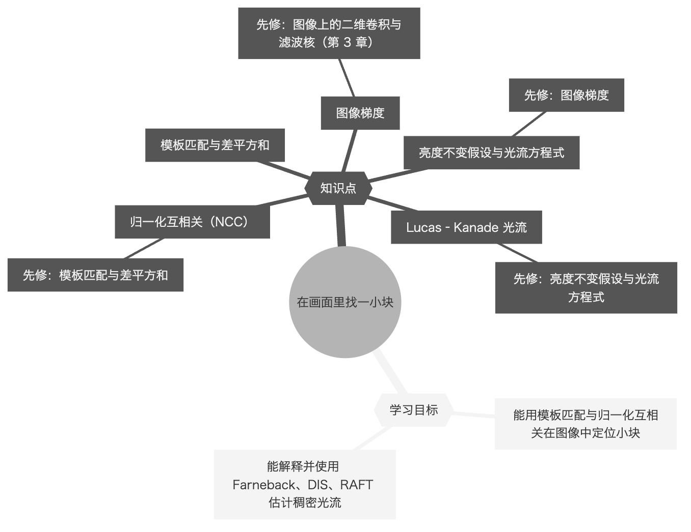
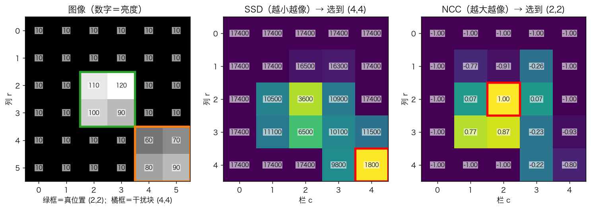
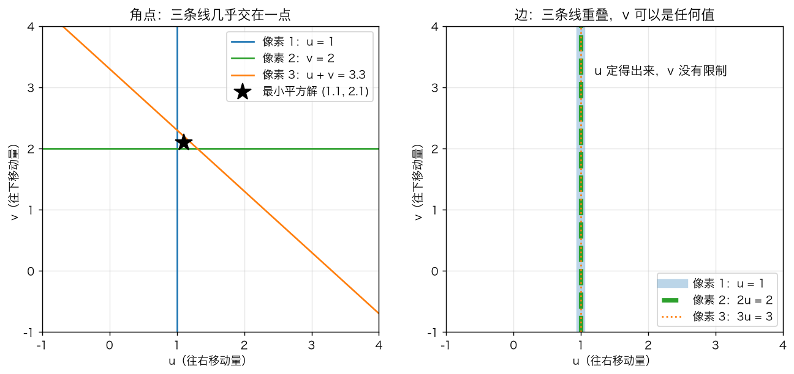

<a id="ch-template-flow-basics"></a>

从滑动比对小块出发，延伸到亮度不变假设与局部光流。

<a id="fig-mindmap-ch-template-flow-basics"></a>



<details><summary>文字说明</summary>思维导图：中心为「在画面里找一小块」，分支为 学习目标（能用模板匹配与归一化互相关在图像中定位小块、能解释并使用 Farneback、DIS、RAFT 估计稠密光流）；知识点（模板匹配与差平方和、归一化互相关（NCC）、图像梯度、亮度不变假设与光流方程式、Lucas–Kanade 光流）。</details>

*图 4-1：在画面里找一小块：本章 5 个知识点、学习目标与各知识点的直接先修（由先修图自动生成）。*

> 本章导图见 [图 4-1](#fig-mindmap-ch-template-flow-basics)。本章假设已会：图像上的二维卷积与滤波核（`image-convolution-2d`）。

<a id="ch-template-flow-basics--find-patch-ssd"></a>

## 1. 拿一小块在画面上滑动，找最像的位置

先把图像想成一张方格纸：在 numpy 里，一张灰阶图像就是一个二维阵列，`img[r, c]` 是第 r 列、第 c 栏那一格的亮度，左上角是 (0, 0)，数字越大越亮。[^c-image-array]

现在玩一个拼图游戏：你手上有一小块拼图（叫做「模板」，其实就是一个小阵列），桌上摊着整幅大图（叫做「来源图像」）。最老实的找法，是把小块依序放到每一个位置，每放一次就替「像不像」打一个分数，最后挑分数最好的位置。[^c-template-sliding]

用一个 6×6 的小图实际算一次。背景每格都是 10，只有第 2、3 列与第 2、3 栏交会的 2×2 块是 [[80, 90], [70, 60]]，而模板正好就是这四个数字。「像不像」最简单的算法，是把两块对应格子的亮度相减、平方、再全部加起来。模板放在左上角 (0, 0) 时，底下是四格 10，差（图像减模板）是 −70、−80、−60、−50，平方和是 4900 + 6400 + 3600 + 2500 = 17400。放在 (2, 1) 时底下是 [[10, 80], [10, 70]]，差是 −70、−10、−60、10，平方和是 8700。放在 (2, 2) 时四个差全是 0，总和是 0。分数越小越像，所以答案是 (2, 2)。[^c-ssd-example]

把这个算法写成公式。设图像宽 W 栏、高 H 列，模板宽 w 栏、高 h 列，模板左上角放在 (r, c)，则差平方和（SSD，sum of squared differences）是 `SSD(r, c) = Σ_{i,j} (I[r+i, c+j] − T[i, j])²`，其中 I 是图像、T 是模板。每个 (r, c) 都得到一个分数，排成一张 (H−h+1)×(W−w+1) 的结果图，上例就是 5×5 共 25 个位置，最小值所在的位置就是匹配处。SSD 是直接拿亮度相减，所以图像亮度一变就会直接影响分数。[^c-ssd-def]

如果把「平方」换成「取绝对值」，就是 SAD（差绝对值和），做的事和 SSD 一样，只是不必做乘法。CPU 做加减比做乘法省时脉，所以有些研究专门想办法减少乘法。[^c-sad-note]

这种逐格尝试的全搜寻出了名地耗时。[^c-fs-slow]

算一下就知道：每个位置要比 w×h 格，位置有 (H−h+1)(W−w+1) 个，总共约 (H−h+1)(W−w+1)·w·h 次运算。一张 1920×1080 的画面配 64×64 的模板，大约是 77 亿次。[^c-brute-cost]

### 范例：`ssd_basic.py`

用 6×6 小图与 2×2 模板，暴力滑动计算差平方和，找出最小处。[^c-ssd-example]

档案：[`ssd_basic.py`](/optical-flow-sam/examples/ch-template-flow-basics/ssd_basic.py)（执行：`python ssd_basic.py`）

```python
import numpy as np

img = np.full((6, 6), 10.0)
tpl = np.array([[80, 90], [70, 60]], dtype=float)
img[2:4, 2:4] = tpl


def ssd_map(img, tpl):
    h, w = tpl.shape
    H, W = img.shape
    out = np.zeros((H - h + 1, W - w + 1))
    for r in range(out.shape[0]):
        for c in range(out.shape[1]):
            out[r, c] = ((img[r:r + h, c:c + w] - tpl) ** 2).sum()
    return out


m = ssd_map(img, tpl)
print('SSD 图大小', m.shape)
print('位置 (0,0) 的 SSD =', int(m[0, 0]))
print('位置 (2,1) 的 SSD =', int(m[2, 1]))
r, c = np.unravel_index(m.argmin(), m.shape)
print(f'最佳位置 (r, c) = ({r}, {c})，SSD = {int(m[r, c])}')
```

预期输出（节录）：

```text
最佳位置 (r, c) = (2, 2)，SSD = 0
```

<a id="ch-template-flow-basics--ncc-brightness"></a>

## 2. 亮度一变，SSD 就看走眼：归一化互相关

现在换个情境：同一个场景，后一张照片整体变亮了（或有影子飘过）。仍用上面的 6×6 图，但把那个 2×2 块整体加 30，变成 [[110, 120], [100, 90]]，并在右下角 (4, 4) 放一块长得有点像的干扰块 [[60, 70], [80, 90]]（模板上下颠倒的版本）。模板仍是 [[80, 90], [70, 60]]。SSD 是直接比亮度差，所以对这种亮度差异很敏感。[^c-ssd-sensitive]

真正的位置 (2, 2) 的 SSD 是 4 × 30² = 3600，干扰块 (4, 4) 的 SSD 只有 400 + 400 + 100 + 900 = 1800，SSD 因此选错了位置（整张分数图见 [图 4-2](#fig-fig-ssd-vs-ncc)）。[^c-ssd-fail-example]

<a id="fig-fig-ssd-vs-ncc"></a>



*图 4-2：左：6×6 图像（数字是亮度），绿框是真正的位置，橘框是长得像的干扰块。中：SSD 分数图，越小越像，红框标出最小处，落在干扰块。右：NCC 分数图，越大越像，红框标出最大处，落在真位置。*

问题出在：亮度「整体加一截」或「整体放大几倍」会让差平方和暴增，但小块里的明暗起伏形状其实没变。所以先做两件事。第一是「去平均」：每格都减掉这个小块自己的平均亮度，「整体加一截」就消失了。第二是「归一化」：再除以剩下那些数字的「长度」（平方和开根号），「整体放大几倍」也消失了。模板平均是 75，去平均后是 (5, 15, −5, −15)。亮了 30 的真块平均是 105，去平均后也是 (5, 15, −5, −15)，一模一样。[^c-ncc-idea]

把去平均、归一化后的两个小块对应格相乘再相加，就得到归一化互相关（NCC，normalized cross-correlation）：`NCC = Σ(P − P̄)(T − T̄) / ( √Σ(P − P̄)² · √Σ(T − T̄)² )`。这里 P 是图像上的小块，T 是模板，上横线表示平均。它衡量两个小块的起伏是不是同步。[^c-ncc-def]

把图像亮度换成 α·亮度 + β（α > 0，也就是整体变亮或变对比）后，NCC 的值不变。[^c-ncc-invariant]

回到例子。真位置 (2, 2) 去平均后与模板完全相同，NCC = 1。干扰块平均 75，去平均后是 (−15, −5, 5, 15)，和模板的 (5, 15, −5, −15) 对应相乘再相加得 −75 − 75 − 25 − 225 = −400，两边的长度都是 √500，所以 NCC = −400 / 500 = −0.8。NCC 因此选中 (2, 2)。[^c-ncc-example]

NCC 的值一定落在 −1 到 1 之间：1 是起伏完全同步，−1 是完全反向。[^c-ncc-range]

NCC 有两个实务细节。第一，如果小块每格亮度都一样（平坦），去平均后全是 0，分母就是 0，NCC 没有定义，实现时要另外处理，例如直接给 −1。[^c-ncc-flat]

第二，实务上很少有完美匹配：周围有模板里没有的内容，图像又有杂讯，NCC 通常不会刚好等于 1。所以要设一个门槛，才能判断是否真的找到。[^c-ncc-practical]

NCC 比 SAD 更耐光照变化，代价是计算量大。[^c-ncc-cost]

好消息是，前面章节学过的 FFT 可以把「模板在每个平移位置做乘加」搬到频率域一次算完，这是加速滑动比对的主流手法。[^c-ncc-fft]

即使换成 NCC，滑动比对还是有天花板：它假设小块的大小与方向都没变，只适合找几乎一模一样的图样。[^c-sliding-limits]

另一个限制是模板每次只能放在整数格上，答案只能精确到 1 个像素。为了得到更细的位移，也为了避开逐格尝试，接下来换个思路：不逐格试，而是从亮度的变化方向直接算出位移。[^c-integer-grid]

### 范例：`ncc_bright.py`

在亮度被改变的 6×6 图上比较 SSD 与 NCC，并在较大的随机纹理图（变亮加杂讯）上验证 NCC 仍能找回位置。[^c-ncc-example]

档案：[`ncc_bright.py`](/optical-flow-sam/examples/ch-template-flow-basics/ncc_bright.py)（执行：`python ncc_bright.py`）

```python
import numpy as np

sw = np.lib.stride_tricks.sliding_window_view


def ssd_map(img, tpl):
    h, w = tpl.shape
    return ((sw(img, (h, w)) - tpl) ** 2).sum(axis=(2, 3))


def ncc_map(img, tpl):
    h, w = tpl.shape
    t = tpl - tpl.mean()
    tn = np.sqrt((t ** 2).sum())
    wins = sw(img, (h, w))
    p = wins - wins.mean(axis=(2, 3), keepdims=True)
    pn = np.sqrt((p ** 2).sum(axis=(2, 3)))
    num = (p * t).sum(axis=(2, 3))
    den = pn * tn
    out = np.full(num.shape, -1.0)
    ok = den > 1e-9
    out[ok] = num[ok] / den[ok]
    return out


img = np.full((6, 6), 10.0)
img[2:4, 2:4] = [[110, 120], [100, 90]]
img[4:6, 4:6] = [[60, 70], [80, 90]]
tpl = np.array([[80, 90], [70, 60]], dtype=float)

ssd = ssd_map(img, tpl)
ncc = ncc_map(img, tpl)
r, c = np.unravel_index(ssd.argmin(), ssd.shape)
print(f'SSD 最佳位置 (r, c) = ({r}, {c})，SSD = {int(ssd[r, c])}')
print('真位置 (2,2) 的 SSD =', int(ssd[2, 2]))
r, c = np.unravel_index(ncc.argmax(), ncc.shape)
print(f'NCC 最佳位置 (r, c) = ({r}, {c})，NCC = {ncc[r, c]:.2f}')
print(f'干扰块 (4,4) 的 NCC = {ncc[4, 4]:.2f}')

# 较大的随机纹理图：亮度 x0.6 + 40，再加轻微杂讯
rng = np.random.default_rng(0)
big = rng.uniform(0, 255, (64, 64))
patch = big[20:32, 35:47].copy()
bright = 0.6 * big + 40 + rng.normal(0, 3, big.shape)
n = ncc_map(bright, patch)
r, c = np.unravel_index(n.argmax(), n.shape)
ok = max(abs(int(r) - 20), abs(int(c) - 35)) <= 1
print('大图测试：NCC 误差 <= 1 像素：', ok)
```

预期输出（节录）：

```text
NCC 最佳位置 (r, c) = (2, 2)，NCC = 1.00
```

<a id="ch-template-flow-basics--image-gradient"></a>

## 3. 用差分量出亮度往哪个方向变

先看一条斜坡。一排像素的亮度是 10、20、30、40、50，每往右一格就多 10。这个「每格多 10」就是亮度在这个方向上的变化率，我们把它叫做梯度：正负号告诉你往哪边变亮，大小告诉你坡有多陡，平坦处的梯度是 0。[^c-diff-ramp]

实际计算时，用左右两个邻居相减再除以 2：`Ix[x] = (I[x+1] − I[x−1]) / 2`。在 10、20、30、40、50 的中间那格 30，得到 (40 − 20) / 2 = 10；在平坦处得到 0。用两侧而不是只用一侧，是为了让估计刚好对准中间那一格。[^c-central-diff]

二维图像要同时看水平与垂直方向，惯用的是 Sobel 核（一个 3×3 的小权重表）：`Kx = [[−1, 0, 1], [−2, 0, 2], [−1, 0, 1]] / 8`，`Ky = [[−1, −2, −1], [0, 0, 0], [1, 2, 1]] / 8`。把核盖在某个像素周围的 3×3，对应格相乘再相加（就是上一章的滤波），得到该像素的 Ix（往右为正）或 Iy（往下为正）。每一行都是左右（或上下）相减，再沿另一个方向用 1、2、1 的权重把三行合起来，最后除以 8，结果刚好等于「每格变化量」。这里直接乘加、不翻转核；若严格依卷积翻转核，正负号会相反。例如亮度 `I = 10·栏 + 5·列` 的斜面，算出来是 Ix = 10、Iy = 5。[^c-sobel]

还有第三个梯度，沿着时间方向：同一个像素在两张连续画面之间的亮度差 `It = I₂ − I₁`。上面那个斜面整张往右平移 1 格后，每个像素都变暗 10，所以 It = −10。(Ix, Iy, It) 这三个数字就是下一节要用的全部原料。[^c-three-grad]

### 范例：`sobel_gradient.py`

用 Sobel 核量出斜面的 Ix、Iy，并检查右移 1 格时光流方程式成立。[^c-sobel]

档案：[`sobel_gradient.py`](/optical-flow-sam/examples/ch-template-flow-basics/sobel_gradient.py)（执行：`python sobel_gradient.py`）

```python
import numpy as np

I1 = np.fromfunction(lambda r, c: 10.0 * c + 5.0 * r, (8, 8))
I2 = np.fromfunction(lambda r, c: 10.0 * (c - 1) + 5.0 * r, (8, 8))  # 整张右移 1 格

kx = np.array([[-1, 0, 1], [-2, 0, 2], [-1, 0, 1]]) / 8.0
ky = np.array([[-1, -2, -1], [0, 0, 0], [1, 2, 1]]) / 8.0

patch = I1[3:6, 3:6]
ix = (patch * kx).sum()
iy = (patch * ky).sum()
it = I2[4, 4] - I1[4, 4]
print(f'Ix = {ix}, Iy = {iy}')
print(f'It = {it}')
u, v = 1.0, 0.0
print(f'Ix*u + Iy*v + It = {ix * u + iy * v + it}')
```

预期输出（节录）：

```text
Ix = 10.0, Iy = 5.0
```

<a id="ch-template-flow-basics--brightness-constancy"></a>

## 4. 亮度不变假设、光流方程式与孔径问题

想像你透过一个小圆孔看一条垂直的边。边往左右移动时你看得出来，因为孔里的画面变了。边上下移动时，孔里什么都没变，你完全无从得知。这就是孔径问题（aperture problem）：只看一小窗时，只能量到垂直于边的那个方向的运动。[^c-aperture-pinhole-vertical-edge]

我们想知道每个像素从第 1 张画面到第 2 张画面移动了多少：往右 u 格、往下 v 格。画面中每个点的 (u, v)，合起来叫「光流」（optical flow）。要算它，先做一个假设，叫亮度不变假设：同一个点移动之后，亮度不变。写成式子就是 `I₂(x+u, y+v) = I₁(x, y)`。[^c-bc-assumption]

这个式子还不能直接解，要先做一个近似。想像你站在斜坡上往前走一小步，高度的改变大约是「坡度 × 步长」。图像也一样：沿 x 走 u 格、沿 y 走 v 格，亮度大约改变 `Ix·u + Iy·v`，所以 `I₂(x+u, y+v) ≈ I₂(x, y) + Ix·u + Iy·v`。又因为 `I₂(x, y) = I₁(x, y) + It`，代入亮度不变假设后 I₁ 两边互相抵消，得到光流方程式：`Ix·u + Iy·v + It = 0`。检查一下：斜坡 `I = 10x` 向右移 1 格，Ix = 10、It = −10，方程式 10u − 10 = 0 给出 u = 1，正是答案。[^c-flow-eq]

这是一条方程式、两个未知数 (u, v)，在 (u, v) 平面上是一条直线。一个像素只能告诉你答案落在某条线上，这就是孔径问题的数学版本。例如只有水平方向有变化的边，Ix = 1、Iy = 0、It = −1，方程式变成 u = 1，而 v 可以是任何值。[^c-one-eq]

这两步（亮度不变、走一小步）都有失效的时候。光线改变或有阴影时，同一个点的亮度本来就会变，亮度不变假设就不成立。[^c-bc-fails]

位移太大时，「一小步」也不成立，因为亮度曲线只有在很小的范围内才像一条直线。[^c-small-motion]

<a id="ch-template-flow-basics--lucas-kanade"></a>

## 5. 小视窗内联立多条方程式：Lucas–Kanade

一个像素只给一条线，那就多借几个邻居。Lucas–Kanade 的假设是：小视窗内的像素移动量都一样，像一群人一起往同一个方向走。看 3 个像素的例子。它们的梯度 (Ix, Iy) 分别是 (1, 0)、(0, 1)、(1, 1)，量到的 It 是 −1、−2、−3.3。三条方程式是 u = 1、v = 2、u + v = 3.3。前两条已经定出 (1, 2)，第三条却说 u + v 该是 3.3，有一点不一致（杂讯）。折衷的办法是找一个 (u, v)，让三条式子的误差平方和最小，这就是最小平方法，有点像用多数决拟合一条线。结果是 (1.1, 2.1)，三条式子的误差分别是 +0.1、+0.1、−0.1，误差被平均分摊给每个人。[^c-lk-3px]

一般化：视窗里有 n 个像素，要最小化 `E(u, v) = Σ (Ix·u + Iy·v + It)²`。令 E 对 u 与对 v 的变化率都等于 0，就得到一组 2×2 方程式：`[[ΣIx², ΣIxIy], [ΣIxIy, ΣIy²]] · [u, v] = −[ΣIxIt, ΣIyIt]`，其中所有的 Σ 都是对视窗内的像素求和。用 3 像素的例子代入，左边矩阵是 [[2, 1], [1, 2]]，右边是 [4.3, 5.3]，解出来正是 (1.1, 2.1)。[^c-lk-normal]

这种「用图像的空间亮度梯度直接算位移」的路线，最早出现在图像对位：它以牛顿–拉弗森叠代去找好的对应，要检查的候选位置比既有方法少得多。[^c-lk-origin]

这组方程式什么时候解得出来？左边那个 2×2 矩阵必须可逆。这个矩阵在两个互相垂直的方向上各有一个「纹理强度」（数学上叫特征值），两个都够大才解得稳，见 [图 4-3](#fig-fig-lk-constraint-lines)。平坦区的 Ix = Iy = 0，矩阵全是 0，完全解不出来。边上所有梯度都指向同一个方向，例如 (1, 0)、(2, 0)、(3, 0)，矩阵是 [[14, 0], [0, 0]]，两个强度是 14 与 0，只能定出垂直于边的那个分量，这就是孔径问题。角点的梯度方向多样，两个强度都大，才能稳定解出 (u, v)；3 像素例子的矩阵 [[2, 1], [1, 2]] 两个强度是 3 与 1，就属于这一类。[^c-lk-solvable]

<a id="fig-fig-lk-constraint-lines"></a>



*图 4-3：每个像素的光流方程式在 (u, v) 平面上是一条直线。左：3 像素的例子，三条线几乎交于一点，星号是最小平方解 (1.1, 2.1)。右：边上的三个像素，梯度都朝同一个方向，三条线叠成同一条垂直线，u=1 定得出来，v 却没有限制。*

对照滑动比对：滑动比对要检查大量候选位置，逐格全搜寻很耗时。[^c-lk-vs-sliding]

Lucas–Kanade 在视窗内只需累加几个和、解一次 2×2 方程式，就直接得到位移，而且结果可以是小数（亚像素）。例如把一张光滑的合成图像移动 (0.3, −0.2) 个像素，用 7×7 视窗估出来的误差小于 0.1。[^c-lk-subpixel]

它靠的是一阶近似，所以位移要小，大约一两格以内。实务上可以叠代：先算出一个估计，把图像依估计搬回去，再算剩下的残余位移。[^c-lk-iter]

还有一个直觉：把图缩小一半，位移也跟着减半，大位移就变成小位移，先在小图上算、再回到大图精修，这就是「由粗到细」的想法。[^c-pyramid-idea]

另外，遮挡（点被挡住，亮度不变假设落空）、光照变化、纹理不足（平坦区或只有一个方向的边）都会让它失效。[^c-lk-limits]

### 范例：`lk_small.py`

在光滑的合成图像上，用 7×7 视窗解 Lucas–Kanade 的 2×2 方程式，估出亚像素位移。[^c-lk-subpixel]

档案：[`lk_small.py`](/optical-flow-sam/examples/ch-template-flow-basics/lk_small.py)（执行：`python lk_small.py`）

```python
import numpy as np


def f(x, y):
    return np.sin(0.5 * x) + np.cos(0.6 * y) + 0.5 * np.sin(0.4 * (x - y))


ys, xs = np.mgrid[0:40, 0:40].astype(float)
u_true, v_true = 0.3, -0.2
I1 = f(xs, ys)
I2 = f(xs - u_true, ys - v_true)  # 内容往 (+u, +v) 方向移动

Iy, Ix = np.gradient(I1)  # axis0 是 y、axis1 是 x
It = I2 - I1

r, c = 20, 20
sl = (slice(r - 3, r + 4), slice(c - 3, c + 4))
ix, iy, it = Ix[sl].ravel(), Iy[sl].ravel(), It[sl].ravel()
A = np.array([[(ix * ix).sum(), (ix * iy).sum()],
              [(ix * iy).sum(), (iy * iy).sum()]])
b = -np.array([(ix * it).sum(), (iy * it).sum()])
u, v = np.linalg.solve(A, b)
print(f'估计 (u, v) = ({u:.2f}, {v:.2f})，真值 = ({u_true}, {v_true})')
err = max(abs(u - u_true), abs(v - v_true))
print('估计误差 < 0.1：', err < 0.1)
```

预期输出（节录）：

```text
估计误差 < 0.1： True
```

<a id="ch-template-flow-basics--practice-hands-on"></a>

## 6. 动手练习

请试着回答下面的问题，先自己算，再对照解答。

**练习 1**（`ex-q-ssd-by-hand`）：6×6 的图背景全是 10，(2,2) 处有 [[80,90],[70,60]]。模板是 [[80,90],[70,60]]。请手算模板放在 (1,1) 时的 SSD，再说明为什么它比 (2,1) 的 8700 还大。

<details><summary>解答</summary>

(1,1) 底下的小块是 [[10,10],[10,80]]，与模板的差是 −70、−80、−60、20，平方和是 4900 + 6400 + 3600 + 400 = 15300。它底下有三格是背景（10），与模板差很多，只有一格刚好落在目标上，所以误差大。(2,1) 的小块是 [[10,80],[10,70]]，有两格落在目标上，所以误差比较小，为 8700。

</details>

**练习 2**（`ex-q-lk-by-hand`）：一个视窗内有三个像素，梯度 (Ix, Iy) 分别是 (2,0)、(0,2)、(1,1)，量到的 It 分别是 −2、−1、−1.5。请列出三条光流方程式并解出 (u, v)。如果三个像素的梯度都是 (2,0)，会发生什么事？

<details><summary>解答</summary>

三条方程式：2u − 2 = 0、2v − 1 = 0、u + v − 1.5 = 0。前两条给 u = 1、v = 0.5，第三条 1 + 0.5 = 1.5 也成立，所以 (u, v) = (1, 0.5)。如果三个梯度都是 (2,0)，矩阵变成 [[12,0],[0,0]]，不可逆，只能解出 u，v 完全没有限制，这就是边的孔径问题。

</details>

**练习 3**（`ex-q-code-ncc`）：自己动手：用 numpy 产生一张 64×64 的随机纹理图，从中裁出 12×12 的模板，再把整张图乘以 0.6、加 40、加标准差 3 的杂讯。分别实现 SSD 与 NCC 匹配，比较它们找到的位置，并用自己的话说明 SSD 为什么可能失败。

<details><summary>解答</summary>

NCC 应该找回原本裁切的位置（误差 ≤ 1 像素）。SSD 直接比亮度差，亮度整体被缩放与平移后，真位置的差平方和会变得很大，可能被某个亮度刚好接近模板数字的位置超过，所以不可靠。NCC 先去平均再归一化，消除了「乘以正数、加一个常数」的影响，所以仍然可靠。可参考范例 ex-ncc-bright 的写法。

</details>

<a id="ch-template-flow-basics--references"></a>

## 章末引用

### 主张与证据

[^c-image-array]: numpy 的 ndarray 可以表示图像；二维灰阶图像用 (row, col) 索引，最小元素 (0, 0) 在左上角。 —— 证据：[scikitimagendcrash〔未核实〕](<https://scikit-image.org/docs/stable/user_guide/numpy_images.html>)（`ev-efee0ce97f11`）；[scikitimagendcrash〔未核实〕](<https://scikit-image.org/docs/stable/user_guide/numpy_images.html>)（`ev-60ca697f5f9b`）
[^c-template-sliding]: 模板匹配像在桌上找拼图：把已知的小图（模板）依序滑过大图（来源图像）的每个位置，在每个位置算一个相似度分数，分数最好的位置就是匹配处。 —— 证据：[apxmlndtemplate〔未核实〕](<https://apxml.com/courses/introduction-to-computer-vision/chapter-5-introduction-object-recognition/template-matching-explained>)（`ev-2cb05764ec98`）；[apxmlndtemplate〔未核实〕](<https://apxml.com/courses/introduction-to-computer-vision/chapter-5-introduction-object-recognition/template-matching-explained>)（`ev-9ad6b2efb773`）；[roboflowndwhat〔未核实〕](<https://roboflow.com/blog/template-matching>)（`ev-48ba52369c47`）
[^c-ssd-example]: 在背景为 10、(2,2) 处有 [[80,90],[70,60]] 的 6×6 图上，以 [[80,90],[70,60]] 为模板，SSD 在 (0,0) 为 17400、在 (2,1) 为 8700、在 (2,2) 为 0，最小处为 (2,2)。 —— 证据：[doindfastc〔未核实〕](<https://doi.org/10.1109/access.2022.3217235>)（`ev-ab7b12a32f98`）；[roboflowndwhat〔未核实〕](<https://roboflow.com/blog/template-matching>)（`ev-47054a1c2946`）
[^c-ssd-def]: SSD(r,c)=Σ(I[r+i,c+j]−T[i,j])² 直接比较亮度差；对 W×H 图像与 w×h 模板，结果图大小为 (W−w+1)×(H−h+1)，最小值所在位置为匹配的左上角。 —— 证据：[doindfastc〔未核实〕](<https://doi.org/10.1109/access.2022.3217235>)（`ev-ab7b12a32f98`）；[roboflowndwhat〔未核实〕](<https://roboflow.com/blog/template-matching>)（`ev-47054a1c2946`）
[^c-sad-note]: SAD（差绝对值和）只用加减不用乘法；CPU 做加减法比乘法省时脉，因此有研究专门设法减少乘法来加速运动向量搜寻。 —— 证据：[doindefficienta〔未核实〕](<https://doi.org/10.1109/indcon.2011.6139485>)（`ev-294a1afe5b62`）；[doindfull〔未核实〕](<https://doi.org/10.1109/icip.2002.1038113>)（`ev-05316040c6a1`）
[^c-fs-slow]: 逐格的全搜寻（full search）非常耗时，因此有许多快速算法被提出。 —— 证据：[doindfaste〔未核实〕](<https://doi.org/10.1109/ism.2010.36>)（`ev-4f4b928cf7b9`）
[^c-brute-cost]: 暴力模板匹配的总运算量约为 (H−h+1)(W−w+1)·w·h；1920×1080 图像配 64×64 模板约 7.7×10⁹ 次。 —— 证据：[doindfaste〔未核实〕](<https://doi.org/10.1109/ism.2010.36>)（`ev-4f4b928cf7b9`）；[doindimproved〔未核实〕](<https://doi.org/10.1109/iccce.2012.6271172>)（`ev-c6e3d6524b55`）
[^c-ssd-sensitive]: SSD 直接计算图像间的亮度差，因此对辐射（亮度）差异相当敏感；传统匹配算法在光照改变、尤其有阴影时会匹配失败。 —— 证据：[doindfastc〔未核实〕](<https://doi.org/10.1109/access.2022.3217235>)（`ev-ab7b12a32f98`）；[doindrectangle〔未核实〕](<https://doi.org/10.1109/icsp48669.2020.9321052>)（`ev-f67c88b8c1d2`）
[^c-ssd-fail-example]: 在 6×6 图中，真块整体加 30 后变成 [[110,120],[100,90]]，并在 (4,4) 放干扰块 [[60,70],[80,90]]：真位置 (2,2) 的 SSD 为 3600，干扰块 (4,4) 的 SSD 为 1800，SSD 选到错的 (4,4)。 —— 证据：[doindfastc〔未核实〕](<https://doi.org/10.1109/access.2022.3217235>)（`ev-ab7b12a32f98`）；[doindrectangle〔未核实〕](<https://doi.org/10.1109/icsp48669.2020.9321052>)（`ev-f67c88b8c1d2`）
[^c-ncc-idea]: 对小块去平均可消除「整体加一个常数」的影响，再除以去平均后数值的长度（平方和开根号）可消除「整体乘以正数」的影响；模板 (80,90,70,60) 与亮 30 的真块去平均后都是 (5,15,−5,−15)。 —— 证据：[doindfastd〔未核实〕](<https://doi.org/10.1007/s12190-024-02157-6>)（`ev-31d3086b5cba`）；[doindfastd〔未核实〕](<https://doi.org/10.1007/s12190-024-02157-6>)（`ev-db3205c4d710`）
[^c-ncc-def]: 归一化互相关（NCC）是常用的模板匹配相似度，借由描述两个窗口的相关性来衡量其相似；其形式为去平均后对应相乘再相加，除以两者的长度之积，对光照变化比 SAD 更稳健。 —— 证据：[doindfastc〔未核实〕](<https://doi.org/10.1109/access.2022.3217235>)（`ev-9f18edcde11b`）；[doindfaste〔未核实〕](<https://doi.org/10.1109/ism.2010.36>)（`ev-848f0936ade7`）
[^c-ncc-invariant]: 将图像亮度换成 α·亮度+β（α>0）后，NCC 的值不变。 —— 证据：[doindfastd〔未核实〕](<https://doi.org/10.1007/s12190-024-02157-6>)（`ev-31d3086b5cba`）；[doindfaste〔未核实〕](<https://doi.org/10.1109/ism.2010.36>)（`ev-848f0936ade7`）
[^c-ncc-example]: 在上述例子中，真位置 (2,2) 的 NCC=1，干扰块 (4,4) 的 NCC=−0.8，NCC 选中 (2,2)。 —— 证据：[doindfastc〔未核实〕](<https://doi.org/10.1109/access.2022.3217235>)（`ev-9f18edcde11b`）；[doindfastd〔未核实〕](<https://doi.org/10.1007/s12190-024-02157-6>)（`ev-31d3086b5cba`）
[^c-ncc-range]: NCC 的值介于 −1 与 1 之间，1 表示起伏完全同步，−1 表示完全反向。 —— 证据：[doindfastc〔未核实〕](<https://doi.org/10.1109/access.2022.3217235>)（`ev-9f18edcde11b`）；[doindfastd〔未核实〕](<https://doi.org/10.1007/s12190-024-02157-6>)（`ev-dcc831d1d973`）
[^c-ncc-flat]: 若小块每格亮度相同，去平均后全为 0，NCC 的分母为 0，NCC 没有定义。 —— 证据：[doindfastc〔未核实〕](<https://doi.org/10.1109/access.2022.3217235>)（`ev-9f18edcde11b`）
[^c-ncc-practical]: 实务中完美匹配几乎不会出现：图像含有模板没有的邻近内容并受杂讯与扭曲影响，归一化相关不会等于 1，需设门槛判断是否匹配；模板匹配对杂讯也很敏感。 —— 证据：[doindfastd〔未核实〕](<https://doi.org/10.1007/s12190-024-02157-6>)（`ev-dcc831d1d973`）；[roboflowndwhat〔未核实〕](<https://roboflow.com/blog/template-matching>)（`ev-7b28909545b1`）
[^c-ncc-cost]: NCC 对光照变化等图像变异比 SAD 更稳健，但计算成本高。 —— 证据：[doindfaste〔未核实〕](<https://doi.org/10.1109/ism.2010.36>)（`ev-848f0936ade7`）
[^c-ncc-fft]: 模板匹配的计算量可以改在傅里叶域处理平移，以有效率地计算；也有方法用 FFT 加速 SSD 的计算。 —— 证据：[doindfastd〔未核实〕](<https://doi.org/10.1007/s12190-024-02157-6>)（`ev-18f67d491b63`）；[doindfull〔未核实〕](<https://doi.org/10.1109/icip.2002.1038113>)（`ev-05316040c6a1`）
[^c-sliding-limits]: 模板匹配适合找大小与方向变化不大的几乎相同图样；图像在不同光照下差异很大，因此光照不变性与旋转不变性同样重要。 —— 证据：[apxmlndtemplate〔未核实〕](<https://apxml.com/courses/introduction-to-computer-vision/chapter-5-introduction-object-recognition/template-matching-explained>)（`ev-69cf3ffa7c7c`）；[doindrectangle〔未核实〕](<https://doi.org/10.1109/icsp48669.2020.9321052>)（`ev-f273d1f2b9b8`）
[^c-integer-grid]: 滑动比对的模板只能放在整数格，结果图只有整数索引，位移精度为 1 个像素。 —— 证据：[roboflowndwhat〔未核实〕](<https://roboflow.com/blog/template-matching>)（`ev-48ba52369c47`）；[roboflowndwhat〔未核实〕](<https://roboflow.com/blog/template-matching>)（`ev-47054a1c2946`）
[^c-diff-ramp]: 一排亮度 10、20、30、40、50 每往右一格多 10；这个每格变化量就是该方向的梯度，平坦处为 0。 —— 证据：[halnditerative〔未核实〕](<https://hal.archives-ouvertes.fr/hal-03697340>)（`ev-7b23c04b2385`）
[^c-central-diff]: 中央差分 Ix[x]=(I[x+1]−I[x−1])/2 在 10,20,30,40,50 的中间得到 10，在平坦处得到 0。 —— 证据：[halnditerative〔未核实〕](<https://hal.archives-ouvertes.fr/hal-03697340>)（`ev-7b23c04b2385`）
[^c-sobel]: Sobel 核 Kx=[[−1,0,1],[−2,0,2],[−1,0,1]]/8、Ky=[[−1,−2,−1],[0,0,0],[1,2,1]]/8 以乘加方式套用，对亮度 10·栏+5·列 的斜面得到 Ix=10、Iy=5；严格卷积需翻转核，符号会相反。 —— 证据：[halnditerative〔未核实〕](<https://hal.archives-ouvertes.fr/hal-03697340>)（`ev-7b23c04b2385`）；[scikitimagendcrash〔未核实〕](<https://scikit-image.org/docs/stable/user_guide/numpy_images.html>)（`ev-efee0ce97f11`）
[^c-three-grad]: 时间差 It=I₂−I₁；上述斜面整张向右平移 1 格后，每个像素的 It=−10。 —— 证据：[halnditerative〔未核实〕](<https://hal.archives-ouvertes.fr/hal-03697340>)（`ev-7b23c04b2385`）
[^c-aperture-pinhole-vertical-edge]: 透过小孔径观察垂直边时，只能解出水平方向的运动分量；垂直方向的运动在孔径内看不到任何变化，因此是模糊的（孔径问题）。 —— 证据：[doindaperture〔未核实〕](<https://doi.org/10.1109/cvpr.2015.7298960>)（`ev-614dca616632`）
[^c-bc-assumption]: 亮度不变假设：同一个点移动 (u,v) 后亮度不变，即 I₂(x+u,y+v)=I₁(x,y)；(u,v) 是该点的光流。 —— 证据：[halnditerative〔未核实〕](<https://hal.archives-ouvertes.fr/hal-03697340>)（`ev-7b23c04b2385`）；[doindaperture〔未核实〕](<https://doi.org/10.1109/cvpr.2015.7298960>)（`ev-614dca616632`）
[^c-flow-eq]: 将 I₂(x+u,y+v) 一阶展开为 I₂+Ix·u+Iy·v，并令 I₂=I₁+It，与亮度不变假设相消后得光流方程式 Ix·u+Iy·v+It=0；例如 I=10x 右移 1 格，Ix=10、It=−10，得 u=1。 —— 证据：[halnditerative〔未核实〕](<https://hal.archives-ouvertes.fr/hal-03697340>)（`ev-7b23c04b2385`）
[^c-one-eq]: 光流方程式一条式子两个未知数，在 (u,v) 平面上是一条直线；当 Ix=1、Iy=0、It=−1 时方程式为 u=1，v 可为任何值。 —— 证据：[doindaperture〔未核实〕](<https://doi.org/10.1109/cvpr.2015.7298960>)（`ev-614dca616632`）
[^c-bc-fails]: 光照改变（尤其有阴影）时，同一场景的图像差异很大，依亮度比对的方法会失败，亮度不变假设也不成立。 —— 证据：[doindrectangle〔未核实〕](<https://doi.org/10.1109/icsp48669.2020.9321052>)（`ev-f67c88b8c1d2`）；[doindrectangle〔未核实〕](<https://doi.org/10.1109/icsp48669.2020.9321052>)（`ev-f273d1f2b9b8`）
[^c-small-motion]: 一阶近似只在位移很小时准确；位移大时，用坡度乘步长估计的亮度变化会有很大误差。 —— 证据：[halnditerative〔未核实〕](<https://hal.archives-ouvertes.fr/hal-03697340>)（`ev-7b23c04b2385`）
[^c-lk-3px]: 三个像素的梯度为 (1,0)、(0,1)、(1,1)，It 为 −1、−2、−3.3 时，最小平方解为 (u,v)=(1.1,2.1)，三条式子的误差为 +0.1、+0.1、−0.1。 —— 证据：[halnditerative〔未核实〕](<https://hal.archives-ouvertes.fr/hal-03697340>)（`ev-7b23c04b2385`）
[^c-lk-normal]: 最小化 E=Σ(Ix·u+Iy·v+It)² 得 2×2 方程式 [[ΣIx²,ΣIxIy],[ΣIxIy,ΣIy²]]·[u,v]=−[ΣIxIt,ΣIyIt]；3 像素例子中矩阵为 [[2,1],[1,2]]、右边为 [4.3,5.3]，解为 (1.1,2.1)。 —— 证据：[halnditerative〔未核实〕](<https://hal.archives-ouvertes.fr/hal-03697340>)（`ev-7b23c04b2385`）
[^c-lk-origin]: 一种利用图像空间亮度梯度、以牛顿–拉弗森叠代寻找好对应的图像对位技术，检查的候选匹配远少于既有技术，因此更快。 —— 证据：[halnditerative〔未核实〕](<https://hal.archives-ouvertes.fr/hal-03697340>)（`ev-7b23c04b2385`）
[^c-lk-solvable]: Lucas–Kanade 的 2×2 矩阵需可逆才有解：平坦区矩阵全为 0；边上梯度同向，例如 (1,0)、(2,0)、(3,0) 得 [[14,0],[0,0]]，两个强度为 14 与 0，只能定出垂直于边的分量；角点两个强度皆大，例如 [[2,1],[1,2]] 的强度为 3 与 1。 —— 证据：[doindaperture〔未核实〕](<https://doi.org/10.1109/cvpr.2015.7298960>)（`ev-614dca616632`）；[halnditerative〔未核实〕](<https://hal.archives-ouvertes.fr/hal-03697340>)（`ev-7b23c04b2385`）
[^c-lk-vs-sliding]: 以梯度为基础的对位方法检查的候选位置远少于逐格全搜寻；而全搜寻本身过于耗时。 —— 证据：[halnditerative〔未核实〕](<https://hal.archives-ouvertes.fr/hal-03697340>)（`ev-7b23c04b2385`）；[doindfaste〔未核实〕](<https://doi.org/10.1109/ism.2010.36>)（`ev-4f4b928cf7b9`）
[^c-lk-subpixel]: 在视窗内累加梯度的乘积并解一次 2×2 方程式即可得到可为小数的位移；对移动 (0.3,−0.2) 像素的光滑合成图像，7×7 视窗的估计误差小于 0.1。 —— 证据：[halnditerative〔未核实〕](<https://hal.archives-ouvertes.fr/hal-03697340>)（`ev-7b23c04b2385`）
[^c-lk-iter]: 以牛顿–拉弗森叠代的方式，可以反复修正位移估计。 —— 证据：[halnditerative〔未核实〕](<https://hal.archives-ouvertes.fr/hal-03697340>)（`ev-7b23c04b2385`）
[^c-pyramid-idea]: 把图像缩小为一半，位移也变为一半，大位移因此变成小位移，可先在小图估计再回大图精修（由粗到细）。 —— 证据：[halnditerative〔未核实〕](<https://hal.archives-ouvertes.fr/hal-03697340>)（`ev-7b23c04b2385`）
[^c-lk-limits]: 遮挡、光照变化与纹理不足（平坦区或只有单一方向的边）会使 Lucas–Kanade 的假设或可解条件失效。 —— 证据：[doindrectangle〔未核实〕](<https://doi.org/10.1109/icsp48669.2020.9321052>)（`ev-f67c88b8c1d2`）；[doindaperture〔未核实〕](<https://doi.org/10.1109/cvpr.2015.7298960>)（`ev-614dca616632`）

### 参考文献

#### 已核实引用

（无）

#### 未核实来源（仅供查找，不得当作已验证引用）

- 〔未核实〕[apxmlndtemplate] (n.d.). *Template Matching Explained*. <https://apxml.com/courses/introduction-to-computer-vision/chapter-5-introduction-object-recognition/template-matching-explained> 授权：unknown；可靠度：不明
- 〔未核实〕[doindaperture] (n.d.). *The aperture problem for refractive motion*. <https://doi.org/10.1109/cvpr.2015.7298960> 授权：unknown；可靠度：高
- 〔未核实〕[doindefficienta] (n.d.). *An efficient fast full search block matching algorithm with SSD criterion*. <https://doi.org/10.1109/indcon.2011.6139485> 授权：unknown；可靠度：高
- 〔未核实〕[doindfastc] (n.d.). *A Fast Template Matching Scheme of Visible and Infrared Image Under Occluded Scenarios*. <https://doi.org/10.1109/access.2022.3217235> 授权：unknown；可靠度：高
- 〔未核实〕[doindfastd] (n.d.). *Fast Normalized Cross-Correlation for Template Matching with Rotations*. <https://doi.org/10.1007/s12190-024-02157-6> 授权：unknown；可靠度：高
- 〔未核实〕[doindfaste] (n.d.). *Fast Template Matching Based on Normalized Cross Correlation Using Adaptive Block Partitioning and…*. <https://doi.org/10.1109/ism.2010.36> 授权：unknown；可靠度：高
- 〔未核实〕[doindfull] (n.d.). *Full search content independent block matching based on the fast Fourier transform*. <https://doi.org/10.1109/icip.2002.1038113> 授权：unknown；可靠度：高
- 〔未核实〕[doindimproved] (n.d.). *An improved full search block matching algorithm for imaging applications*. <https://doi.org/10.1109/iccce.2012.6271172> 授权：unknown；可靠度：高
- 〔未核实〕[doindrectangle] (n.d.). *Rectangle Template Matching Based on Gradient-Chromatic Illumination-Invariant Images*. <https://doi.org/10.1109/icsp48669.2020.9321052> 授权：unknown；可靠度：高
- 〔未核实〕[halnditerative] (n.d.). *An Iterative Image Registration Technique with an Application to Stereo Vision*. <https://hal.archives-ouvertes.fr/hal-03697340> 授权：unknown；可靠度：不明
- 〔未核实〕[roboflowndwhat] (n.d.). *What is Template Matching? An Introduction*. <https://roboflow.com/blog/template-matching> 授权：unknown；可靠度：不明
- 〔未核实〕[scikitimagendcrash] (n.d.). *4. A crash course on NumPy for images*. <https://scikit-image.org/docs/stable/user_guide/numpy_images.html> 授权：unknown；可靠度：高
