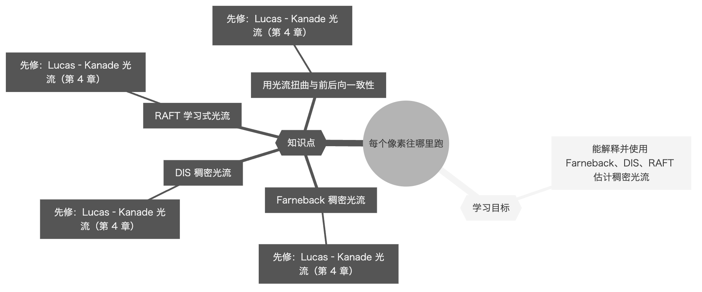
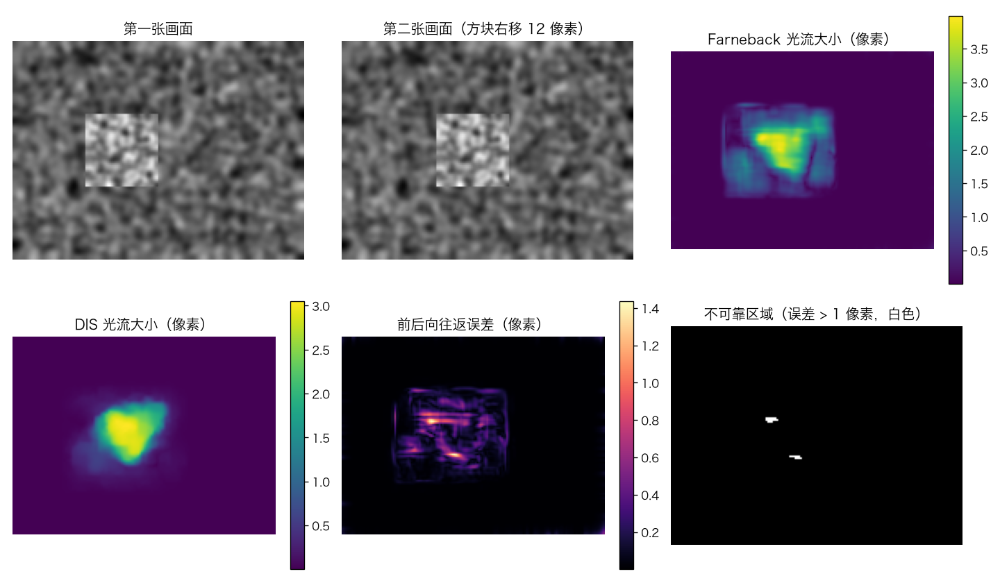

<a id="ch-dense-flow"></a>

比较三种稠密光流的想法与使用方式，并学会用光流扭曲画面与检查可靠度。

<a id="fig-mindmap-ch-dense-flow"></a>



<details><summary>文字说明</summary>思维导图：中心为「每个像素往哪里跑」，分支为 学习目标（能解释并使用 Farneback、DIS、RAFT 估计稠密光流）；知识点（Farneback 稠密光流、DIS 稠密光流、RAFT 学习式光流、用光流扭曲与前后向一致性）。</details>

*图 5-1：每个像素往哪里跑：本章 4 个知识点、学习目标与各知识点的直接先修（由先修图自动生成）。*

> 本章导图见 [图 5-1](#fig-mindmap-ch-dense-flow)。本章假设已会：Lucas–Kanade 光流（`lucas-kanade`）。

<a id="ch-dense-flow--dense-recap"></a>

## 1. 从几个箭头到每个像素都有箭头

把视频暂停在相邻的两格，问每个像素：「到下一格时，你跑去哪里了？」如果每个像素都得到一个箭头 (dx, dy)，整张图的箭头合起来就叫「稠密光流」。[^c-dense-def]

上一章的 Lucas–Kanade 只看一小块视窗，所以通常只在少数角点上追踪。物体动得太快时，它会变不稳定，甚至追丢目标。这就是本章要换方法的原因。[^c-lk-limit]

想替每个像素都估出箭头，传统上有两条路：一条是「视窗式」的局部做法，另一条是最小化全局能量的做法。本章依序介绍三种方法，Farneback、DIS 和 RAFT，全貌见 [图 5-1](#fig-mindmap-ch-dense-flow)。前两种属于局部、手工设计的传统做法，第三种是学习式的。[^c-local-global]

<a id="ch-dense-flow--farneback-1d"></a>

## 2. Farneback 的起点：看抛物线怎么平移

先看一维的具体例子。假设某像素附近的亮度起伏，刚好是抛物线 f1(x) = 2x² + x。下一格整条曲线往右平移 3 格，变成 f2(x) = f1(x−3) = 2x² − 11x + 15。二次项系数 2 完全没变，只有一次项系数从 1 变成 −11。[^c-par-shift]

这样就能反推位移。一般地说，若 f1 = ax² + bx + c，向右平移 d 后，一次项系数会变成 b − 2ad。所以 d = −(b₂ − b₁) / (2a)。代入数字：d = −(−11 − 1) / 4 = 3，刚好还原出平移量。[^c-par-solve]

Farneback 光流就是把这个想法用在整张图上：用二次多项式（曲面）近似每个像素的邻域，两张图各拟合一次。再用曲面系数的变化，推算每个像素的位移。[^c-farn-idea]

### 范例：`ex_parabola.py`

用 numpy 拟合平移前后的抛物线，验证一次项系数的变化能还原位移。[^c-par-solve]

档案：[`ex_parabola.py`](/optical-flow-sam/examples/ch-dense-flow/ex_parabola.py)（执行：`python ex_parabola.py`）

```python
import numpy as np

x = np.linspace(-5, 5, 21)
f1 = 2 * x**2 + x
d = 3
f2 = 2 * (x - d) ** 2 + (x - d)
a1, b1, c1 = np.polyfit(x, f1, 2)
a2, b2, c2 = np.polyfit(x, f2, 2)
print(f'a1={a1:.1f} b1={b1:.1f} b2={b2:.1f}')
print(f'估计位移 d = {-(b2 - b1) / (2 * a1):.1f}')
```

预期输出（节录）：

```text
估计位移 d = 3.0
```

<a id="ch-dense-flow--farneback-2d"></a>

## 3. 推广到二维、金字塔与 OpenCV

到了二维，邻域的亮度起伏变成一张曲面：f(x) = xᵀAx + bᵀx + c。A 是 2×2 对称表格，描述往各方向弯得多厉害，b 是整体倾斜的方向。曲面平移 d 之后，A 不变，b 变成 b − 2A·d。因此 d = −½ A⁻¹ (b₂ − b₁)，和一维的公式一样，只是把除法换成矩阵的反运算。[^c-2d-solve]

真实图像不会刚好是完美曲面，所以算法会反复做一轮流程：先平滑图像，再做多项式展开，接着更新中间变数，最后输出光流。每轮都用目前的位移估计去修正，越修越准。[^c-farn-loop]

曲面近似只在位移不大时可靠。解法是金字塔：先把图像缩小，大位移就变成小位移，在小图上估好之后逐层放大，每层只负责修正残余的小误差。代价是这种由粗到细的做法，可能漏掉小而快的物体，也可能延续早期的错误。[^c-pyramid]

在 OpenCV 中，用 cv2.calcOpticalFlowFarneback(前一张灰阶图, 后一张灰阶图, None, pyr_scale, levels, winsize, iterations, poly_n, poly_sigma, flags) 呼叫。其中 pyr_scale 是每层缩小的比例（例如 0.5），levels 是金字塔层数，winsize 是平均视窗大小，iterations 是每层迭代次数，poly_n 是拟合曲面的邻域大小，poly_sigma 是展开时的平滑程度。输出是形状 (高, 宽, 2) 的阵列，分别存每个像素的 dx 与 dy。[^c-farn-api]

### 范例：`ex_2d_solve.py`

二维曲面平移后 b 变成 b−2A·d，用公式把位移还原出来。[^c-2d-solve]

档案：[`ex_2d_solve.py`](/optical-flow-sam/examples/ch-dense-flow/ex_2d_solve.py)（执行：`python ex_2d_solve.py`）

```python
import numpy as np

A = np.array([[2.0, 0.5], [0.5, 1.0]])
b1 = np.array([1.0, -1.0])
d = np.array([3.0, 2.0])
b2 = b1 - 2 * A @ d
d_est = -0.5 * np.linalg.inv(A) @ (b2 - b1)
print('还原位移 d =', np.round(d_est, 3))
```

预期输出（节录）：

```text
还原位移 d = [3. 2.]
```

<a id="ch-dense-flow--dis-flow-sec"></a>

## 4. DIS：为了速度，改用块来搜

Farneback 要替每个像素解一次曲面，成本不低。DIS（Dense Inverse Search）换个角度：把图像切成重叠的小块，每个块在下一张图中搜寻最佳位置，再把块的位移铺成每像素的光流，最后做一次细化。「逆向」是指搜寻时重复使用块本身的梯度资讯，不必每次迭代都重算。它与 Lucas–Kanade 同属「局部视窗反复对齐」这一族，所以 DIS 可看成让 LK 式迭代变快、又能输出稠密结果。[^c-dis-design]

局部视窗反复对齐求稠密光流这件事本身有研究支持：迭代式 Lucas–Kanade 可以用来估计稠密光流。[^c-iter-lk]

OpenCV 用 cv2.DISOpticalFlow_create(预设) 建立 DIS。预设有 ULTRAFAST、FAST、MEDIUM 三档，越快的档位块越稀疏、迭代越少，质量也跟着下降。用 .calc(前一张, 后一张, None) 取得光流。范例中的数值与计时请自己跑一次看看。[^c-dis-preset]

### 范例：`ex_flow_api.py`

对已知平移 (3,2) 的合成画面，分别用 Farneback 与三种 DIS 预设估计光流，印出形状、平均位移与耗时。[^c-dis-preset]

档案：[`ex_flow_api.py`](/optical-flow-sam/examples/ch-dense-flow/ex_flow_api.py)（执行：`python ex_flow_api.py`）

```python
import time
import numpy as np
import cv2

rng = np.random.default_rng(0)
base = cv2.GaussianBlur(rng.random((240, 320)).astype(np.float32), (0, 0), 3)
base = cv2.normalize(base, None, 0, 255, cv2.NORM_MINMAX).astype(np.uint8)
img2 = np.roll(base, shift=(2, 3), axis=(0, 1))
print('真实位移 (dx,dy) = (3.0, 2.0)')


def report(name, flow, t):
    c = flow[30:-30, 30:-30]
    print(f'{name}: 形状 {flow.shape} 平均 dx={c[..., 0].mean():.2f} dy={c[..., 1].mean():.2f} 耗时 {t * 1000:.1f} ms')


t0 = time.time()
fl = cv2.calcOpticalFlowFarneback(base, img2, None, 0.5, 3, 15, 3, 5, 1.2, 0)
report('Farneback', fl, time.time() - t0)

presets = [('DIS-ULTRAFAST', cv2.DISOPTICAL_FLOW_PRESET_ULTRAFAST),
           ('DIS-FAST', cv2.DISOPTICAL_FLOW_PRESET_FAST),
           ('DIS-MEDIUM', cv2.DISOPTICAL_FLOW_PRESET_MEDIUM)]
for name, p in presets:
    dis = cv2.DISOpticalFlow_create(p)
    t0 = time.time()
    fl = dis.calc(base, img2, None)
    report(name, fl, time.time() - t0)
```

预期输出（节录）：

```text
真实位移 (dx,dy) = (3.0, 2.0)
```

<a id="ch-dense-flow--raft-sec"></a>

## 5. RAFT：用预训练网路反复修正

前两种方法的规则都是人写的，RAFT 则交给神经网路学。这里只讲它怎么用，不涉及训练。它由三个部件组成：一个替每个像素抽出特征向量的编码器，一个计算所有像素配对相似度的相关层，以及一个反复更新光流的循环单元。[^c-raft-three]

相似度的算法很直接：两张图各有一份每像素的特征，把第一张的每个特征向量和第二张的每个特征向量做内积，就得到「所有像素配对」的相似度表，称为相关体。[^c-raft-vol]

这张表很大。以输入 1024×448 为例，特征解析度是 1/8，也就是 128×56 = 7168 个位置。配对数是 7168² = 51,380,224，以 float32 计约 205 MB，这是 RAFT 吃记忆体的主因。[^c-vol-size]

光流从全 0 开始，每轮迭代产生一个修正量 Δf，更新成 f(k+1) = f(k) + Δf。每轮都用目前的光流算出每个像素在第二张图的对应位置 x′ = x + f(x)，并在相关体中查表。[^c-raft-iter]

迭代次数可以在推论时调整，论文评估时在 Sintel 用 32 次，在 KITTI 用 24 次；这个更新单元可套用 100 次以上而不发散。[^c-raft-n]

传统做法多半先在低解析度估计、再放大修正，RAFT 则始终维持单一张高解析度光流，不断更新它。这避免了粗到细的两个毛病：早期错误难以挽回，以及漏掉小而快的物体。相关体同时保留大小位移的资讯，所以每次更新都看得到。[^c-raft-single]

输入是两张彩色图像，输出是光流场。网路内部以 1/8 解析度预测，再用每个像素周围 3×3 粗网格邻居的凸组合放大回原解析度。[^c-raft-io]

与传统法的差别，在于特征与运动先验是学出来的，不是手工设计的。论文报告，只用合成资料训练的 RAFT 在 KITTI 上的端点误差（EPE，预测箭头与真实箭头的平均距离）是 5.04 像素，比先前最佳方法低 40%，显示跨资料集的泛化能力强。速度上，在 1080Ti GPU 处理 1088×436 视频约 10 帧／秒。因此实务上它通常需要 GPU，输入尺寸大时还要留意相关体的记忆体用量。[^c-raft-pros]

<a id="ch-dense-flow--warp-consistency"></a>

## 6. 用光流扭曲画面，再检查它可不可信

光流好不好，最直接的检验是用它把第二张图「扭回」第一张。后向扭曲的做法是：对第一张图的每个像素 x，去第二张图的 x + f(x) 取颜色，坐标不是整数时用双线性插值，也就是取周围像素的加权平均。例如一列亮度 10、20、30，在位置 1.5 采样得 25。[^c-backward-warp]

扭曲后的图与第一张图逐像素相减，就是「残差」。光流正确时，残差应该接近 0；残差大的地方，光流多半有问题。[^c-residual]

只看残差还不够，所以再加上前后向一致性检查。先看一个像素的往返：第一张图的像素 (10, 20) 前向光流是 (+3, +1)，落在第二张的 (13, 21)。在第二张图的这个位置，后向光流若是 (−3, −1)，就刚好走回起点，往返误差是 0。[^c-roundtrip]

如果这个点在第二张被别的东西挡住，第二张就没有它的对应位置，那里的后向光流可能是 (0, 0)，往返误差是 √(3² + 1²) ≈ 3.16 像素。实务上设一个门槛（例如 1 像素），误差超过就标成「不可靠」。遮挡区与跑出画面的区域，会自然地被这样抓出来。[^c-occlusion]

但一致性检查不是万能的。墙壁这类没有纹理的区域，或只有单一方向边缘的地方，本来就有「孔径问题」：光看局部，答案不唯一。前后向可能一起猜错，而且猜得很一致，所以要配合残差一起看。[^c-aperture]

<a id="fig-fig-flow-consistency"></a>



*图 5-2：合成画面中方块右移 12 像素。上排是两张画面与 Farneback 光流大小，下排是 DIS 光流大小、前后向往返误差，以及误差超过 1 像素的不可靠区域。*

[图 5-2](#fig-fig-flow-consistency) 用合成画面示范：方块向右移动 12 像素，背景不动。方块后方露出来的区域，在前后向误差图上会亮起来。[^c-fig-check]

三种方法怎么选？Farneback 靠曲面与金字塔，适合位移不大的场景，也容易漏掉小而快的物体。DIS 为速度而设计，可用预设档位在速度与质量之间折衷。RAFT 在单一高解析度上反复更新，大位移与小而快的物体都比较稳，但需要 GPU 与较多记忆体。[^c-compare]

### 范例：`ex_roundtrip.py`

一个像素的前后向往返误差（一致与遮挡两种情况）、双线性插值，以及 RAFT 相关体大小的估算。[^c-occlusion]

档案：[`ex_roundtrip.py`](/optical-flow-sam/examples/ch-dense-flow/ex_roundtrip.py)（执行：`python ex_roundtrip.py`）

```python
import numpy as np

fw = (3, 1)


def err(fw, bw):
    return float(np.hypot(fw[0] + bw[0], fw[1] + bw[1]))


print(f'一致 → 往返误差 = {err(fw, (-3, -1)):.3f}')
print(f'遮挡 → 往返误差 = {err(fw, (0, 0)):.3f}')
print('双线性插值 1.5 处 =', np.interp(1.5, [0, 1, 2], [10.0, 20.0, 30.0]))
h, w = 1024 // 8, 448 // 8
n = (h * w) ** 2
print(f'相关体元素数 = {n}  约 {n * 4 / 1e6:.0f} MB')
```

预期输出（节录）：

```text
遮挡 → 往返误差 = 3.162
```

<a id="ch-dense-flow--practice-compare"></a>

## 7. 练习：三种方法比一比

请自己动手做一次完整的比较，题目见下方练习。

**练习 1**（`exr-compare`）：挑一对连续的视频画面（可自己从视频截取），依序完成：(1) 用 Farneback、DIS、RAFT（torchvision 预训练模型）各算一次前向光流；(2) 用各自的光流把后一张扭回前一张，计算残差的平均值；(3) 再算反方向光流，做前后向一致性检查，把往返误差超过 1 像素的区域标出来；(4) 用自己的话说明三者的假设与适用情境有何不同。

<details><summary>解答</summary>

参考做法：Farneback 与 DIS 用 cv2 先转灰阶再呼叫；RAFT 可用 torchvision.models.optical_flow 的 raft_large(weights=...)，输入是两张 [N,3,H,W] 的图像张量（先用对应权重附带的 transforms 预处理），输出是迭代过程中每轮的光流清单，取最后一个。torchvision 的 RAFT 要求输入长宽可被 8 整除，必要时先缩放或补边。扭曲时，对前一张每个像素 x，去后一张的 x+f(x) 用 cv2.remap（双线性）取值，再与前一张相减取平均绝对值。一致性检查则是把后向光流在 x+f(x) 处采样，计算 |f(x)+b(x+f(x))|。通常的观察：Farneback 在大位移处残差大，DIS 最快但细节略粗，RAFT 在大位移与细小物体上最稳，但最吃资源；三者的不可靠区域都会集中在遮挡边缘与无纹理处。

</details>

<a id="ch-dense-flow--references"></a>

## 章末引用

### 主张与证据

[^c-dense-def]: 稠密光流为每个像素计算一个二维位移向量，表示该像素相对于前一帧移动了多少。 —— 证据：[doinddensely〔未核实〕](<https://doi.org/10.1109/icaccaf.2017.8344729>)（`ev-650d111c0d35`）
[^c-lk-limit]: 基于 Lucas–Kanade 的稀疏光流追踪效果尚可，但物体快速移动时稳定性变差，甚至追丢目标；它的速度范围小，也无法直接给出稠密光流。 —— 证据：[doindmulti〔未核实〕](<https://doi.org/10.1109/ccdc.2008.4598340>)（`ev-78bc034e4f2d`）；[doinddensely〔未核实〕](<https://doi.org/10.1109/icaccaf.2017.8344729>)（`ev-ca72168f6452`）
[^c-local-global]: 光流估计是欠定问题，传统上用局部（视窗式）或全局（最小化正则化泛函）两种方式处理；两者原本都针对小位移，用一阶近似的光流约束。 —— 证据：[doinddensea〔未核实〕](<https://doi.org/10.1109/icip.2005.1529706>)（`ev-d68b659f77e2`）；[doinddensea〔未核实〕](<https://doi.org/10.1109/icip.2005.1529706>)（`ev-728c4c9a657c`）
[^c-par-shift]: 若 f1(x)=2x²+x，向右平移 3 后 f2(x)=f1(x−3)=2x²−11x+15：二次项系数不变，一次项由 1 变成 −11。这是 Farneback 以二次多项式近似邻域后比较系数的具体例子。 —— 证据：[doindfpgaa〔未核实〕](<https://doi.org/10.1109/fccm48280.2020.00054>)（`ev-60c296caaf59`）
[^c-par-solve]: 对 f1=ax²+bx+c 右移 d，一次项系数变为 b−2ad，故 d=−(b2−b1)/(2a)；本例 d=−(−12)/4=3。这是多项式展开结果用于位移估计的一维形式。 —— 证据：[doindfpgaa〔未核实〕](<https://doi.org/10.1109/fccm48280.2020.00054>)（`ev-60c296caaf59`）
[^c-farn-idea]: Farneback 光流用二次多项式近似每个像素的邻域，再用两张图像多项式展开的结果估计位移。 —— 证据：[doindfpgaa〔未核实〕](<https://doi.org/10.1109/fccm48280.2020.00054>)（`ev-60c296caaf59`）；[doindego〔未核实〕](<https://doi.org/10.1109/cvprw.2014.53>)（`ev-e0ddc3b45bd9`）
[^c-2d-solve]: 二维曲面 f(x)=xᵀAx+bᵀx+c（A 对称）平移 d 后，A 不变、b 变为 b−2A·d，因此 d=−½A⁻¹(b2−b1)；这是以多项式展开结果估计位移的二维形式。 —— 证据：[doindfpgaa〔未核实〕](<https://doi.org/10.1109/fccm48280.2020.00054>)（`ev-60c296caaf59`）
[^c-farn-loop]: Farneback 算法的回圈有四个基本步骤：图像平滑、多项式展开、更新中间变数、输出光流；并以迭代与多尺度方式估计位移以提升效果。 —— 证据：[doindfpgaa〔未核实〕](<https://doi.org/10.1109/fccm48280.2020.00054>)（`ev-56071c4d31a4`）
[^c-pyramid]: 以一阶近似为基础的方法只适合小位移；处理大位移时用图像金字塔，先在低解析度估计大位移，再于高解析度细化小位移，但这种由粗到细的做法可能漏掉小而快的物体，也难从早期错误中恢复。 —— 证据：[doindraft〔未核实〕](<https://doi.org/10.24963/ijcai.2021/662>)（`ev-6783771cb45a`）；[doindfpgaa〔未核实〕](<https://doi.org/10.1109/fccm48280.2020.00054>)（`ev-56071c4d31a4`）
[^c-farn-api]: cv2.calcOpticalFlowFarneback 实现 Farneback 多项式展开法，接收前后两张灰阶图与 pyr_scale、levels、winsize、iterations、poly_n、poly_sigma、flags，回传形状 (高, 宽, 2) 的 dx、dy 光流。 —— 证据：[doindfpgaa〔未核实〕](<https://doi.org/10.1109/fccm48280.2020.00054>)（`ev-60c296caaf59`）
[^c-dis-design]: DIS 把图像切成重叠块，逐块做逆向（重用块梯度的）Lucas–Kanade 式搜寻，再将块位移合成稠密光流并细化，设计目标是速度；其基础是局部视窗的迭代配准。 —— 证据：[doinddensea〔未核实〕](<https://doi.org/10.1109/icip.2005.1529706>)（`ev-ec40b5807e50`）
[^c-iter-lk]: 可以用局部视窗的迭代配准（迭代式 Lucas–Kanade）来估计稠密光流。 —— 证据：[doinddensea〔未核实〕](<https://doi.org/10.1109/icip.2005.1529706>)（`ev-ec40b5807e50`）
[^c-dis-preset]: OpenCV 的 DISOpticalFlow 提供 ULTRAFAST、FAST、MEDIUM 等预设，越快的档位耗时越短、质量越低，用 .calc(前, 后, None) 取得稠密光流。 —— 证据：[doinddensea〔未核实〕](<https://doi.org/10.1109/icip.2005.1529706>)（`ev-ec40b5807e50`）
[^c-raft-three]: RAFT 由三部分组成：为每个像素抽取特征向量的特征编码器、为所有像素配对产生 4D 相关体的相关层，以及以 GRU 为基础、反复从相关体取值并更新光流的更新运算子。 —— 证据：[doindraft〔未核实〕](<https://doi.org/10.24963/ijcai.2021/662>)（`ev-526d533f8929`）；[doindraft〔未核实〕](<https://doi.org/10.24963/ijcai.2021/662>)（`ev-1e24cba1fc6e`）
[^c-raft-vol]: 相关体是把两张图像的所有特征向量两两做内积得到，可用一次矩阵乘法算出，之后再以多尺度池化。 —— 证据：[doindraft〔未核实〕](<https://doi.org/10.24963/ijcai.2021/662>)（`ev-f9adea2e2b6c`）；[doindraft〔未核实〕](<https://doi.org/10.24963/ijcai.2021/662>)（`ev-36e27ee803de`）
[^c-vol-size]: 所有像素配对的相关体：输入 1024×448、特征解析度 1/8 时有 128×56=7168 个位置，配对数 7168²=51,380,224，以 float32 约 205 MB。 —— 证据：[doindraft〔未核实〕](<https://doi.org/10.24963/ijcai.2021/662>)（`ev-f9adea2e2b6c`）
[^c-raft-iter]: RAFT 从 f0=0 开始，每次迭代产生更新量 Δf 并做 f(k+1)=f(k)+Δf；每轮用目前光流把像素 x 对应到 x′=x+f(x)，在相关体中查表。 —— 证据：[doindraft〔未核实〕](<https://doi.org/10.24963/ijcai.2021/662>)（`ev-1ddd8515ffee`）；[doindraft〔未核实〕](<https://doi.org/10.24963/ijcai.2021/662>)（`ev-9404b98558f5`）
[^c-raft-n]: RAFT 论文在 Sintel 用 32 次、KITTI 用 24 次光流更新做评估，更新运算子可套用 100 次以上而不发散。 —— 证据：[doindraft〔未核实〕](<https://doi.org/10.24963/ijcai.2021/662>)（`ev-fdbaee0dc902`）；[doindraft〔未核实〕](<https://doi.org/10.24963/ijcai.2021/662>)（`ev-33e84715a160`）
[^c-raft-single]: RAFT 维持并更新单一固定的高解析度光流，不采用先低解析度再细化的由粗到细设计，因而能克服粗解析度错误难以恢复、容易漏掉小而快物体的限制。 —— 证据：[doindraft〔未核实〕](<https://doi.org/10.24963/ijcai.2021/662>)（`ev-ca3d4b6a3ef2`）；[doindraft〔未核实〕](<https://doi.org/10.24963/ijcai.2021/662>)（`ev-36e27ee803de`）
[^c-raft-io]: RAFT 网路以 1/8 解析度输出光流，再用每个像素粗解析度 3×3 邻居的凸组合放大到全解析度。 —— 证据：[doindraft〔未核实〕](<https://doi.org/10.24963/ijcai.2021/662>)（`ev-2dbde6ceaa90`）；[doindraft〔未核实〕](<https://doi.org/10.24963/ijcai.2021/662>)（`ev-fc289f4f7913`）
[^c-raft-pros]: RAFT 的特征与运动先验由学习而来而非手工设计；仅用合成资料训练即在 KITTI 达到 5.04 像素的端点误差（降低 40%），在 1080Ti 上处理 1088×436 视频约每秒 10 帧。 —— 证据：[doindraft〔未核实〕](<https://doi.org/10.24963/ijcai.2021/662>)（`ev-ba227ad06803`）；[doindraft〔未核实〕](<https://doi.org/10.24963/ijcai.2021/662>)（`ev-293a617eb37e`）；[doindraft〔未核实〕](<https://doi.org/10.24963/ijcai.2021/662>)（`ev-ff5951c0ad9f`）
[^c-backward-warp]: 后向扭曲对目标图像每个像素 x 去另一张图的 x+f(x) 取值，非整数坐标用双线性插值；例如一列 10、20、30 在位置 1.5 采样为 25。 —— 证据：[doindraft〔未核实〕](<https://doi.org/10.24963/ijcai.2021/662>)（`ev-9404b98558f5`）
[^c-residual]: 把后一张图用光流扭回前一张后，与前一张逐像素相减的差就是残差；光流目标是让相似的图像区域对齐，故光流正确处残差应接近 0。 —— 证据：[doindraft〔未核实〕](<https://doi.org/10.24963/ijcai.2021/662>)（`ev-09cb930c35e5`）
[^c-roundtrip]: 像素 (10,20) 前向光流 (+3,+1) 落在 (13,21)，若该处后向光流为 (−3,−1)，往返误差为 0。 —— 证据：[doindraft〔未核实〕](<https://doi.org/10.24963/ijcai.2021/662>)（`ev-9404b98558f5`）
[^c-occlusion]: 被遮挡的点在后一张没有对应；若该处后向光流为 (0,0)，往返误差为 √10≈3.16 像素，超过门槛（如 1 像素）就标为不可靠。 —— 证据：[doindraft〔未核实〕](<https://doi.org/10.24963/ijcai.2021/662>)（`ev-9404b98558f5`）
[^c-aperture]: 光流是欠定的不适定问题（孔径问题），仅看局部无法唯一决定运动，需要额外约束；因此无纹理或单方向边缘区域的光流可能不可靠，即使前后向看起来一致。 —— 证据：[doindincorporating〔未核实〕](<https://doi.org/10.1109/confluence.2014.6949319>)（`ev-724bd012cd87`）
[^c-fig-check]: 在合成画面（方块右移 12 像素、背景不动）上，用 Farneback 前后向光流计算往返误差，方块后方露出的区域误差较大而被标出。 —— 证据：[doindraft〔未核实〕](<https://doi.org/10.24963/ijcai.2021/662>)（`ev-9404b98558f5`）
[^c-compare]: Farneback 依靠曲面近似与金字塔，适合小位移且可能漏掉小而快的物体；DIS 为速度设计并可选预设档位；RAFT 以单一高解析度反复更新，较能处理大位移与小而快的物体，但需要 GPU 与较多记忆体。 —— 证据：[doindraft〔未核实〕](<https://doi.org/10.24963/ijcai.2021/662>)（`ev-6783771cb45a`）；[doindraft〔未核实〕](<https://doi.org/10.24963/ijcai.2021/662>)（`ev-ca3d4b6a3ef2`）；[doindraft〔未核实〕](<https://doi.org/10.24963/ijcai.2021/662>)（`ev-ff5951c0ad9f`）

### 参考文献

#### 已核实引用

（无）

#### 未核实来源（仅供查找，不得当作已验证引用）

- 〔未核实〕[doinddensea] (n.d.). *Dense optical flow by iterative local window registration*. <https://doi.org/10.1109/icip.2005.1529706> 授权：unknown；可靠度：高
- 〔未核实〕[doinddensely] (n.d.). *Densely sampled noiseless optical flow for motion based visual activity analysis*. <https://doi.org/10.1109/icaccaf.2017.8344729> 授权：unknown；可靠度：高
- 〔未核实〕[doindego] (n.d.). *Ego-Motion Estimation on Range Images Using High-Order Polynomial Expansion*. <https://doi.org/10.1109/cvprw.2014.53> 授权：unknown；可靠度：高
- 〔未核实〕[doindfpgaa] (n.d.). *An FPGA-Optimized Architecture of Real-time Farneback Optical Flow*. <https://doi.org/10.1109/fccm48280.2020.00054> 授权：unknown；可靠度：高
- 〔未核实〕[doindincorporating] (n.d.). *Incorporating discontinuity preserving approach for optical flow estimation*. <https://doi.org/10.1109/confluence.2014.6949319> 授权：unknown；可靠度：高
- 〔未核实〕[doindmulti] (n.d.). *Multi-resolution optical flow tracking algorithm based on multi-scale Harris corner points feature*. <https://doi.org/10.1109/ccdc.2008.4598340> 授权：unknown；可靠度：高
- 〔未核实〕[doindraft] (n.d.). *RAFT: Recurrent All-Pairs Field Transforms for Optical Flow (Extended Abstract)*. <https://doi.org/10.24963/ijcai.2021/662> 授权：unknown；可靠度：高
