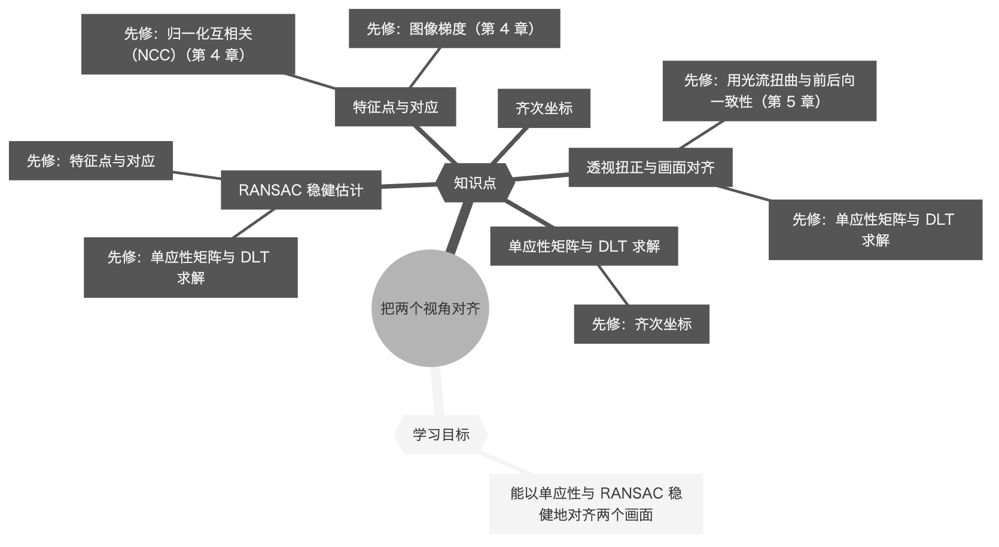
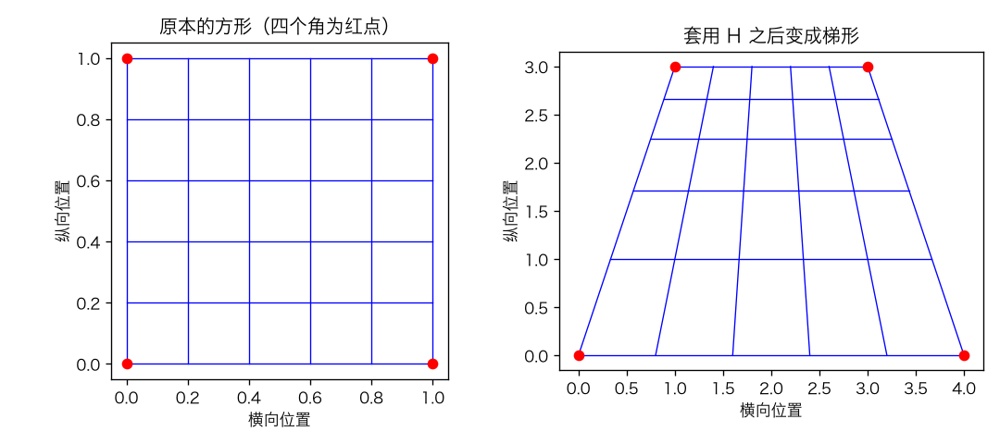
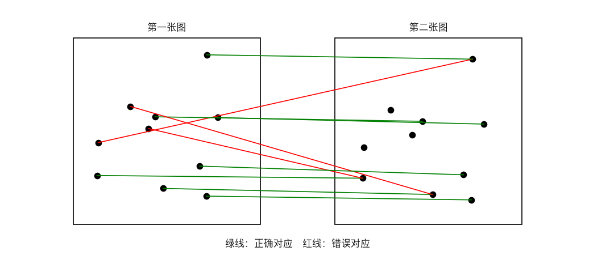
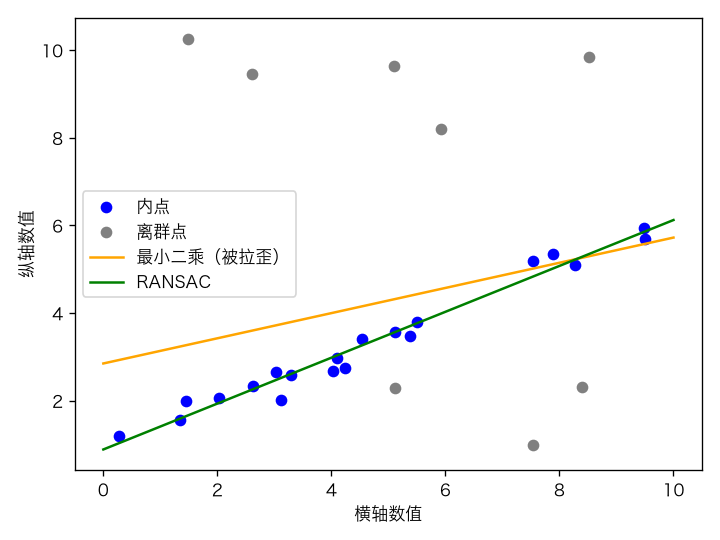

<a id="ch-homography-ransac"></a>

以平面透视变换加稳健估计，在含大量错误对应时仍能对齐两个画面。

<a id="fig-mindmap-ch-homography-ransac"></a>



<details><summary>文字说明</summary>思维导图：中心为「把两个视角对齐」，分支为 学习目标（能以单应性与 RANSAC 稳健地对齐两个画面）；知识点（齐次坐标、单应性矩阵与 DLT 求解、特征点与对应、RANSAC 稳健估计、透视扭正与画面对齐）。</details>

*图 6-1：把两个视角对齐：本章 5 个知识点、学习目标与各知识点的直接先修（由先修图自动生成）。*

> 本章导图见 [图 6-1](#fig-mindmap-ch-homography-ransac)。本章假设已会：图像梯度（`image-gradient`）、归一化互相关（NCC）（`ncc`）、用光流扭曲与前后向一致性（`flow-warp-consistency`）。

<a id="ch-homography-ransac--homogeneous-intro"></a>

## 1. 多补一个 1：让平移也能乘矩阵

想像你站在一面墙的左边拍一张照，再走到右边拍第二张。墙上同一个钉子在两张照片里的坐标不一样，要对齐两张照片，就得找出一条「坐标换算规则」。先从最简单的规则开始：把点 (2, 3) 往右移 5、往上移 1，得到 (7, 4)，这是加法。放大、旋转这类换算都能写成「用一个 2×2 矩阵去乘坐标」，平移偏偏不行：2×2 矩阵乘上原点 (0, 0) 永远还是 (0, 0)，原点动不了，所以平移没办法只靠 2×2 矩阵乘法完成。[^c-translation-not-matrix]

解法是多补一个 1：把 (2, 3) 写成三个数的 (2, 3, 1)，这个多出来的 1 就是齐次坐标（homogeneous coordinates）的第三个坐标。拿一个 3×3 矩阵去乘它，矩阵第一列是 (1, 0, 5)，第二列是 (0, 1, 1)，第三列是 (0, 0, 1)。三列各自和 (2, 3, 1) 对应相乘再相加，得到 2+5=7、3+1=4、1，也就是 (7, 4, 1)，去掉最后的 1 就是平移后的 (7, 4)。平移因此变成一次矩阵乘法，可以和其他变换连乘在一起。[^c-homog-translate]

3×3 矩阵的最后一列不一定要是 (0, 0, 1)。例如把第三列改成 (0, 0.1, 1)，其余为单位矩阵，乘上 (2, 3, 1) 得到 (2, 3, 1.3)。这时第三个数不再是 1，规则是把前两个数都除以第三个数，得到 (2/1.3, 3/1.3) ≈ (1.54, 2.31)。「除以第三个坐标」就是透视的来源：y 越大、除数越大，点就越被往原点缩，看起来越远越小。[^c-homog-divide]

同一个点可以有很多种写法：(2, 3, 1)、(4, 6, 2)、(20, 30, 10) 除以各自的第三个数后，都是 (2, 3)。所以把矩阵整个乘上任何非零倍数，算出来的最终位置都不变，这个「整体倍数不影响结果」的性质，马上就会用来数自由度。[^c-homog-scale]

<a id="ch-homography-ransac--homography-meaning"></a>

## 2. 单应性是什么、何时适用、需要几组点

把上一节那个一般的 3×3 矩阵叫做单应性矩阵 H（homography，平面透视变换）。它把第一张画面的每个点 (x, y, 1) 乘上 H、再除以第三个坐标，就得到那个点在第二张画面的位置。拍同一个平面物体（墙、桌面、一张纸）的两个视角，彼此就由这样的平面到平面变换相连。[^c-homography-def]

不是任何两张照片都能用一个 H 对齐。适用条件有两种：场景近似平面，或两个视角之间相机只做纯旋转（原地转头、位置不动）。条件不成立时，近处与远处物体的位移不一致，用单一 H 对齐就会出现重影（ghosting）。[^c-homography-conditions]

H 有 9 个数字，但上一节说过整体乘上倍数不改变结果，所以真正独立的只有 8 个，也就是 8 个自由度。[^c-homography-dof]

每组对应点（第一张的 (x, y) 对上第二张的 (u, v)）提供两个条件，一个管横向、一个管纵向。8 个未知数需要 8 个条件，所以至少要 4 组对应点，而且这 4 点中不能有三点共线，否则条件会重复、解不唯一。[^c-four-pairs]

<a id="ch-homography-ransac--dlt-solve"></a>

## 3. 从四组点解出 H：DLT 与 SVD

先看最直观的例子：把方形的四个角 (0,0)、(1,0)、(1,1)、(0,1)，对到梯形的四个角 (0,0)、(4,0)、(3,3)、(1,3)。[图 6-2](#fig-fig-homography-square) 左边是原本方形上的格线，右边是用解出的 H 把整张格线搬过去的结果。四个角一确定，H 就确定了，格线内部每一点的去向也跟着确定，直线仍是直线，但平行线不再平行，这正是透视的样子。[^c-trapezoid]

<a id="fig-fig-homography-square"></a>



*图 6-2：左：原本的方形与格线；右：用四组角点解出的 H 把格线搬过去，变成梯形，平行线不再平行。*

怎么从四组点算出 H？把 H 的三列分别叫 h1、h2、h3（各含 3 个数）。一组对应 (x, y)→(u, v) 满足 u = (h1·p)/(h3·p)、v = (h2·p)/(h3·p)，其中 p = (x, y, 1)。两边乘掉分母后，变成 u(h3·p) − h1·p = 0 与 v(h3·p) − h2·p = 0，两条对 9 个未知数 h 来说都是一次式，也就是线性方程。每组点写成两列：(−x, −y, −1, 0, 0, 0, ux, uy, u) 与 (0, 0, 0, −x, −y, −1, vx, vy, v)。四组点叠起来是 8×9 的矩阵 A，要解的是 A·h = 0，这个做法叫直接线性变换（DLT，Direct Linear Transform）。[^c-dlt-rows]

h = 0 显然满足 A·h = 0，但那是没用的解，所以多加一条「h 的长度为 1」。点有杂讯或多于 4 组时，A·h 不可能刚好为零，目标改成让 A·h 的长度尽量小，也就是最小二乘。用 SVD（奇异值分解）可以直接得到答案。直觉是：SVD 把 A 拆成一组互相垂直的方向，并告诉你 A 在每个方向上「拉伸多少倍」，被拉伸得最少（最接近压成零）的那个方向，就是最能让 A·h 接近零的 h。取最小奇异值对应的方向，重新排成 3×3，就是 H。[^c-dlt-svd]

实务上还有一步要做：坐标归一化。图像坐标动辄几百，A 里有些项是 x、y，有些是 ux、uy 这种上十万的乘积，数量级差很多，杂讯与计算误差会被放大。常见做法是先把点平移到重心在原点、再缩放到平均距离约 √2，算完之后再把变换还原，这样 DLT 才稳定。[^c-dlt-norm]

<a id="ch-homography-ransac--keypoints"></a>

## 4. 对应点从哪来：特征点、描述子与必然混入的错误

前面假设手上已有正确的对应点，实际上要靠电脑自己找。想像把两张照片并排，从左图的每个特征点拉一条线到右图它「认为」相同的位置，就得到像 [图 6-3](#fig-fig-match-lines) 的配对连线图。绿线是对的，红线是配错的，而且红线并不少见：成像方式不同、纹理重复或有多个相似目标时，比对都会产生许多错误配对。[^c-mismatch]

<a id="fig-fig-match-lines"></a>



*图 6-3：左右两张图的特征点以连线配对：绿线是正确对应，红线是配错的对应。*

先挑点：好的特征点是角点。用前面学过的图像梯度来想，平坦处梯度很小，边缘只在一个方向有梯度，沿着边滑动看起来都一样，而角点在两个方向都有明显梯度，往哪个方向移一点，周围都会明显不同，才找得到唯一的对应位置。这和 Lucas–Kanade 偏好好追的点是同一个道理。[^c-keypoint-corner]

再描述：只有位置不够，还要把特征点周围的小块浓缩成一串数字，叫描述子（descriptor），用来和另一张图的描述子比对相似度，概念上和前面用 NCC 在图里找一小块相似很像。SIFT 这类描述子维度高、特征点多，记忆体与比对时间都大；ORB 就是为了降低描述子成本、缩短比对时间而提出的。[^c-descriptor]

比对时若只用一个全局的距离门槛，每个点的难易度不同，门槛很难挑，所以有研究让门槛依每个查询点与资料库的状况自动调整。实务上常用的「比值测试」有类似精神：看最近邻的距离与次近邻的距离，若两者差不多（例如最近 / 次近 > 0.75），代表这个点长得和好几处都像、不够独特，就丢掉。0.75 是惯例而非定理，只能挡掉部分错配。[^c-ratio-test]

为什么不能直接把所有对应丢给最小二乘？因为最小二乘让每一个点都有发言权，离谱的点最吵。简单的例子是平均数：九个值都是 10、一个错成 100，平均变成 (90+100)/10 = 19，被单一一个错误拉偏 9。换成 H 的估计，一个离群点就能把整个解拉歪，所以必须先把错误对应滤掉。[^c-outlier-ls]

<a id="ch-homography-ransac--ransac-vote"></a>

## 5. RANSAC：随机抽样、投票找出内点

先用直线来比喻。假设有 20 个点大致在一条直线上，另外混进 8 个乱飞的离群点（outlier，错误资料），符合模型的点叫内点（inlier）。直接做最小二乘拟合，直线会被离群点拉歪，如 [图 6-4](#fig-fig-ransac-line) 的橘线。RANSAC 的做法是：随机抽 2 个点拉一条线，数有多少点离这条线够近（内点），重复很多次，留下得票最多的那条。抽到两个都是好点的机会不低，那条线就会得到很高的票数，而离群点即使被抽中，拟合出的线也拿不到多少票。[^c-ransac-line]

<a id="fig-fig-ransac-line"></a>



*图 6-4：蓝点是内点，灰点是离群点；橘线是对全部点做最小二乘的结果，绿线是 RANSAC 找到的直线。*

套到单应性：每一轮随机抽 4 组对应（最小样本，刚好够解 8 个自由度），用 DLT 算出 H；再把所有第一张的点用 H 搬到第二张，量它和实际对应位置的距离，也就是重投影误差；误差小于门槛（例如 3 像素）的算内点；重复许多轮，保留内点最多的那个 H。实务上常用 RANSAC 滤掉 SIFT 之类特征匹配中的错误对应。[^c-ransac-homography]

要抽几轮才够？设内点比例为 w，每轮抽 s 个点（单应性 s = 4）。一轮抽出的 4 点全是内点的概率是 w 的 4 次方。重复 N 轮、至少有一轮全是内点的概率是 1 − (1 − w^4)^N，要求它不低于信心水准 p，解出 N ≥ ln(1−p) / ln(1−w^4)。[^c-ransac-iter]

代入数字：内点比例 30%、信心 99%。w^4 = 0.0081，N ≥ ln(0.01)/ln(0.9919) ≈ 566.2，所以要 567 次。内点比例 50% 只要 72 次，70% 只要 17 次。内点比例从 70% 降到 30%，次数增加约 33 倍，是因为它被乘了 4 次方。[^c-ransac-numbers]

选出得票最多的 H 之后，还要再做一次精修：把所有内点拿来，再用 DLT（含归一化）做一次最小二乘。理由是最佳样本只用了 4 点，它们本身带杂讯，而全部内点平均之后的估计更准。[^c-ransac-refit]

<a id="ch-homography-ransac--warp-check"></a>

## 6. 把画面扭正、检查残差，以及什么时候会失败

有了 H，要怎么把整张图搬过去？直觉是「把每个来源像素推到新位置」，但这样会在目标画面留下没被覆盖的小洞。实务上用逆向映射：走访输出画面每个像素 (u, v)，用 H 的反矩阵算出它对应到来源图的哪个位置，再到来源图去取色，输出每个像素就一定有值。这和前一章用光流扭曲画面时「由输出往回查来源」是同一个思路。[^c-inverse-mapping]

反推出的来源位置通常是小数，需要插值。最常用的是双线性插值：看四个邻近像素，依距离加权。例如左上、右上为 10、20，左下、右下为 30、40，取水平 0.25、垂直 0.5 的位置，上排得 10 + 0.25×10 = 12.5，下排得 30 + 0.25×10 = 32.5，再各半混合得 22.5。[^c-bilinear]

与光流的关系：单应性可以看成一种特别的光流。对每个像素 p，它的位移是 H·p（除以第三个坐标后）减去 p，整张图的位移场只由 8 个数字决定。[^c-h-as-flow]

两者的差别在于自由度。Lucas–Kanade、Farneback 这类光流让每个像素各有自己的位移，能处理非平面和物体运动，但杂讯多、也慢；单应性是整张图共用一个全局模型，稳定而便宜，只在平面或纯旋转成立时才准。前一章的前后向一致性检查，也可以拿来检查扭曲后的结果是否合理。[^c-flow-compare]

OpenCV 的流程只有几行：先用 cv2.findHomography(src, dst, cv2.RANSAC, 3.0) 取得 H 与内点掩膜，再用 cv2.warpPerspective(img, H, (宽, 高)) 扭正。范例 [图 6-4](#fig-fig-ransac-line) 之外的程式 ransac_iterations.py 把这几步用合成资料跑一遍（含 40% 错误对应），同时验证迭代次数公式与双线性插值。[^c-opencv-flow]

怎么判读结果？第一，看内点数与比例，内点太少代表 H 不可信。第二，看内点的重投影误差，中位数应小于 2 像素。第三，把扭正后的图和目标图叠起来目视，边缘和纹理应该重合，没有重影。光看一个数字不够，内点误差很小但内点数只有 6 时，仍可能是巧合。[^c-hom-residual-check]

常见失败之一是场景不是平面：近的和远的物体位移不同，单一 H 只能对齐其中一层，其余出现重影。这是因为平面场景没有视差与遮挡，才可以仅用单一 H 描述两视角关系。[^c-fail-parallax]

其他失败情形有：重复纹理（磁砖、窗格）使描述子互相混淆，错配集中在规律的位置，RANSAC 可能把这些一致的错配当成内点；内点太少，4 点样本很难抽到全对；抽到的 4 点共线或几乎共线，解会退化。[^c-fail-other]

场景不平面时的替代方案：若只有旋转、缩放与平移，可以改用自由度较少的仿射或相似变换，限制多、较不容易被杂讯带偏；若相机有平移且场景有深度，改用描述两视角关系的基础矩阵（fundamental matrix），或直接用稠密光流，让每个像素各自移动。[^c-alternatives]

### 范例：`ransac_iterations.py`

计算 RANSAC 所需迭代次数，验证双线性插值，并在含 40% 错误对应的合成资料上比较一般最小二乘与 cv2.findHomography 的 RANSAC。[^c-opencv-flow]

档案：[`ransac_iterations.py`](/optical-flow-sam/examples/ch-homography-ransac/ransac_iterations.py)（执行：`python ransac_iterations.py`）

```python
import math
import numpy as np
import cv2


def need(w, s=4, p=0.99):
    return math.ceil(math.log(1 - p) / math.log(1 - w ** s))


for w in (0.7, 0.5, 0.3):
    print(f'内点比例 {w:.0%} → 需要 {need(w)} 次')

a = np.array([[10.0, 20.0], [30.0, 40.0]])
fx, fy = 0.25, 0.5
top = a[0, 0] * (1 - fx) + a[0, 1] * fx
bot = a[1, 0] * (1 - fx) + a[1, 1] * fx
print(f'双线性插值结果 {top * (1 - fy) + bot * fy:.1f}')


def apply(H, p):
    q = np.hstack([p, np.ones((len(p), 1))]) @ H.T
    return q[:, :2] / q[:, 2:3]


rng = np.random.default_rng(0)
cv2.setRNGSeed(0)
Ht = np.array([[1.0, 0.2, 30], [0.05, 1.1, 10], [0.0005, 0.0002, 1]])
n = 200
src = rng.uniform(0, 640, (n, 2))
dst = apply(Ht, src) + rng.normal(0, 0.5, (n, 2))
bad = rng.random(n) < 0.4
dst[bad] = rng.uniform(0, 640, (int(bad.sum()), 2))
s32, d32 = src.astype(np.float32), dst.astype(np.float32)

H0, _ = cv2.findHomography(s32, d32, 0)
H1, mask = cv2.findHomography(s32, d32, cv2.RANSAC, 3.0)
e0 = np.linalg.norm(apply(H0, src) - dst, axis=1)
e1 = np.linalg.norm(apply(H1, src) - dst, axis=1)
inl = mask.ravel() == 1
print(f'全部点最小二乘：误差中位数 {np.median(e0[~bad]):.2f} 像素（只看真正的好点）')
print(f'RANSAC：内点 {int(inl.sum())} 个，内点误差中位数 {np.median(e1[inl]):.2f} 像素')
```

预期输出（节录）：

```text
内点比例 30% → 需要 567 次
```

<a id="ch-homography-ransac--practice-sec"></a>

## 7. 动手想一想

请试着回答下面的练习，检验你是否真的懂了。

**练习 1**（`ex-iter-count`）：内点比例只有 50%，每轮抽 4 点，要有 99% 的信心至少抽到一次全内点样本，至少需要几轮？如果改成信心 99.9%，次数大约变成几倍？

<details><summary>解答</summary>

w^4 = 0.0625，N ≥ ln(0.01)/ln(0.9375) ≈ 71.4，所以 72 轮。信心 99.9% 时分子变成 ln(0.001)，是原来 ln(0.01) 的 1.5 倍，N ≈ 107.03，所以要 108 轮，约是原来的 1.5 倍。

</details>

**练习 2**（`ex-homog-divide`）：用单位矩阵但第三列改为 (0.2, 0, 1)，把点 (4, 5) 补成 (4, 5, 1) 后乘上去，最后的位置是哪里？这个变换让 x 越大的点怎么变？

<details><summary>解答</summary>

得 (4, 5, 1.8)，除以 1.8 后是 (2.22, 2.78)。x 越大，第三个坐标越大，点就被缩得越多，离原点越近。

</details>

**练习 3**（`ex-fail-case`）：两张照片拍的是一个房间，前景有桌子，后景有墙，相机同时有移动。为什么用一个 H 对齐后桌子会有重影？可以怎么改善？

<details><summary>解答</summary>

相机移动且场景有深度，桌子与墙的位移不同（视差），单一 H 只能对齐其中一层。可以只对平面部分（如墙）估 H，或改用稠密光流、基础矩阵等方法。

</details>

<a id="ch-homography-ransac--references"></a>

## 章末引用

### 主张与证据

[^c-translation-not-matrix]: 二维点的平移是加法，无法写成 2×2 矩阵乘法，因为 2×2 矩阵乘零向量仍为零向量，原点不能移动。 —— 证据：[doindhomographyc〔未核实〕](<https://doi.org/10.1109/access.2018.2837639>)（`ev-784c9c8e5f85`）
[^c-homog-translate]: 把点 (2,3) 补成 (2,3,1)，乘上第一列 (1,0,5)、第二列 (0,1,1)、第三列 (0,0,1) 的矩阵，得 (7,4,1)，即平移后的 (7,4)。 —— 证据：[doindhomographyc〔未核实〕](<https://doi.org/10.1109/access.2018.2837639>)（`ev-784c9c8e5f85`）
[^c-homog-divide]: 齐次坐标算出 (x',y',w') 后，实际位置是 (x'/w', y'/w')；例如 (2,3,1) 乘上第三列为 (0,0.1,1) 的矩阵得 (2,3,1.3)，位置约 (1.54,2.31)。 —— 证据：[doindhomographyc〔未核实〕](<https://doi.org/10.1109/access.2018.2837639>)（`ev-784c9c8e5f85`）
[^c-homog-scale]: 齐次坐标中 (2,3,1)、(4,6,2)、(20,30,10) 代表同一个点，因此矩阵整体乘上任意非零倍数不改变变换结果。 —— 证据：[doindhomographyc〔未核实〕](<https://doi.org/10.1109/access.2018.2837639>)（`ev-784c9c8e5f85`）；[doinddecoupled〔未核实〕](<https://doi.org/10.48550/arxiv.2505.16599>)（`ev-238aa61a7a4c`）
[^c-homography-def]: 同一平面物体的两个视角图像之间由平面到平面的单应性（平面射影变换）相连，估计其参数是电脑视觉的基本问题。 —— 证据：[doindrecovering〔未核实〕](<https://doi.org/10.1109/iccv.2009.5459474>)（`ev-e2ab3566a437`）；[doindrecovering〔未核实〕](<https://doi.org/10.1109/iccv.2009.5459474>)（`ev-a6cec51b808e`）
[^c-homography-conditions]: 以全局单应性对齐两张图像的合理条件是两视角只有纯旋转或整个场景为平面；实务上这条件很少完全成立，因此常出现重影。 —— 证据：[doindenhacing〔未核实〕](<https://doi.org/10.1109/icdsp.2018.8631702>)（`ev-ecb9e8d14d08`）；[doindenhacing〔未核实〕](<https://doi.org/10.1109/icdsp.2018.8631702>)（`ev-2007d418fb59`）
[^c-homography-dof]: 平面单应性有 8 个自由度。 —— 证据：[doinddecoupled〔未核实〕](<https://doi.org/10.48550/arxiv.2505.16599>)（`ev-238aa61a7a4c`）
[^c-four-pairs]: 估计单应性至少需要 4 组（非共线的）对应点；每组点给 2 个条件，8 个自由度需要 8 个条件。 —— 证据：[doindhomographyc〔未核实〕](<https://doi.org/10.1109/access.2018.2837639>)（`ev-4a2f124ce517`）；[doinddecoupled〔未核实〕](<https://doi.org/10.48550/arxiv.2505.16599>)（`ev-238aa61a7a4c`）
[^c-trapezoid]: 方形四角 (0,0),(1,0),(1,1),(0,1) 对到梯形四角 (0,0),(4,0),(3,3),(1,3) 可唯一决定一个 H，且直线仍为直线、平行线不再平行。 —— 证据：[doinddecoupled〔未核实〕](<https://doi.org/10.48550/arxiv.2505.16599>)（`ev-238aa61a7a4c`）；[doindhomographyc〔未核实〕](<https://doi.org/10.1109/access.2018.2837639>)（`ev-4a2f124ce517`）
[^c-dlt-rows]: 每组对应 (x,y)→(u,v) 可写成两列线性方程 (−x,−y,−1,0,0,0,ux,uy,u) 与 (0,0,0,−x,−y,−1,vx,vy,v) 乘上 h 等于 0；四组点叠成 8×9 矩阵 A，要解 A·h=0（DLT）。 —— 证据：[doindrevisit〔未核实〕](<https://doi.org/10.1109/dicta.2015.7371221>)（`ev-0a4b9010a1b5`）；[doinddecoupled〔未核实〕](<https://doi.org/10.48550/arxiv.2505.16599>)（`ev-238aa61a7a4c`）
[^c-dlt-svd]: DLT 把相容方程化为最小二乘问题，可用 SVD 求解：在 |h|=1 的限制下，最小化 |A·h| 的解是 A 的最小奇异值对应的右奇异向量，重排成 3×3 即 H。 —— 证据：[doindrevisit〔未核实〕](<https://doi.org/10.1109/dicta.2015.7371221>)（`ev-0a4b9010a1b5`）
[^c-dlt-norm]: 直接的 DLT 解对杂讯很敏感，做坐标归一化（类似归一化八点算法）才能得到稳定的结果。 —— 证据：[doindrevisit〔未核实〕](<https://doi.org/10.1109/dicta.2015.7371221>)（`ev-0a4b9010a1b5`）
[^c-mismatch]: 成像方式不同、多目标等情况下，特征比对会产生许多错误配对或漏掉目标，造成难以融合的失配。 —— 证据：[doindfeature〔未核实〕](<https://doi.org/10.3724/sp.j.7100931203>)（`ev-86d2bb76493b`）；[doindobject〔未核实〕](<https://doi.org/10.1109/icosp.2014.7015229>)（`ev-99a1f384f0fc`）
[^c-keypoint-corner]: 角点在两个方向都有明显梯度，因此比平坦处或只有单一方向梯度的边缘更容易被唯一定位。 —— 证据：[doindfeature〔未核实〕](<https://doi.org/10.3724/sp.j.7100931203>)（`ev-149c2d8dd6f6`）
[^c-descriptor]: SIFT 类描述子提取的特征点多、维度高，使模板大、记忆体多、比对慢；ORB 为降低描述子成本与比对时间而提出。 —— 证据：[doindobject〔未核实〕](<https://doi.org/10.1109/icosp.2014.7015229>)（`ev-d7b137d3caba`）；[doindobject〔未核实〕](<https://doi.org/10.1109/icosp.2014.7015229>)（`ev-99a1f384f0fc`）
[^c-ratio-test]: 传统做法对每个查询描述子取最近邻并用全局相异度门槛；也有方法让门槛自动配合每个查询描述子与资料库。比值测试比较最近邻与次近邻距离，比值过大即丢弃，0.75 是惯例门槛，只能挡掉部分错配。 —— 证据：[doindcontrario〔未核实〕](<https://doi.org/10.1109/icpr.2008.4761371>)（`ev-54a91cec0498`）
[^c-outlier-ls]: 最小二乘让每个点都有影响力，单一离群点即可使结果偏移：九个 10 与一个 100 的平均是 19，偏离 9；因此需要 RANSAC 之类的方法滤掉错误对应。 —— 证据：[doindfeature〔未核实〕](<https://doi.org/10.3724/sp.j.7100931203>)（`ev-149c2d8dd6f6`）
[^c-ransac-line]: RANSAC 拟合直线：随机抽 2 点拉线、数近点为内点、重复后取票数最多者，结果不被离群点拉歪，而最小二乘直线会被拉歪。 —— 证据：[doindfeature〔未核实〕](<https://doi.org/10.3724/sp.j.7100931203>)（`ev-149c2d8dd6f6`）
[^c-ransac-homography]: RANSAC 估计单应性时，每轮从第一张图像点集随机取 4 点及其在第二张的对应点求 H，再以重投影误差门槛计算内点，留下内点最多者；常用于过滤 SIFT 匹配中的错误对应。 —— 证据：[doindhomographyc〔未核实〕](<https://doi.org/10.1109/access.2018.2837639>)（`ev-787f9e849f9c`）；[doindfeature〔未核实〕](<https://doi.org/10.3724/sp.j.7100931203>)（`ev-149c2d8dd6f6`）
[^c-ransac-iter]: 若内点比例为 w、每轮抽 s 点、信心水准为 p，则至少抽到一次全内点样本所需轮数 N ≥ ln(1−p)/ln(1−w^s)。 —— 证据：[doindhomographyc〔未核实〕](<https://doi.org/10.1109/access.2018.2837639>)（`ev-787f9e849f9c`）
[^c-ransac-numbers]: s=4、信心 99% 时，内点比例 30% 需 567 次、50% 需 72 次、70% 需 17 次。 —— 证据：[doindhomographyc〔未核实〕](<https://doi.org/10.1109/access.2018.2837639>)（`ev-787f9e849f9c`）
[^c-ransac-refit]: 选出最佳样本的 H 后，以全部内点再做一次（含归一化的）DLT 最小二乘精修，结果比只用 4 点更准。 —— 证据：[doindrevisit〔未核实〕](<https://doi.org/10.1109/dicta.2015.7371221>)（`ev-0a4b9010a1b5`）；[doindhomographyc〔未核实〕](<https://doi.org/10.1109/access.2018.2837639>)（`ev-787f9e849f9c`）
[^c-inverse-mapping]: 逆向映射走访输出每个像素，用 H 的反矩阵求出来源位置再取色，因此输出没有洞；这和光流扭曲由输出往回查来源的思路相同。 —— 证据：[doindplanar〔未核实〕](<https://doi.org/10.1109/icip.2005.1529944>)（`ev-762b0c7d2e82`）
[^c-bilinear]: 双线性插值：四邻像素 10、20、30、40，取水平 0.25、垂直 0.5，结果为 22.5。 —— 证据：[doindplanar〔未核实〕](<https://doi.org/10.1109/icip.2005.1529944>)（`ev-762b0c7d2e82`）
[^c-h-as-flow]: 单应性等同于一个位移场：像素 p 的位移为 H·p（除以第三坐标）减去 p，整个位移场只由 8 个数决定。 —— 证据：[doinddecoupled〔未核实〕](<https://doi.org/10.48550/arxiv.2505.16599>)（`ev-238aa61a7a4c`）；[doindplanar〔未核实〕](<https://doi.org/10.1109/icip.2005.1529944>)（`ev-762b0c7d2e82`）
[^c-flow-compare]: 稠密光流让每个像素各自位移，可处理非平面与物体运动但杂讯较多；单应性用全局 8 参数，稳定便宜，仅在平面或纯旋转时准确。 —— 证据：[doindenhacing〔未核实〕](<https://doi.org/10.1109/icdsp.2018.8631702>)（`ev-ecb9e8d14d08`）；[doinddecoupled〔未核实〕](<https://doi.org/10.48550/arxiv.2505.16599>)（`ev-238aa61a7a4c`）
[^c-opencv-flow]: OpenCV 对齐流程是 cv2.findHomography(src,dst,cv2.RANSAC,3.0) 得 H 与内点掩膜，再以 cv2.warpPerspective(img,H,(宽,高)) 扭正。 —— 证据：[doindhomographyc〔未核实〕](<https://doi.org/10.1109/access.2018.2837639>)（`ev-787f9e849f9c`）；[doindfeature〔未核实〕](<https://doi.org/10.3724/sp.j.7100931203>)（`ev-149c2d8dd6f6`）
[^c-hom-residual-check]: 判读单应性对齐结果要同时看内点数、内点重投影误差（中位数应小于 2 像素）与叠图视觉检查，单一数字不足以判断。 —— 证据：[doindhomographyc〔未核实〕](<https://doi.org/10.1109/access.2018.2837639>)（`ev-4a2f124ce517`）；[doindhomographyc〔未核实〕](<https://doi.org/10.1109/access.2018.2837639>)（`ev-787f9e849f9c`）
[^c-fail-parallax]: 平面场景没有视差与遮挡问题，单一 H 才足以描述两视角；非平面时则出现重影。 —— 证据：[doindlinear〔未核实〕](<https://doi.org/10.1109/cvpr.2003.1211396>)（`ev-2dd1f3cf8965`）；[doindenhacing〔未核实〕](<https://doi.org/10.1109/icdsp.2018.8631702>)（`ev-2007d418fb59`）
[^c-fail-other]: 重复纹理会造成规律的错配，内点太少时 4 点样本难抽到全对，抽到共线或近共线的 4 点会使解退化。 —— 证据：[doindhomographyc〔未核实〕](<https://doi.org/10.1109/access.2018.2837639>)（`ev-4a2f124ce517`）；[doindobject〔未核实〕](<https://doi.org/10.1109/icosp.2014.7015229>)（`ev-99a1f384f0fc`）
[^c-alternatives]: 场景不平面时，可改用自由度较少的仿射／相似变换、描述两视角关系的基础矩阵，或每个像素各自位移的稠密光流。 —— 证据：[doindenhacing〔未核实〕](<https://doi.org/10.1109/icdsp.2018.8631702>)（`ev-ecb9e8d14d08`）；[doindlinear〔未核实〕](<https://doi.org/10.1109/cvpr.2003.1211396>)（`ev-2dd1f3cf8965`）

### 参考文献

#### 已核实引用

（无）

#### 未核实来源（仅供查找，不得当作已验证引用）

- 〔未核实〕[doindcontrario] (n.d.). *A contrario matching of SIFT-like descriptors*. <https://doi.org/10.1109/icpr.2008.4761371> 授权：unknown；可靠度：高
- 〔未核实〕[doinddecoupled] (n.d.). *Decoupled Geometric Parameterization and its Application in Deep Homography Estimation*. <https://doi.org/10.48550/arxiv.2505.16599> 授权：unknown；可靠度：高
- 〔未核实〕[doindenhacing] (n.d.). *Enhacing Image Mosaicing with Adaptive Local Homographies*. <https://doi.org/10.1109/icdsp.2018.8631702> 授权：unknown；可靠度：高
- 〔未核实〕[doindfeature] (n.d.). *Feature Point Matching Between Infrared Image and Visible Light Image Based on SIFT and ORB…*. <https://doi.org/10.3724/sp.j.7100931203> 授权：unknown；可靠度：高
- 〔未核实〕[doindhomographyc] (n.d.). *Homography Estimation Based on Order-Preserving Constraint and Similarity Measurement*. <https://doi.org/10.1109/access.2018.2837639> 授权：unknown；可靠度：高
- 〔未核实〕[doindlinear] (n.d.). *Linear auto-calibration for ground plane motion*. <https://doi.org/10.1109/cvpr.2003.1211396> 授权：unknown；可靠度：高
- 〔未核实〕[doindobject] (n.d.). *Object recognition based on ORB and self-adaptive kernel clustering algorithm*. <https://doi.org/10.1109/icosp.2014.7015229> 授权：unknown；可靠度：高
- 〔未核实〕[doindplanar] (n.d.). *Planar homography: accuracy analysis and applications*. <https://doi.org/10.1109/icip.2005.1529944> 授权：unknown；可靠度：高
- 〔未核实〕[doindrecovering] (n.d.). *Recovering planar homographies between 2D shapes*. <https://doi.org/10.1109/iccv.2009.5459474> 授权：unknown；可靠度：高
- 〔未核实〕[doindrevisit] (n.d.). *A Revisit of Methods for Determining the Fundamental Matrix with Planes*. <https://doi.org/10.1109/dicta.2015.7371221> 授权：unknown；可靠度：高
