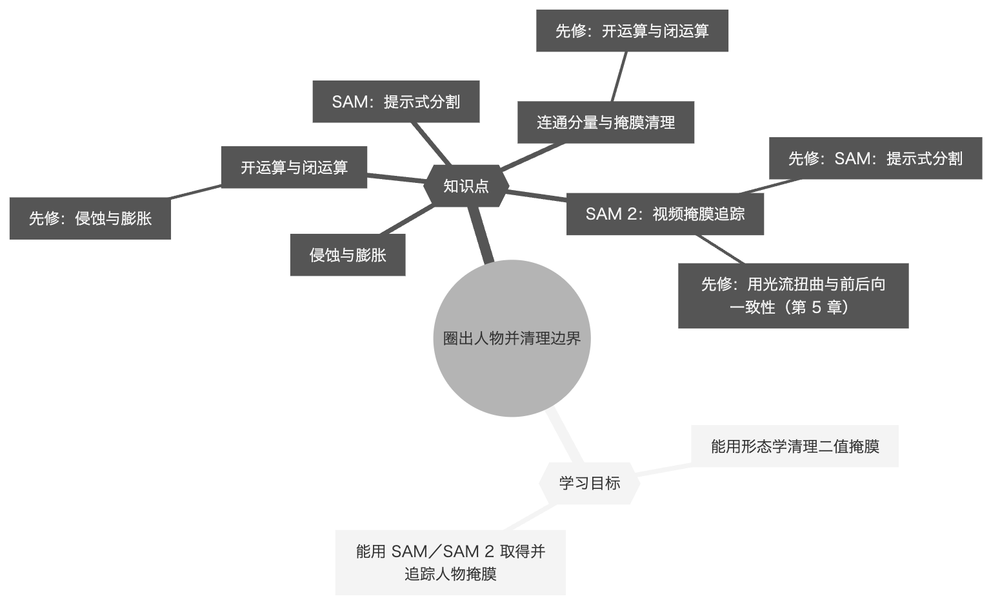
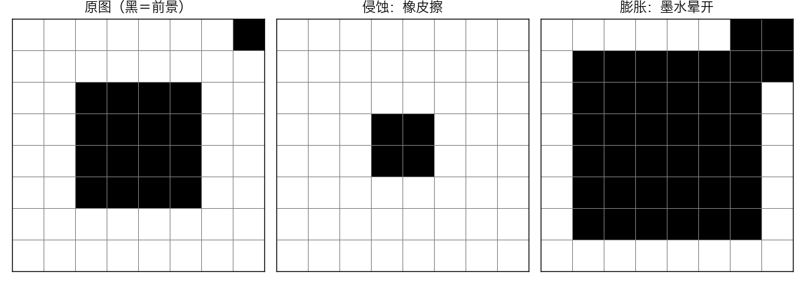
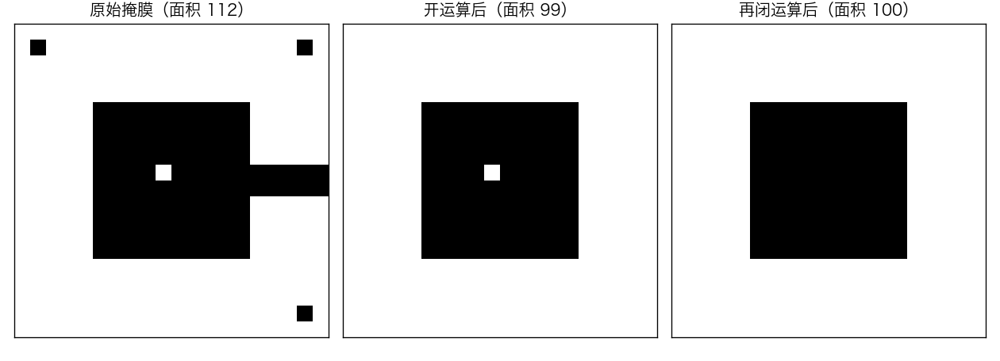
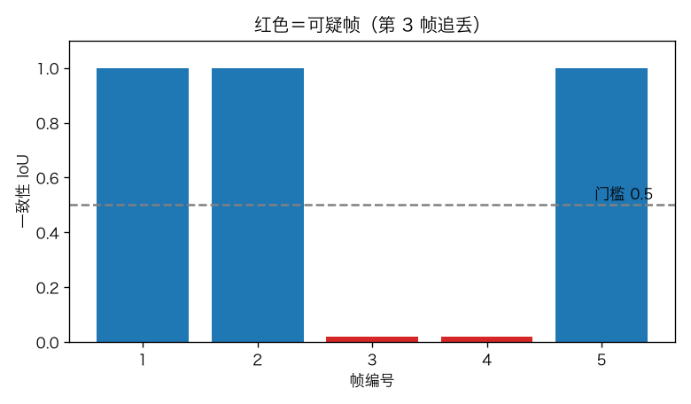

<a id="ch-mask-morphology-sam"></a>

以形态学清理二值掩膜，再用 SAM 取得人物掩膜，并以 SAM 2 在视频中追踪。

<a id="fig-mindmap-ch-mask-morphology-sam"></a>



<details><summary>文字说明</summary>思维导图：中心为「圈出人物并清理边界」，分支为 学习目标（能用形态学清理二值掩膜、能用 SAM／SAM 2 取得并追踪人物掩膜）；知识点（侵蚀与膨胀、开运算与闭运算、连通分量与掩膜清理、SAM：提示式分割、SAM 2：视频掩膜追踪）。</details>

*图 7-1：圈出人物并清理边界：本章 5 个知识点、学习目标与各知识点的直接先修（由先修图自动生成）。*

> 本章导图见 [图 7-1](#fig-mindmap-ch-mask-morphology-sam)。本章假设已会：用光流扭曲与前后向一致性（`flow-warp-consistency`）。

<a id="ch-mask-morphology-sam--mask-basics"></a>

## 1. 掩膜是一张只有 0 和 1 的阵列

想像你把一张透明描图纸盖在照片上，人所在的地方涂黑，其他地方留白。把这张描图纸存成 numpy 阵列，就是「二值掩膜」。它的形状和图像一样，每格只有 0 或 1，1 代表「这个像素属于人」。人与背景的交界是一刀切的，没有渐层。[^c-mask-binary]

分割程式产生的掩膜很少一次就干净。背景里会冒出几粒孤立的 1（杂点），人身上会出现几个本该是 1 的小洞。杂讯可能出现在背景或物件上，形状可能是点状，也可能是一片一片的。这些杂点和小洞会让后续的分类与描述效率变差，所以要先清理掩膜。[^c-mask-noise]

<a id="ch-mask-morphology-sam--erosion-dilation"></a>

## 2. 缩小与扩大：侵蚀与膨胀

先看一个 8×8 的黑白方格（[图 7-2](#fig-fig-erode-dilate) 最左边）。中间有一块 4×4 的实心方块，右上角另有一粒孤立的像素。拿「橡皮擦」来擦：每个值为 1 的像素，只要它周围 3×3 范围内有任何一格是 0，就被擦成 0。擦完之后，4×4 的方块只剩正中间的 2×2，右上角那一粒因为周围都是 0，整个消失。这个动作叫「侵蚀」。[^c-erode-toy]

反过来是「墨水晕开」：每个值为 0 的像素，只要它周围 3×3 范围内有任何一格是 1，就被染成 1。同一张图晕开后，4×4 的方块长成 6×6。右上角那一粒变成一小块，被图的边界截掉一部分后与大方块连在一起。这个动作叫「膨胀」。[^c-dilate-toy]

<a id="fig-fig-erode-dilate"></a>



*图 7-2：左：原图有一个 4×4 方块与一粒孤立像素。中：3×3 侵蚀后方块剩 2×2、孤立像素消失。右：3×3 膨胀后方块变 6×6、孤立像素变成小块并与大块相连。*

上面反复出现的「周围 3×3」其实可以换成别的形状，这个小模板就叫「结构元素」。它是一个小小的 0/1 图案，用来决定每个像素要看哪些邻居。侵蚀规定模板盖到的格子必须全是 1 才保留。膨胀规定模板盖到任何一个 1 就设为 1。结构元素的形状与大小，决定了这次运算的用途与效果。[^c-struct-elem]

侵蚀和膨胀是一对镜像：侵蚀前景，等于对背景做膨胀，只是结构元素要左右上下翻转（3×3 方形翻转后不变）。所以只要想通膨胀，侵蚀就是「背景在膨胀」。[^c-erode-dual]

结构元素大小的影响很直接。边长 2r+1 的方形结构元素，会让实心方块每一边各缩进 r 像素（侵蚀）或各长出 r 像素（膨胀）。例如 10×10 的方块用 5×5 结构元素侵蚀，只剩 6×6。比这个结构元素还小的杂点会整个消失。[^c-size-effect]

<a id="ch-mask-morphology-sam--opening-closing"></a>

## 3. 去杂点与补小洞：开运算与闭运算

单独侵蚀会把整个人瘦一圈，单独膨胀会胖一圈，通常不是我们要的。把两者接起来，就能让杂点消失而身形不变。「开运算」是先侵蚀再膨胀：先擦一遍，杂点被擦光，之后再晕开也晕不回来。大块的主体只是缩了一圈，晕开后恢复原状。[^c-opening]

<a id="fig-fig-opening-closing"></a>



*图 7-3：左：原始掩膜有三粒杂点、一个单像素洞与一条 2 像素宽的细臂（面积 112，共 4 块）。中：3×3 开运算后杂点与细臂消失，洞还在（面积 99）。右：再做 3×3 闭运算，洞被补上（面积 100）。*

顺序反过来是「闭运算」，先膨胀再侵蚀：先晕开，小洞被墨水盖住，再缩回来，洞就不会重新出现。闭运算本来就是用来复原并平滑受损结构的工具。[^c-closing-cited]

[图 7-3](#fig-fig-opening-closing) 的人形掩膜有一个单像素的洞。先开运算后面积是 99，再闭运算后面积变成 100，刚好补回那一格洞。[^c-close-toy]

结构元素的大小是一个取舍。太小就清不掉较大的杂块，太大就会连真正的细节一起吃掉。[图 7-3](#fig-fig-opening-closing) 的人形右侧有一条 2 像素宽的「手臂」。3×3 的开运算就把它整条吃掉，因为 3×3 的方块放不进 2 像素宽的细条。若换成 11×11 的结构元素，连 10×10 的身体都会全部消失。细手指、细肢在掩膜里也一样容易被误删，所以核的大小要小于你想保留的最细部位。[^c-opening-eats]

文献也指出，开闭运算若全程用同一种大小的结构元素，不能把正负杂讯都除干净。改用不同大小的结构元素组合，才能在去杂讯的同时保留细节。实务上可以先用小核处理，真有必要再逐步放大。[^c-diff-size]

闭运算还有一个副作用：它会把靠得很近的东西黏在一起。有研究举例，用标准闭运算处理指纹图像时，会把指纹纹路和靠近边缘的结构杂讯连在一起，造成错误的分割。人物掩膜旁若有靠近的杂物碎片，也要小心被闭运算接上。[^c-closing-merge]

<a id="ch-mask-morphology-sam--component-cleanup"></a>

## 4. 数有几块：连通分量与面积门槛

形态学只能按「大小」一视同仁地处理，要精准地说「小于某面积的碎片都丢掉」，就需要先数清楚掩膜里有几块。「连通分量」就是把彼此相连的 1 归成一块。在 [图 7-3](#fig-fig-opening-closing) 最左边那张图里，人形主体、三粒杂点各自成一块，共 4 块。这里「相连」采 8 连通，也就是斜对角相邻的像素也算相连。[^c-components]

数完之后，替每一块算面积（含几个像素），再设一个面积门槛，只留下面积不小于门槛的块。例如门槛设 20，面积为 1 的三粒杂点就被丢掉。它和开运算的差别在于：被留下的主体完全不被改动，包括那条 2 像素宽的手臂，所以手臂仍在，面积为 109。[^c-area-filter]

填洞用同一招，只是对象换成背景。先把掩膜反相，使背景变成 1。背景里最大的一块是真正的外面，其余面积很小的背景块，就是被人身体包住的洞。把这些小块填成 1 即可。范例中这个洞只有 1 格，填完后面积变成 110，连通块剩 1。[^c-fill-holes]

面积门槛要比杂点最大面积大，又要比你想保留的最小真实部位（例如一只手）的面积小。实务上一个稳妥的顺序是：先用面积过滤和填洞去掉碎片与洞，再用 3×3 这种小核的开、闭运算磨平边界。这样大块的清理交给面积门槛，形态学只负责微调，细肢被吃掉的风险较小。范例 {{example:ex-morph-cleanup}} 把这几种做法的结果并排印出。[^c-pipeline]

### 范例：`morph_cleanup.py`

建立一张含小洞、细臂与三粒杂点的 20×20 人形掩膜，分别用开闭运算、面积过滤加填洞清理，并示范大结构元素把身体吃光，印证面积门槛与小核开闭的搭配原则。[^c-pipeline]

档案：[`morph_cleanup.py`](/optical-flow-sam/examples/ch-mask-morphology-sam/morph_cleanup.py)（执行：`python morph_cleanup.py`）

```python
import numpy as np
import cv2


def build_mask():
    m = np.zeros((20, 20), np.uint8)
    m[5:15, 5:15] = 1      # 身体 10x10
    m[9, 9] = 0            # 单像素小洞
    m[9:11, 15:20] = 1     # 2 像素宽的细臂
    for r, c in [(1, 1), (1, 18), (18, 18)]:
        m[r, c] = 1        # 三粒杂点
    return m


def count(m):
    n, _ = cv2.connectedComponents(m, connectivity=8)
    return n - 1


def area_filter(m, min_area, connectivity=8):
    n, lab, stats, _ = cv2.connectedComponentsWithStats(m, connectivity=connectivity)
    out = np.zeros_like(m)
    for i in range(1, n):
        if stats[i, cv2.CC_STAT_AREA] >= min_area:
            out[lab == i] = 1
    return out


def fill_holes(m, max_hole):
    inv = (1 - m).astype(np.uint8)
    inv_keep = area_filter(inv, max_hole + 1, connectivity=4)
    return (1 - inv_keep).astype(np.uint8)


m = build_mask()
k3 = np.ones((3, 3), np.uint8)
print(f'原始：面积={int(m.sum())}，连通块={count(m)}')

opened = cv2.morphologyEx(m, cv2.MORPH_OPEN, k3)
print(f'3×3 开运算后面积={int(opened.sum())}')
closed = cv2.morphologyEx(opened, cv2.MORPH_CLOSE, k3)
print(f'清理后：面积={int(closed.sum())}，连通块={count(closed)}')

filtered = area_filter(m, 20)
print(f'面积过滤后：面积={int(filtered.sum())}')
filled = fill_holes(filtered, 5)
print(f'面积过滤＋填洞：面积={int(filled.sum())}，连通块={count(filled)}')

k11 = np.ones((11, 11), np.uint8)
big = cv2.morphologyEx(m, cv2.MORPH_OPEN, k11)
print(f'11×11 开运算后面积={int(big.sum())}')

blk = np.zeros((20, 20), np.uint8)
blk[5:15, 5:15] = 1
k5 = np.ones((5, 5), np.uint8)
print(f'5×5 侵蚀后面积={int(cv2.erode(blk, k5).sum())}')
print(f'5×5 膨胀后面积={int(cv2.dilate(blk, k5).sum())}')
```

预期输出（节录）：

```text
清理后：面积=100，连通块=1
```

<a id="ch-mask-morphology-sam--sam-prompt"></a>

## 5. 用点或框提示 SAM 得到掩膜

前面的掩膜是假设已经有了，现在来看掩膜怎么来。SAM（Segment Anything Model）是一个预训练好的分割模型。你给它一张图，再加上「提示」，也就是在人身上点一个点，或画一个框，它就回传那个物体的掩膜。它的特点是「零样本」：不必针对你的视频再训练就能用，并且接受点、框这类几何形状的提示。[^c-sam-prompt]

用白话看，SAM 分成三块。图像编码器是最重的一块，把整张图读一遍做成内部笔记。提示编码器把你点的点或框翻成模型看得懂的信号。掩膜解码器把笔记和提示合起来画出掩膜。其中提示编码器与掩膜解码器是轻量的，图像编码器才是重的。这也是为什么同一张图可以只换提示反复取掩膜。[^c-sam-arch]

SAM 并非完美。有研究指出，虽然它用了数量极大的掩膜训练，遇到结构复杂的物体（例如头发、细肢）时掩膜质量仍不理想。这就是人物掩膜还需要形态学、连通分量清理的原因。[^c-sam-limit]

一个提示可能对应好几种合理的圈法：只圈脸、圈整个人、连背景一起圈。若工具给你多张候选掩膜与分数，不要只看分数，要用规则挑。一个简单做法是：先要求候选必须包含你点的人身上的点，再排除面积占整张图比例过大的，最后在剩下的里面选分数最高的。范例 {{example:ex-pick-candidate}} 有四张候选：只含脸的 A、整个人的 B、整张图的 C、人加旁边的人的 E。在没有负点时，这个规则会选到分数最高的 E，也就是连旁人都圈进去的那张。[^c-pick-candidate]

若旁边还有别人，或衣服和背景颜色相近，掩膜常会多圈进去一块。处理方式是补一个「负点」，点在多圈进去的地方，表示「这里不是我要的」，并排除包含负点的候选。范例中加了负点后，原本分数最高、却圈到旁人的候选 E 被排除，改选到只含目标人物的 B。[^c-negpoint]

挑到候选后，不要直接拿去用，先接上前一节的清理流程：面积过滤去碎片、填洞、小核开闭磨边界。清理后再用 IoU（交集面积除以联集面积，下一节细讲）或肉眼比对边界，确认贴合度没有变差。[^c-sam-clean]

### 范例：`pick_candidate.py`

用合成的四张候选掩膜示范挑选规则：含正点、面积上限、分数最高，再加入负点排除圈到旁人的候选。[^c-negpoint]

档案：[`pick_candidate.py`](/optical-flow-sam/examples/ch-mask-morphology-sam/pick_candidate.py)（执行：`python pick_candidate.py`）

```python
import numpy as np

H = W = 20


def box(r0, r1, c0, c1):
    m = np.zeros((H, W), bool)
    m[r0:r1, c0:c1] = True
    return m


cands = {
    'A': (box(2, 6, 8, 12), 0.90),     # 只有脸
    'B': (box(2, 18, 6, 14), 0.88),    # 整个人
    'C': (np.ones((H, W), bool), 0.70),  # 整张图
    'E': (box(2, 18, 6, 17), 0.92),    # 人加旁边的人
}


def select(cands, pos, neg, max_frac=0.5):
    best, best_score = None, -1.0
    for name, (m, s) in cands.items():
        if not all(m[r, c] for r, c in pos):
            continue
        if any(m[r, c] for r, c in neg):
            continue
        if m.sum() / m.size > max_frac:
            continue
        if s > best_score:
            best, best_score = name, s
    return best


pos = [(10, 9)]
print('无负点：' + select(cands, pos, []))
print('加负点：' + select(cands, pos, [(10, 15)]))
```

预期输出（节录）：

```text
加负点：B
```

<a id="ch-mask-morphology-sam--sam2-video"></a>

## 6. SAM 2：把提示传到整段视频

视频有上百帧，每一帧都点一次太累。SAM 2 做的是在第一帧给提示，再逐帧往后传播，每帧得到一张掩膜。本书的证据库没有收录 SAM 2 的论文，所以这里不谈它内部怎么记住前面的帧。我们把它当成黑盒：输入是首帧提示，输出是每帧一张掩膜。下面的检查只依赖这个输入输出，换任何追踪器都能用。[^c-track-blackbox]

先看一个失败例子。假设追踪器一路追一个每帧往右走 2 像素的方块人，到第 3 帧突然输出全空的掩膜（人被挡住或追丢），第 4 帧又在正确位置冒出来。[图 7-4](#fig-fig-track-iou) 画出这段逐帧结果的检查分数：第 3、4 帧掉到 0，其余为 1。只看第 4 帧的掩膜单独是好的，因此要看相邻两帧的关系才找得到问题。[^c-track-failure]

<a id="fig-fig-track-iou"></a>



*图 7-4：每根长条是『上一帧掩膜推到这一帧』与『这一帧掩膜』的 IoU。第 3 帧追丢（掩膜全空）、第 4 帧因上一帧有误而连带偏低，两者都低于 0.5 的门槛线，应从第 3 帧补提示。*

怎么自动找出可疑的帧？沿用前面章节的光流扭曲与前后向一致性：用光流把上一帧的掩膜推到这一帧的位置，与这一帧的掩膜比较。比较用 IoU，也就是两张掩膜重叠的面积除以两者合起来的面积，1 表示完全重合，0 表示毫无重叠。范例 {{example:ex-track-check}} 用已知的平移 2 像素代替光流，若 IoU 低于 0.5 就标为可疑。结果第 3、4 帧被标出，第一个可疑帧是第 3 帧。真正出错的是第一个，第 4 帧只是因为上一帧错了才连带被标。[^c-flow-check]

补提示的方式：回到第一个可疑帧，若掩膜漏了人，就在人身上补一个正点。若多圈了旁人，就在多圈的地方补一个负点。补完后从该帧重新往后传播，再跑一次一致性检查。范例中把第 3 帧换成正确掩膜，模拟补提示后，可疑帧清单变成空的。这只是流程逻辑的模拟，不代表真实追踪器一定一次修好，通常要多检查几次。[^c-reprompt]

最后和光流追踪对照。只靠光流传递掩膜，每一步的小误差会累积。范例中光流每帧少估 1 像素，传 5 帧后掩膜已偏离 5 像素，IoU 只剩约 0.33，而且光流不知道「人」是什么，不会自己修正。SAM 2 这类提示式追踪器能在你补提示的帧上重新圈出人，但仍会在遮挡与人物交错处失手。因此实务上是两者搭配：用追踪器产生掩膜，用光流一致性当质量检查，出事的帧再补提示。[^c-flow-vs-sam]

### 范例：`track_check.py`

以合成的移动方块模拟追踪失败，用平移推掩膜加 IoU 找出可疑帧，模拟补提示，并示范只靠光流传递时误差累积。[^c-flow-check]

档案：[`track_check.py`](/optical-flow-sam/examples/ch-mask-morphology-sam/track_check.py)（执行：`python track_check.py`）

```python
import numpy as np

H = W = 40


def sq(t):
    m = np.zeros((H, W), np.uint8)
    c = 5 + 2 * t
    m[15:25, c:c + 10] = 1
    return m


def iou(a, b):
    i = np.logical_and(a, b).sum()
    u = np.logical_or(a, b).sum()
    return 1.0 if u == 0 else i / u


def warp(m, dx):
    return np.roll(m, dx, axis=1)


def check(masks, dx=2, thr=0.5):
    scores = [iou(warp(masks[t - 1], dx), masks[t]) for t in range(1, len(masks))]
    flagged = [t for t, s in enumerate(scores, 1) if s < thr]
    return scores, flagged


truth = [sq(t) for t in range(6)]
pred = [m.copy() for m in truth]
pred[3] = np.zeros((H, W), np.uint8)

scores, flagged = check(pred)
print('相邻帧 IoU：' + ', '.join(f'{s:.2f}' for s in scores))
print(f'可疑帧：{flagged}')
print(f'第一个可疑帧：{flagged[0]}')

pred[3] = truth[3].copy()
_, flagged2 = check(pred)
print(f'补提示后可疑帧：{flagged2}')

m = truth[0]
for _ in range(5):
    m = warp(m, 1)
print(f'光流单独传播 5 帧后 IoU={iou(m, truth[5]):.2f}')
```

预期输出（节录）：

```text
第一个可疑帧：3
```

<a id="ch-mask-morphology-sam--practice"></a>

## 7. 练习

请用下列题目检查自己是否能独立操作。

**练习 1**（`ex-q-sizes`）：有一张人物掩膜，手指宽约 4 像素，背景杂点最大约 3×3。你要选开运算的方形结构元素边长，你会选多少？若改用面积过滤，门槛要怎么定？

<details><summary>解答</summary>

开运算的结构元素边长要小于手指宽度 4，例如 3×3 能保住手指；但 3×3 的杂点刚好放得进 3×3 核，不会被开运算清掉，所以杂点要靠面积过滤。面积过滤的门槛要大于杂点最大面积 9，又小于手指等真实部位的面积，例如 20。若手指与手相连，它属于同一个连通分量，面积过滤不会动到它。

</details>

**练习 2**（`ex-q-pipeline`）：请拿 ex-morph-cleanup 的 build_mask，把细臂改成 4 像素宽，重跑开运算（3×3）与面积过滤，两者对细臂的结果各是什么？再把杂点改成 5×5 的小块，门槛 20 还够用吗？

<details><summary>解答</summary>

4 像素宽的细臂能放进 3×3，所以 3×3 开运算会保留它；面积过滤本来就保留它。把杂点改成 5×5（面积 25）后，门槛 20 挡不住，需要把门槛提高到大于 25，并确认仍小于要保留的真实部位面积。这说明门槛要依杂点最大面积调整。

</details>

**练习 3**（`ex-q-track`）：你用 SAM 2 追踪一段视频，一致性检查标出第 40、41 帧可疑。你要在哪一帧补提示？补什么提示？若第 40 帧的掩膜多圈进了后面经过的路人，又该补什么？

<details><summary>解答</summary>

从第一个可疑帧（第 40 帧）补提示，因为第 41 帧可能只是被上一帧连带影响。若掩膜漏了人，在人身上补正点。若多圈了路人，在路人身上补负点，补完后从该帧重新传播，再跑一次一致性检查确认。

</details>

<a id="ch-mask-morphology-sam--references"></a>

## 章末引用

### 主张与证据

[^c-mask-binary]: 二值分割掩膜可以看成一个边界陡峭（非 0 即 1）的二维窗函数：区域内为 1、区域外为 0。 —— 证据：[hdlndimproved〔未核实〕](<http://hdl.handle.net/11025/11927>)（`ev-4946f328f00e`）
[^c-mask-noise]: 图像中的杂讯会使分割结果出现许多不要的小洞；杂讯可出现在背景与物件上，呈点状或片状，因此需要清理。 —— 证据：[doindsegmentation〔未核实〕](<https://doi.org/10.1109/igarss.2000.861650>)（`ev-26d2fec6c417`）；[doindreduce〔未核实〕](<https://doi.org/10.1109/icts.2016.7910287>)（`ev-191f569ae186`）
[^c-erode-toy]: 侵蚀是以结构元素扫过二值图像、只保留整个模板都落在前景内的像素；对 8×8 图中的 4×4 实心块与一粒孤立像素做 3×3 侵蚀，4×4 块剩中间 2×2（面积 4），孤立像素消失。 —— 证据：[doindopticald〔未核实〕](<https://doi.org/10.1364/ol.15.000697>)（`ev-d4e66c47e911`）；[doindrecursive〔未核实〕](<https://doi.org/10.1109/83.841511>)（`ev-a52df07b597a`）
[^c-dilate-toy]: 膨胀是模板盖到任一前景像素就设为前景；对同一张 8×8 图做 3×3 膨胀，4×4 块变成 6×6，孤立像素变成被图边界截断的小块并与大块相连，总面积 39。 —— 证据：[doindopticald〔未核实〕](<https://doi.org/10.1364/ol.15.000697>)（`ev-d4e66c47e911`）；[doindrecursive〔未核实〕](<https://doi.org/10.1109/83.841511>)（`ev-a52df07b597a`）
[^c-struct-elem]: 结构元素是具有特定形状、用来量测并侦测图像中对应形状的小模板；形态学运算的用途与表现取决于结构元素的选择。 —— 证据：[doindimprovedb〔未核实〕](<https://doi.org/10.1109/cisp.2009.5303727>)（`ev-b82262a24928`）
[^c-erode-dual]: 二值图像的侵蚀等同于对背景以镜射后的结构元素做膨胀。 —— 证据：[doindrecursive〔未核实〕](<https://doi.org/10.1109/83.841511>)（`ev-a52df07b597a`）
[^c-size-effect]: 边长 2r+1 的方形结构元素使实心方块每边缩进（侵蚀）或长出（膨胀）r 像素；10×10 方块以 5×5 侵蚀剩 6×6（面积 36），以 5×5 膨胀成 14×14（面积 196）。 —— 证据：[doindimprovedb〔未核实〕](<https://doi.org/10.1109/cisp.2009.5303727>)（`ev-b82262a24928`）；[doindopticald〔未核实〕](<https://doi.org/10.1364/ol.15.000697>)（`ev-d4e66c47e911`）
[^c-opening]: 开运算是先侵蚀再膨胀：小于结构元素的杂点在侵蚀时消失而不会被膨胀救回，大块主体则恢复原状，用来去除杂讯。 —— 证据：[doindfilter〔未核实〕](<https://doi.org/10.1109/snpd.2007.443>)（`ev-4664e8e6471c`）
[^c-closing-cited]: 形态学闭运算是复原并平滑受损结构的有力工具。 —— 证据：[doindadaptive〔未核实〕](<https://doi.org/10.1109/isivc.2016.7893996>)（`ev-9cebb959a10b`）
[^c-close-toy]: 范例人形掩膜经 3×3 开运算后面积为 99，再经 3×3 闭运算后面积为 100，单像素洞被补上。 —— 证据：[doindadaptive〔未核实〕](<https://doi.org/10.1109/isivc.2016.7893996>)（`ev-9cebb959a10b`）
[^c-opening-eats]: 3×3 开运算会移除 2 像素宽的细臂，11×11 开运算会把 10×10 的身体整个移除（面积 0）；结构元素放不进去的部位都会被吃掉。 —— 证据：[doindimprovedb〔未核实〕](<https://doi.org/10.1109/cisp.2009.5303727>)（`ev-b82262a24928`）；[doindfilter〔未核实〕](<https://doi.org/10.1109/snpd.2007.443>)（`ev-b1c131f15ff6`）
[^c-diff-size]: 以相同大小结构元素做的开闭（或闭开）滤波无法有效去除所有正、负脉冲杂讯；改用不同大小结构元素的广义滤波，能在去杂讯的同时充分保留图像细节。 —— 证据：[doindfilter〔未核实〕](<https://doi.org/10.1109/snpd.2007.443>)（`ev-4664e8e6471c`）；[doindfilter〔未核实〕](<https://doi.org/10.1109/snpd.2007.443>)（`ev-b1c131f15ff6`）
[^c-closing-merge]: 标准闭运算可能把靠近的结构杂讯与目标纹理连在一起，造成错误的分割结果。 —— 证据：[doindfiltera〔未核实〕](<https://doi.org/10.1371/journal.pone.0154160.g009>)（`ev-e10ebe0880bf`）
[^c-components]: 连通分量是彼此相连的前景像素群；以 8 连通计算，范例掩膜含 1 块主体与 3 粒杂点，共 4 个连通分量。 —— 证据：[doindreduce〔未核实〕](<https://doi.org/10.1109/icts.2016.7910287>)（`ev-191f569ae186`）
[^c-area-filter]: 以面积门槛 20 过滤连通分量，三粒单像素杂点被移除，主体（含细臂）保持不变，面积为 109。 —— 证据：[doindreduce〔未核实〕](<https://doi.org/10.1109/icts.2016.7910287>)（`ev-191f569ae186`）；[doindsegmentation〔未核实〕](<https://doi.org/10.1109/igarss.2000.861650>)（`ev-26d2fec6c417`）
[^c-fill-holes]: 将掩膜反相后，面积小于门槛的背景连通分量即为洞；填上后范例面积变 110、连通块为 1。 —— 证据：[doindsegmentation〔未核实〕](<https://doi.org/10.1109/igarss.2000.861650>)（`ev-26d2fec6c417`）
[^c-pipeline]: 面积门槛须大于杂点最大面积、小于要保留的最小真实部位面积；先用面积过滤与填洞处理碎片与洞，再用小核开闭磨边界，可降低细肢被吃掉、细节消失的风险。 —— 证据：[doindfilter〔未核实〕](<https://doi.org/10.1109/snpd.2007.443>)（`ev-b1c131f15ff6`）；[doindfilter〔未核实〕](<https://doi.org/10.1109/snpd.2007.443>)（`ev-4664e8e6471c`）
[^c-sam-prompt]: SAM 在一般图像分割上具有零样本能力，并支援弹性的几何提示（如点与框）。 —— 证据：[arxivndcat〔未核实〕](<https://arxiv.org/abs/2402.03631>)（`ev-cf1999a818bf`）
[^c-sam-arch]: SAM 由沉重的图像编码器，加上轻量的提示编码器与掩膜解码器组成。 —— 证据：[doindefficientvit〔未核实〕](<https://doi.org/10.1109/cvprw63382.2024.00782>)（`ev-916a64630be8`）；[doindfine〔未核实〕](<https://doi.org/10.1109/aimla67915.2026.11522461>)（`ev-878cdad61e90`）
[^c-sam-limit]: SAM 虽以大量掩膜训练，但在结构复杂的物体上，掩膜预测质量在许多情况下仍有不足。 —— 证据：[arxivndsegment〔未核实〕](<https://arxiv.org/abs/2306.01567>)（`ev-a45b78bf5c82`）
[^c-pick-candidate]: 挑候选掩膜的规则：必须包含正点、面积比例不超过 50%、其中取分数最高者；范例四张候选中，无负点时此规则选出分数最高的 E（人加旁人）。 —— 证据：[arxivndcat〔未核实〕](<https://arxiv.org/abs/2402.03631>)（`ev-cf1999a818bf`）
[^c-negpoint]: 加入负点并排除包含负点的候选后，原本因分数最高而被选中、但圈到旁人的候选 E 被排除，改选到只含目标人物的候选 B。 —— 证据：[arxivndcat〔未核实〕](<https://arxiv.org/abs/2402.03631>)（`ev-cf1999a818bf`）
[^c-sam-clean]: SAM 掩膜在复杂结构处质量有限，可接上面积过滤、填洞与小核开闭清理，并以 IoU（交集面积除以联集面积）检查清理后的贴合度。 —— 证据：[arxivndsegment〔未核实〕](<https://arxiv.org/abs/2306.01567>)（`ev-a45b78bf5c82`）
[^c-track-blackbox]: 检查追踪结果只需要『首帧提示输入、每帧一张掩膜输出』这个介面，与追踪器内部机制无关；提示式分割本身支援点、框等几何提示。 —— 证据：[arxivndcat〔未核实〕](<https://arxiv.org/abs/2402.03631>)（`ev-cf1999a818bf`）
[^c-track-failure]: 在每帧右移 2 像素的方块序列中，追踪器于第 3 帧输出空掩膜、第 4 帧恢复；相邻帧一致性 IoU 依序为 1、1、0、0、1，只看单帧掩膜看不出第 4 帧的异常。 —— 证据：[arxivndcat〔未核实〕](<https://arxiv.org/abs/2402.03631>)（`ev-cf1999a818bf`）
[^c-flow-check]: 以光流（范例中以已知平移 2 像素代替）把上一帧掩膜推到本帧后与本帧掩膜算 IoU，低于 0.5 即标为可疑；范例标出第 3、4 帧，第一个可疑帧是第 3 帧。 —— 证据：[arxivndcat〔未核实〕](<https://arxiv.org/abs/2402.03631>)（`ev-cf1999a818bf`）
[^c-reprompt]: 在第一个可疑帧补上正确掩膜（模拟补点提示）后重新检查，可疑帧清单为空；点、框等几何提示是 SAM 类模型的互动方式。 —— 证据：[arxivndcat〔未核实〕](<https://arxiv.org/abs/2402.03631>)（`ev-cf1999a818bf`）
[^c-flow-vs-sam]: 光流每帧少估 1 像素时，只靠光流传递掩膜 5 帧后偏离 5 像素，对真值的 IoU 约 0.33；误差会逐帧累积。 —— 证据：[arxivndcat〔未核实〕](<https://arxiv.org/abs/2402.03631>)（`ev-cf1999a818bf`）

### 参考文献

#### 已核实引用

（无）

#### 未核实来源（仅供查找，不得当作已验证引用）

- 〔未核实〕[arxivndcat] (n.d.). *CAT-SAM: Conditional Tuning for Few-Shot Adaptation of Segment Anything Model*. <https://arxiv.org/abs/2402.03631> 授权：unknown；可靠度：高
- 〔未核实〕[arxivndsegment] (n.d.). *Segment Anything in High Quality*. <https://arxiv.org/abs/2306.01567> 授权：unknown；可靠度：高
- 〔未核实〕[doindadaptive] (n.d.). *Adaptive morphological closing based on inertia tensor for structuring element estimation*. <https://doi.org/10.1109/isivc.2016.7893996> 授权：unknown；可靠度：高
- 〔未核实〕[doindefficientvit] (n.d.). *EfficientViT-SAM: Accelerated Segment Anything Model Without Performance Loss*. <https://doi.org/10.1109/cvprw63382.2024.00782> 授权：unknown；可靠度：高
- 〔未核实〕[doindfilter] (n.d.). *Filter Design Based on the Theory of the Generalized Morphological Filter with Omnidirectional…*. <https://doi.org/10.1109/snpd.2007.443> 授权：unknown；可靠度：高
- 〔未核实〕[doindfiltera] (n.d.). *Filter Design and Performance Evaluation for Fingerprint Image Segmentation*. <https://doi.org/10.1371/journal.pone.0154160.g009> 授权：unknown；可靠度：高
- 〔未核实〕[doindfine] (n.d.). *Fine-Tune Segment Anything Model (SAM) on Custom Data*. <https://doi.org/10.1109/aimla67915.2026.11522461> 授权：unknown；可靠度：高
- 〔未核实〕[doindimprovedb] (n.d.). *Improved Morphological TOP-HAT Filter Optimized with Genetic Algorithm*. <https://doi.org/10.1109/cisp.2009.5303727> 授权：unknown；可靠度：高
- 〔未核实〕[doindopticald] (n.d.). *Optical asymmetrical median filtering using gray-scale convolution kernels*. <https://doi.org/10.1364/ol.15.000697> 授权：unknown；可靠度：高
- 〔未核实〕[doindrecursive] (n.d.). *Recursive binary dilation and erosion using digital line structuring elements in arbitrary…*. <https://doi.org/10.1109/83.841511> 授权：unknown；可靠度：高
- 〔未核实〕[doindreduce] (n.d.). *Reduce noise in the binary image using non linear spatial filtering of mode*. <https://doi.org/10.1109/icts.2016.7910287> 授权：unknown；可靠度：高
- 〔未核实〕[doindsegmentation] (n.d.). *Segmentation on edge preserving smoothing image based on graph theory*. <https://doi.org/10.1109/igarss.2000.861650> 授权：unknown；可靠度：高
- 〔未核实〕[hdlndimproved] (n.d.). *Improved Estimation of Tissue Noise Power Spectra in CT Data*. <http://hdl.handle.net/11025/11927> 授权：unknown；可靠度：不明
