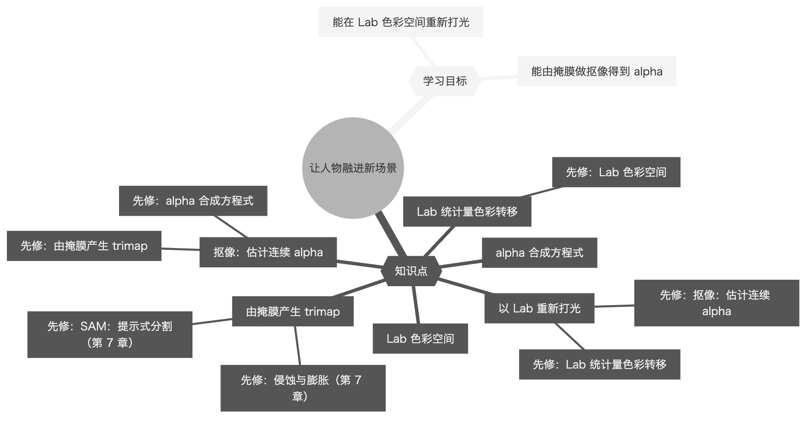
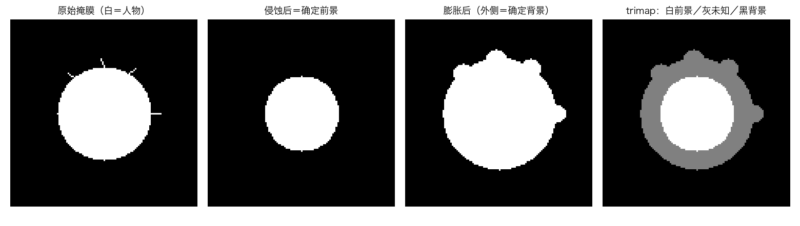

<a id="ch-matting-relight"></a>

由掩膜得到连续 alpha，再在 Lab 空间调整前景的光线与色调。

<a id="fig-mindmap-ch-matting-relight"></a>



<details><summary>文字说明</summary>思维导图：中心为「让人物融进新场景」，分支为 学习目标（能由掩膜做抠像得到 alpha、能在 Lab 色彩空间重新打光）；知识点（alpha 合成方程式、由掩膜产生 trimap、抠像：估计连续 alpha、Lab 色彩空间、Lab 统计量色彩转移、以 Lab 重新打光）。</details>

*图 8-1：让人物融进新场景：本章 6 个知识点、学习目标与各知识点的直接先修（由先修图自动生成）。*

> 本章导图见 [图 8-1](#fig-mindmap-ch-matting-relight)。本章假设已会：侵蚀与膨胀（`erosion-dilation`）、SAM：提示式分割（`sam-promptable-segmentation`）。

<a id="ch-matting-relight--alpha-pixel"></a>

## 1. 半透明叠图：从一个像素算起

想像把一张半透明的彩色玻璃纸盖在一张风景照上，然后只看其中一个像素。玻璃纸（前景）在这个像素的颜色是 F = (200, 100, 50)，底下照片（背景）的颜色是 B = (20, 40, 180)，三个数字依序是红、绿、蓝，范围 0 到 255。玻璃纸只挡住 30%，也就是不透明度 α = 0.3，所以眼睛看到的是 30% 的玻璃纸加上 70% 的背景。红色是 0.3×200 + 0.7×20 = 74，绿色是 0.3×100 + 0.7×40 = 58，蓝色是 0.3×50 + 0.7×180 = 141，这个像素最后的颜色是 (74, 58, 141)。[^m8-alpha-pixel-example]

把这个算法对每个通道、每个像素都写成一条公式，就是合成方程式 `I = αF + (1−α)B`。I 是看到的最终颜色，F 是前景本身的颜色，B 是背景颜色，α 是前景的不透明度，范围 0 到 1。α = 1 表示完全看到前景，α = 0 表示完全看到背景，中间的值就是半透明。把所有像素的 α 排成一张灰阶图，这张图叫 alpha 通道，或 alpha matte。[^m8-alpha-equation]

用剪纸来想：二值掩膜就像用剪刀沿着轮廓剪下人物，边上只有「有纸」或「没纸」两种状态。头发丝却细得比一个像素还细，边界像素里同时有发丝和背景。以上面的例子来说，这个像素的真实 α 是 0.3，红色应该是 74。硬边只能选 α = 1，红色变成 200，或选 α = 0，红色变成 20，两种都和真实值差很远。贴到新背景上，边缘就会出现锯齿和生硬的轮廓。[^m8-alpha-hardedge]

### 范例：`alpha_pixel.py`

单一像素的 alpha 合成，以及硬边与真实 α 的差距，并示范 RGB 乘 1.3 后被截断的色偏。[^m8-alpha-pixel-example]

档案：[`alpha_pixel.py`](/optical-flow-sam/examples/ch-matting-relight/alpha_pixel.py)（执行：`python alpha_pixel.py`）

```python
import numpy as np

F = np.array([200, 100, 50], dtype=float)
B = np.array([20, 40, 180], dtype=float)
a = 0.3
I = a * F + (1 - a) * B
print("合成结果", [int(round(v)) for v in I])
print("硬边 α=1 红通道:", int(F[0]), "α=0 红通道:", int(B[0]), "真实 α=0.3:", int(round(I[0])))

skin = np.array([230, 150, 120], dtype=float)
bright = np.minimum(skin * 1.3, 255)
print("提亮后", [int(round(v)) for v in bright])
```

预期输出（节录）：

```text
合成结果 [74, 58, 141]
```

<a id="ch-matting-relight--trimap-band"></a>

## 2. 把掩膜拆成确定前景、确定背景与未知带

上一章你已经用 SAM 取得人物掩膜，也学过侵蚀（把白色区域向内缩一圈）和膨胀（向外长一圈）。这种掩膜只有 0 和 1，边界到底准不准没有人知道。抠像算法需要先知道哪些像素不用猜，哪些像素要猜。这张标注图叫 trimap，每个像素属于三类之一：确定前景、确定背景、未知。[^m8-trimap-def]

由掩膜做出 trimap 只要两步。把掩膜侵蚀 k 个像素，剩下的白色就是确定前景。把掩膜膨胀 k 个像素，膨胀范围之外的区域就是确定背景。两者之间宽约 2k 的环带就是未知带，发丝和半透明的边缘都落在这里，[图 8-2](#fig-fig-trimap-from-mask) 画出了这四张图。k 决定未知带的宽度：k 太小，发丝会超出膨胀范围，被当成确定背景直接丢掉；k 太大，要估计的像素就变多。[^m8-trimap-recipe]

<a id="fig-fig-trimap-from-mask"></a>



*图 8-2：由左至右：原始掩膜、侵蚀后的确定前景、膨胀后的范围，以及合成出的 trimap（白＝确定前景、灰＝未知带、黑＝确定背景）。细发丝被侵蚀掉，落入灰色未知带。*

用侵蚀与膨胀自动做 trimap 很方便，但它的质量会随着分割结果的好坏而波动。SAM 掩膜如果漏掉一块或多出一块，trimap 就跟着错，所以先把掩膜清干净再做 trimap，结果会稳定得多。[^m8-trimap-quality]

<a id="ch-matting-relight--matting-alpha"></a>

## 3. 在未知带估计连续 alpha

硬边的问题不只是锯齿。边界像素里混着人物和「原本背景」的颜色，把人物贴到新背景时，这些旧背景的颜色会跟着露出来，在人物周围形成一圈不协调的亮边或色边。[^m8-bleed]

抠像（alpha matting）就是估计每个像素的 α，也就是前景的不透明度掩膜，目的是取代硬边。[^m8-matting-def]

这件事难在哪里？每个像素的 I 是已知的，但 α、F、B 三样都不知道。一个像素有红、绿、蓝三条方程式，却有 α 加上 F 三通道、B 三通道共 7 个未知数，所以只靠合成方程式解不出 α。[^m8-matting-underconstrained]

trimap 就是用来补这个缺口的。确定前景和确定背景的 α 分别就是 1 和 0，只需要在未知带里估计。闭式解（closed-form）matting 的意思是：把问题写成一组线性方程式，直接解出答案，不需要反复迭代。它可以吃 trimap，也可以只吃使用者随手画的几笔线条。它的弱点是在背景「破洞」处过度平滑。[^m8-closedform]

实务上更常用预训练的深度模型。多数高质量模型都需要 trimap 当辅助输入，完全不用 trimap 的做法则容易分不清前景背景，过渡区也比较模糊。[^m8-matting-trimap-required]

也有模型以粗掩膜当引导，从粗略的掩膜出发逐步修细不确定的区域，并且能推广到 trimap 这类没见过的引导形式，所以可以直接接在 SAM 掩膜后面使用。[^m8-mg-matting]

如果只想要快速的替代方案，可以把掩膜做高斯模糊（羽化），边缘自然变成 0 到 1 的渐层。但模糊只看掩膜，不看图像内容，每个边缘都被抹成同样宽度的斜坡，并不知道发丝真正在哪里，所以只适合当备案。[^m8-gauss-blur-limit]

验收时看未知带里的 α 值。发丝边缘应该有许多 0.05 到 0.95 之间的值，形成渐层，而不是只有 0 和 1 两种。[^m8-alpha-check]

<a id="ch-matting-relight--lab-space"></a>

## 4. Lab：把亮度与颜色分开

先看 RGB 提亮会出什么问题。取一个肤色像素 (230, 150, 120)，想让它亮 30%，把三个通道都乘 1.3，得到 (299, 195, 156)。但像素最多只能是 255，红色被截成 255，结果是 (255, 195, 156)。原本红与绿的比例是 1.53，现在只剩 1.31，肤色变得偏黄偏白。RGB 的三个通道同时承载亮度和颜色，动一个通道就会连带改到颜色。[^m8-rgb-brighten]

Lab 色彩空间把「亮度」和「颜色」拆成不同的轴。L 是明度，从 0（黑）到 100（白）。a 是绿到红的轴，负值偏绿，正值偏红。b 是蓝到黄的轴，负值偏蓝，正值偏黄。a 和 b 都是 0 时是中性灰。例如纯红色的 L 约 53，a 和 b 都是正数。[^m8-lab-def]

既然亮度和颜色分在不同的轴，只改 L 就能调明暗，a、b 完全不动，颜色方向因此不变。反过来只动 a、b 就能调色调而不改明暗。这就是重新打光选 Lab 而不选 RGB 的原因。[^m8-lab-why]

实现时 OpenCV 的 cvtColor 会在内部完成 sRGB、线性 RGB、XYZ、Lab 这一连串转换，你只需要注意值域。float32 图像要先缩到 0 到 1，转出来的 L 是 0 到 100，a、b 约在 −128 到 127。8-bit 图像则会把 L 乘上 255/100，a、b 加上 128，所以白色变成 (255, 128, 128)。[^m8-lab-opencv]

<a id="ch-matting-relight--stats-transfer"></a>

## 5. 用平均与标准差把色调拉向另一张图

先看一个通道的几个数字。前景某个通道的值是 [40, 50, 60, 70]，平均 55，标准差约 11.18，标准差代表数字分散的程度。背景在这个通道的平均是 80，标准差是 5。转换分四步：每个值先减掉自己的平均，再除以自己的标准差，再乘上目标的标准差，最后加上目标的平均，也就是 `x' = (x − μs)/σs × σt + μt`。结果是 [73.29, 77.76, 82.24, 86.71]，整体被提到 80 附近，而且比原来更集中。[^m8-stat-1d]

为什么这样做就会一致？前两步把资料变成平均 0、标准差 1，后两步把它放大成目标的标准差，再平移到目标的平均。代数上新平均正好是 μt，新标准差正好是 σt。平均决定整体的明暗或偏色，标准差决定对比，两者都对上之后，这个通道的「整体气氛」就和目标一致。[^m8-stat-match]

推广到彩色图只要对 Lab 的 L、a、b 三个通道各做一次同样的转换，通道之间互不影响。L 对上之后明暗相近，a、b 对上之后色调相近。[^m8-stat-3ch]

如果要对前景处理，统计量不能把背景像素算进去。改用 alpha 当权重，平均写成 `μ = Σ(α·x) / Σα`，标准差也用同样的权重算。这样半透明的边缘像素贡献较少，背景像素完全不参与。[^m8-weighted-stats]

### 范例：`stat_1d.py`

一个通道的平均与标准差调整，验证新平均与标准差恰为目标值。[^m8-stat-1d]

档案：[`stat_1d.py`](/optical-flow-sam/examples/ch-matting-relight/stat_1d.py)（执行：`python stat_1d.py`）

```python
import numpy as np

x = np.array([40, 50, 60, 70], dtype=float)
mu_s, sd_s = x.mean(), x.std()
mu_t, sd_t = 80.0, 5.0
y = (x - mu_s) / sd_s * sd_t + mu_t
print(f"原本 平均 {mu_s:.1f}，标准差 {sd_s:.2f}")
print("转换后", np.round(y, 2).tolist())
print(f"新平均 {y.mean():.1f}，新标准差 {y.std():.1f}")
```

预期输出（节录）：

```text
转换后 [73.29, 77.76, 82.24, 86.71]
```

<a id="ch-matting-relight--relight-fg"></a>

## 6. 只对前景重新打光

把前面的零件接起来。先把前景和背景都转成 Lab，用 alpha 加权算出前景的平均与标准差，再用背景的平均与标准差得到完全转换后的前景 T(F)。接着用强度 s（0 到 1）决定要拉多远：`F' = F + s·(T(F) − F)`。s = 0 完全不动，s = 1 完全转换。转回 RGB 之后，再用合成方程式放到新背景上：`I = α·F' + (1−α)·B`。[^m8-relight-blend]

s = 1 时，前景的平均与背景的平均完全一致，但可能「过强」。前景的色调全被背景牵着走，标准差比值 σt/σs 如果很大（例如 3 倍），原本的细微差异也会被放大三倍，杂讯和斑点更明显。s 小于 1 时，剩下的差距是原差距的 (1−s) 倍。如果某通道原本差 d = 20，要把差距压到 5 以内，就需要 (1−s)×20 ≤ 5，也就是 s ≥ 0.75。所以取 s = 0.75 到 0.9 常常刚好，既达标又保留前景原有的质感。[^m8-relight-strength]

柔和过渡来自 alpha 本身。最后一步用 α 混合，边缘像素的 α 是 0 到 1 的渐层，所以边缘是旧前景与新背景按比例混合，不会有一圈突兀的色带。这也是前面要花功夫做抠像的原因：硬边的 alpha 会让这个过渡变成一刀切。[^m8-relight-soft]

验收标准有两个：前景和背景的平均 L、a、b 各通道差距都在 5 以内，而且不产生明显色偏。第二点特别要看 a、b。如果背景的 a 平均是 −30（偏绿）而前景是 +15，s = 1 会把 a 整个拉移 45 个单位，人物的肤色就会变绿。遇到这种情况，对 a、b 用比 L 更小的 s，只要差距进到 5 以内就好。[^m8-relight-limit]

### 范例：`lab_relight.py`

在 Lab 以 alpha 加权统计做前景色彩转移，并比较不同强度 s 的平均差距，另外验证 Lab 的基本性质与 8-bit 缩放。[^m8-relight-strength]

档案：[`lab_relight.py`](/optical-flow-sam/examples/ch-matting-relight/lab_relight.py)（执行：`python lab_relight.py`）

```python
import numpy as np
import cv2

rng = np.random.default_rng(0)
h = w = 32
fg = rng.uniform(0.3, 0.8, (h, w, 3)).astype(np.float32)
bg = rng.uniform(0.1, 0.5, (h, w, 3)).astype(np.float32)
bg[..., 0] *= 0.5
bg[..., 2] += 0.3

yy, xx = np.mgrid[0:h, 0:w]
r = np.hypot(yy - 15.5, xx - 15.5)
alpha = np.clip((14 - r) / 6, 0, 1).astype(np.float32)

red = cv2.cvtColor(np.array([[[1.0, 0.0, 0.0]]], dtype=np.float32), cv2.COLOR_RGB2LAB)[0, 0]
print("红色 L≈53、a>0、b>0:", bool(abs(red[0] - 53.2) < 1 and red[1] > 0 and red[2] > 0))
white8 = cv2.cvtColor(np.array([[[255, 255, 255]]], dtype=np.uint8), cv2.COLOR_RGB2LAB)[0, 0]
print("8-bit 白色 Lab:", [int(v) for v in white8])

fg_lab = cv2.cvtColor(fg, cv2.COLOR_RGB2LAB)
bg_lab = cv2.cvtColor(bg, cv2.COLOR_RGB2LAB)

l2 = fg_lab.copy()
l2[..., 0] *= 1.3
print("只改 L 时 a、b 不变:", bool(np.array_equal(l2[..., 1:], fg_lab[..., 1:])))

wt = alpha.astype(np.float64)[..., None]
f64 = fg_lab.astype(np.float64)
mu_s = (wt * f64).sum((0, 1)) / wt.sum()
sd_s = np.sqrt((wt * (f64 - mu_s) ** 2).sum((0, 1)) / wt.sum())
mu_t = bg_lab.astype(np.float64).mean((0, 1))
sd_t = bg_lab.astype(np.float64).std((0, 1))
trans = (f64 - mu_s) / sd_s * sd_t + mu_t

for s in (0.0, 0.6, 1.0):
    lab = f64 + s * (trans - f64)
    mu = (wt * lab).sum((0, 1)) / wt.sum()
    diff = np.abs(mu - mu_t)
    print(f"s={s:.1f} 平均差距 L/a/b = {np.round(diff, 1).tolist()}, 皆小于 5: {bool((diff < 5).all())}")

lab1 = (f64 + 1.0 * (trans - f64)).astype(np.float32)
rgb = np.clip(cv2.cvtColor(lab1, cv2.COLOR_LAB2RGB), 0, 1)
out = alpha[..., None] * rgb + (1 - alpha[..., None]) * bg
soft = int(((alpha > 0.05) & (alpha < 0.95)).sum())
print("合成输出形状", out.shape, "，alpha 渐层像素数大于 0:", soft > 0)
```

预期输出（节录）：

```text
s=1.0 平均差距 L/a/b = [0.0, 0.0, 0.0], 皆小于 5: True
```

<a id="ch-matting-relight--practice-check"></a>

## 7. 自我检查

请自己动手试试下面的问题，再对照解答。

**练习 1**（`ex-q1`）：某像素 F=(100,200,50)、B=(40,40,40)、α=0.25，请算出合成后的 RGB，并说明如果硬边把 α 设成 0 会发生什么事。

<details><summary>解答</summary>

红 0.25×100+0.75×40=55，绿 0.25×200+0.75×40=80，蓝 0.25×50+0.75×40=42.5，约 (55, 80, 43)。α 设成 0 就变成 (40,40,40)，这个像素完全看不到前景的颜色，边缘会被削掉一圈，变得生硬。

</details>

**练习 2**（`ex-q2`）：要为一个半径 100 像素的圆形掩膜做 trimap，侵蚀与膨胀都用 k=10，未知带大约多宽？确定前景的半径是多少？

<details><summary>解答</summary>

未知带宽约 2k=20 像素。确定前景是侵蚀后的圆，半径约 90；确定背景是半径 110 之外的区域。

</details>

**练习 3**（`ex-q3`）：前景的平均 L 是 70，背景的平均 L 是 40。要让两者差距在 5 以内，强度 s 至少要多少？为什么不一定要取 s=1？

<details><summary>解答</summary>

原差距 d=30，需要 (1−s)×30 ≤ 5，所以 s ≥ 1−5/30 ≈ 0.83。s=1 会把前景的明暗完全拉到背景的统计，若标准差比值很大，细节和杂讯会被放大。取刚好达标的 s 就能保留前景的原有质感。

</details>

<a id="ch-matting-relight--references"></a>

## 章末引用

### 主张与证据

[^m8-alpha-pixel-example]: 当 F=(200,100,50)、B=(20,40,180)、α=0.3 时，依合成方程式 I=αF+(1−α)B 的结果是 (74,58,141)。 —— 证据：[doindcomposting〔未核实〕](<https://doi.org/10.1109/38.329100>)（`ev-a47997c3f131`）；[doindlearning〔未核实〕](<https://doi.org/10.1109/icip.2012.6467308>)（`ev-17c33467d2d6`）
[^m8-alpha-equation]: 合成方程式为 I=αF+(1−α)B，其中 α 是前景不透明度、范围 0 到 1，α=1 为完全前景、α=0 为完全背景；α 组成的图称为 alpha matte。 —— 证据：[doindlearning〔未核实〕](<https://doi.org/10.1109/icip.2012.6467308>)（`ev-17c33467d2d6`）；[doindcomposting〔未核实〕](<https://doi.org/10.1109/38.329100>)（`ev-a47997c3f131`）
[^m8-alpha-hardedge]: 二值掩膜只允许 α 为 0 或 1，边界混合像素（如真实 α=0.3、红通道 74）只能被硬选成 200 或 20，造成锯齿与生硬边缘。 —— 证据：[doindlearning〔未核实〕](<https://doi.org/10.1109/icip.2012.6467308>)（`ev-17c33467d2d6`）；[doindforeground〔未核实〕](<https://doi.org/10.1109/wacv48630.2021.00165>)（`ev-9e81f4e82972`）
[^m8-trimap-def]: trimap 是每个像素分成前景、背景、未知三类的标注图；边界复杂时可把该区标成未知，比手动做 alpha 抠像容易。 —— 证据：[doindautomatice〔未核实〕](<https://doi.org/10.1109/icip42928.2021.9506481>)（`ev-e8ad3c153bcf`）
[^m8-trimap-recipe]: 把掩膜侵蚀 k 像素得到确定前景，把掩膜膨胀 k 像素后取反得到确定背景，其余约 2k 宽的环带为未知带；k 太小会把超出膨胀范围的发丝当成背景。 —— 证据：[doindsampling〔未核实〕](<https://doi.org/10.1109/tcsvt.2023.3260025>)（`ev-943d5ef341f2`）；[arxivndhuman〔未核实〕](<https://arxiv.org/abs/2103.17020>)（`ev-e602815f04bb`）；[doindautomatice〔未核实〕](<https://doi.org/10.1109/icip42928.2021.9506481>)（`ev-e8ad3c153bcf`）
[^m8-trimap-quality]: 以前景分割做侵蚀或膨胀来自动产生 trimap，其效果会随分割质量而波动。 —— 证据：[doindsampling〔未核实〕](<https://doi.org/10.1109/tcsvt.2023.3260025>)（`ev-943d5ef341f2`）；[arxivndhuman〔未核实〕](<https://arxiv.org/abs/2103.17020>)（`ev-e602815f04bb`）
[^m8-bleed]: 透明或半透明区域里前景与背景颜色混合，原背景颜色会跟着被取出，使新合成的颜色不协调。 —— 证据：[doindforeground〔未核实〕](<https://doi.org/10.1109/wacv48630.2021.00165>)（`ev-9e81f4e82972`）
[^m8-matting-def]: alpha matting 是估计图像中前景的不透明度掩膜。 —— 证据：[doindlearning〔未核实〕](<https://doi.org/10.1109/icip.2012.6467308>)（`ev-bf748c2d0e10`）；[doindforeground〔未核实〕](<https://doi.org/10.1109/wacv48630.2021.00165>)（`ev-fd9fc0c96a17`）
[^m8-matting-underconstrained]: I=αF+(1−α)B 中 α、F、B 皆未知，方程式欠定，单靠它无法解出 α。 —— 证据：[doindlearning〔未核实〕](<https://doi.org/10.1109/icip.2012.6467308>)（`ev-17c33467d2d6`）
[^m8-closedform]: closed-form matting 同时提供以 trimap 为基础与以涂抹线条（scribble）为基础的抠像，但在背景破洞区域会因过度平滑而产生明显误差。 —— 证据：[doindenhancement〔未核实〕](<https://doi.org/10.1109/dicta.2010.110>)（`ev-cbcbd8feb0c8`）
[^m8-matting-trimap-required]: 多数高质量抠像方法需要使用者提供 trimap；不用 trimap 的方法质量仍较差，容易前景背景混淆并在过渡区产生模糊细节。 —— 证据：[arxivndpp〔未核实〕](<https://arxiv.org/abs/2204.09433>)（`ev-b12a451d57cb`）
[^m8-mg-matting]: Mask Guided Matting 以一般粗掩膜为引导，在解码过程逐步修细不确定区域，且能推广到 trimap、低质量 alpha 等未见过的引导型态。 —— 证据：[arxivndmask〔未核实〕](<https://arxiv.org/abs/2012.06722>)（`ev-acce329c259d`）；[arxivndmask〔未核实〕](<https://arxiv.org/abs/2012.06722>)（`ev-5345e00d459d`）
[^m8-gauss-blur-limit]: 对掩膜做高斯模糊可得到 0 到 1 的渐层，但模糊只用掩膜、不使用图像内容，边缘宽度处处相同，不会贴合真实发丝。 —— 证据：[arxivndmask〔未核实〕](<https://arxiv.org/abs/2012.06722>)（`ev-acce329c259d`）；[arxivndhuman〔未核实〕](<https://arxiv.org/abs/2103.17020>)（`ev-e602815f04bb`）
[^m8-alpha-check]: 验收抠像时，统计未知带中 α 介于 0.05 与 0.95 的像素，发丝边缘应有大量这类中间值而非只有 0 和 1。 —— 证据：[doindautomatice〔未核实〕](<https://doi.org/10.1109/icip42928.2021.9506481>)（`ev-75a772c70f67`）；[doindlearning〔未核实〕](<https://doi.org/10.1109/icip.2012.6467308>)（`ev-17c33467d2d6`）
[^m8-rgb-brighten]: 把肤色 (230,150,120) 的 RGB 三通道乘 1.3 后红色被截成 255，结果为 (255,195,156)，红绿比由约 1.53 降到 1.31，肤色变偏黄偏白。 —— 证据：[doindforeground〔未核实〕](<https://doi.org/10.1109/wacv48630.2021.00165>)（`ev-9e81f4e82972`）
[^m8-lab-def]: Lab 中 L 为明度（0 黑到 100 白），a 为绿到红轴，b 为蓝到黄轴，a、b 为 0 时是中性灰；纯红的 L 约 53 且 a、b 为正。 —— 证据：[doindforeground〔未核实〕](<https://doi.org/10.1109/wacv48630.2021.00165>)（`ev-9e81f4e82972`）；[arxivndfasta〔未核实〕](<https://arxiv.org/abs/2006.14970>)（`ev-18d54ab821fa`）
[^m8-lab-why]: 在 Lab 中只改 L 会让 a、b 不变，因此能调明暗而不改颜色方向；RGB 的三通道同时含亮度与颜色，做不到。 —— 证据：[doindforeground〔未核实〕](<https://doi.org/10.1109/wacv48630.2021.00165>)（`ev-9e81f4e82972`）；[arxivndfasta〔未核实〕](<https://arxiv.org/abs/2006.14970>)（`ev-18d54ab821fa`）
[^m8-lab-opencv]: OpenCV 的 cvtColor 内部完成 sRGB 到 Lab 的转换；float32 输入需在 0 到 1，L 为 0 到 100；8-bit 时 L 乘 255/100、a 与 b 加 128，白色成为 (255,128,128)。 —— 证据：[arxivndfasta〔未核实〕](<https://arxiv.org/abs/2006.14970>)（`ev-18d54ab821fa`）
[^m8-stat-1d]: 把 [40,50,60,70]（平均 55、标准差约 11.18）以 x'=(x−μs)/σs×σt+μt 转到平均 80、标准差 5，得到 [73.29,77.76,82.24,86.71]。 —— 证据：[doindforeground〔未核实〕](<https://doi.org/10.1109/wacv48630.2021.00165>)（`ev-9e81f4e82972`）
[^m8-stat-match]: 此转换后资料的平均恰为 μt、标准差恰为 σt，平均决定整体明暗或偏色，标准差决定对比。 —— 证据：[doindforeground〔未核实〕](<https://doi.org/10.1109/wacv48630.2021.00165>)（`ev-9e81f4e82972`）
[^m8-stat-3ch]: 彩色图的色彩转移是对 Lab 的 L、a、b 三通道各自独立做平均与标准差匹配。 —— 证据：[doindforeground〔未核实〕](<https://doi.org/10.1109/wacv48630.2021.00165>)（`ev-9e81f4e82972`）
[^m8-weighted-stats]: 只对前景算统计时以 alpha 为权重，平均为 μ=Σ(α·x)/Σα，标准差同样加权，背景像素不参与。 —— 证据：[doindautomatice〔未核实〕](<https://doi.org/10.1109/icip42928.2021.9506481>)（`ev-75a772c70f67`）；[arxivndfasta〔未核实〕](<https://arxiv.org/abs/2006.14970>)（`ev-18d54ab821fa`）
[^m8-relight-blend]: 重新打光为 F'=F+s·(T(F)−F)（Lab 中），其中 s 为 0 到 1 的强度，再以 I=α·F'+(1−α)·B 合成。 —— 证据：[doindcomposting〔未核实〕](<https://doi.org/10.1109/38.329100>)（`ev-a47997c3f131`）；[arxivndfasta〔未核实〕](<https://arxiv.org/abs/2006.14970>)（`ev-18d54ab821fa`）
[^m8-relight-strength]: 强度 s 时前景与背景的平均差距为原差距的 (1−s) 倍，若原差距为 d，要压到 5 以内需 s ≥ 1−5/|d|（d=20 时 s ≥ 0.75）；s=1 时标准差比值大会放大前景细节与杂讯。 —— 证据：[doindforeground〔未核实〕](<https://doi.org/10.1109/wacv48630.2021.00165>)（`ev-9e81f4e82972`）；[arxivndfasta〔未核实〕](<https://arxiv.org/abs/2006.14970>)（`ev-18d54ab821fa`）
[^m8-relight-soft]: 以 alpha 做最终混合时，边缘像素是 F' 与背景按 α 比例混合，边缘 alpha 的 0 到 1 渐层直接决定柔和过渡；硬边 alpha 会使过渡一刀切。 —— 证据：[doindcomposting〔未核实〕](<https://doi.org/10.1109/38.329100>)（`ev-a47997c3f131`）；[doindlearning〔未核实〕](<https://doi.org/10.1109/icip.2012.6467308>)（`ev-17c33467d2d6`）
[^m8-relight-limit]: 验收要求各通道平均差距在 5 以内且无色偏；若前景 a 平均 +15、背景 −30，s=1 会把 a 拉移 45 单位使肤色偏绿，此时 a、b 应用较小的 s，只需差距进到 5 以内。 —— 证据：[doindforeground〔未核实〕](<https://doi.org/10.1109/wacv48630.2021.00165>)（`ev-9e81f4e82972`）；[arxivndfasta〔未核实〕](<https://arxiv.org/abs/2006.14970>)（`ev-18d54ab821fa`）

### 参考文献

#### 已核实引用

（无）

#### 未核实来源（仅供查找，不得当作已验证引用）

- 〔未核实〕[arxivndfasta] (n.d.). *Fast Multi-Level Foreground Estimation*. <https://arxiv.org/abs/2006.14970> 授权：unknown；可靠度：高
- 〔未核实〕[arxivndhuman] (n.d.). *Human Perception Modeling for Automatic Natural Image Matting*. <https://arxiv.org/abs/2103.17020> 授权：unknown；可靠度：高
- 〔未核实〕[arxivndmask] (n.d.). *Mask Guided Matting via Progressive Refinement Network*. <https://arxiv.org/abs/2012.06722> 授权：unknown；可靠度：高
- 〔未核实〕[arxivndpp] (n.d.). *PP-Matting: High-Accuracy Natural Image Matting*. <https://arxiv.org/abs/2204.09433> 授权：unknown；可靠度：高
- 〔未核实〕[doindautomatice] (n.d.). *Automatic Trimap Generation by a Multimodal Neural Network*. <https://doi.org/10.1109/icip42928.2021.9506481> 授权：unknown；可靠度：高
- 〔未核实〕[doindcomposting] (n.d.). *Composting, part 2: practice*. <https://doi.org/10.1109/38.329100> 授权：unknown；可靠度：高
- 〔未核实〕[doindenhancement] (n.d.). *An Enhancement to Closed-Form Method for Natural Image Matting*. <https://doi.org/10.1109/dicta.2010.110> 授权：unknown；可靠度：高
- 〔未核实〕[doindforeground] (n.d.). *Foreground color prediction through inverse compositing*. <https://doi.org/10.1109/wacv48630.2021.00165> 授权：unknown；可靠度：高
- 〔未核实〕[doindlearning] (n.d.). *Learning based alpha matting using support vector regression*. <https://doi.org/10.1109/icip.2012.6467308> 授权：unknown；可靠度：高
- 〔未核实〕[doindsampling] (n.d.). *Sampling Propagation Attention With Trimap Generation Network for Natural Image Matting*. <https://doi.org/10.1109/tcsvt.2023.3260025> 授权：unknown；可靠度：高
