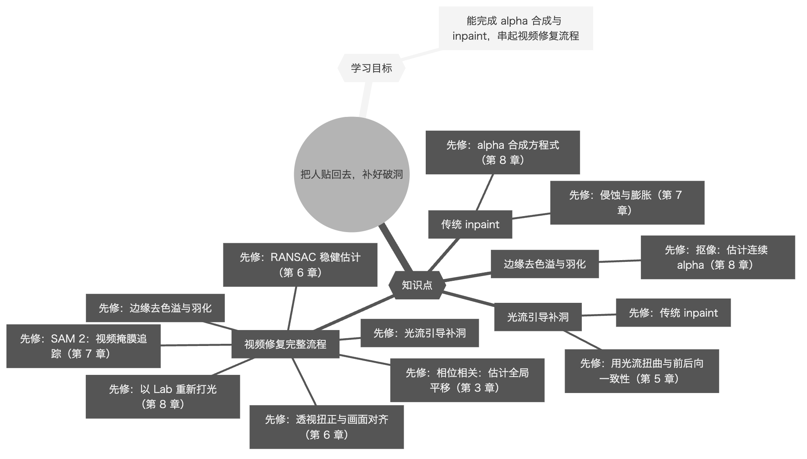
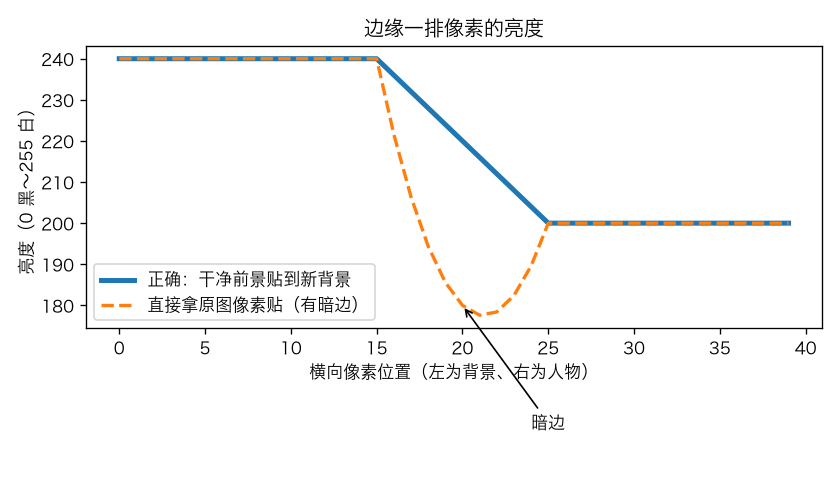
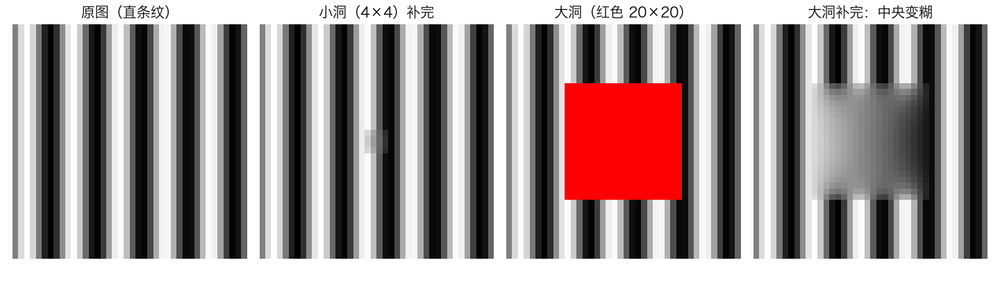
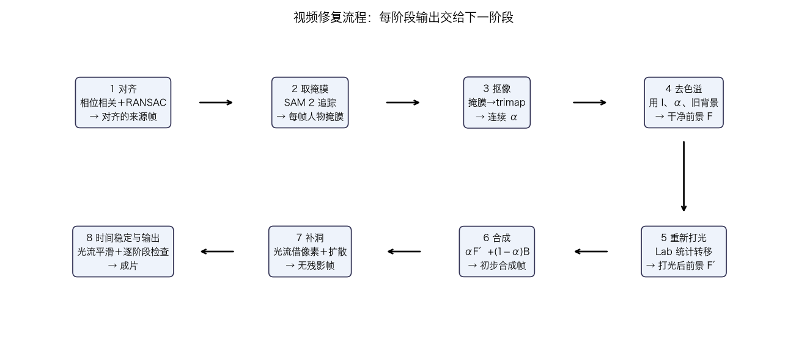

<a id="ch-composite-inpaint-pipeline"></a>

完成去色溢、合成与补洞，并把前面所有算法串成视频修复流程。

<a id="fig-mindmap-ch-composite-inpaint-pipeline"></a>



<details><summary>文字说明</summary>思维导图：中心为「把人贴回去，补好破洞」，分支为 学习目标（能完成 alpha 合成与 inpaint，串起视频修复流程）；知识点（边缘去色溢与羽化、传统 inpaint、光流引导补洞、视频修复完整流程）。</details>

*图 9-1：把人贴回去，补好破洞：本章 4 个知识点、学习目标与各知识点的直接先修（由先修图自动生成）。*

> 本章导图见 [图 9-1](#fig-mindmap-ch-composite-inpaint-pipeline)。本章假设已会：抠像：估计连续 alpha（`alpha-matting`）、侵蚀与膨胀（`erosion-dilation`）、alpha 合成方程式（`alpha-compositing`）、用光流扭曲与前后向一致性（`flow-warp-consistency`）、RANSAC 稳健估计（`ransac`）、透视扭正与画面对齐（`perspective-warp`）、相位相关：估计全局平移（`phase-correlation`）、SAM 2：视频掩膜追踪（`sam2-video-tracking`）、以 Lab 重新打光（`lab-relighting`）。

<a id="ch-composite-inpaint-pipeline--fringe-problem"></a>

## 1. 贴上去的人为什么有一圈旧颜色

想像你用剪刀把一张站在红墙前的人像剪下来，贴到一张白纸上。剪刀沿着边缘剪，那一圈其实是「半人半墙」的颜色，所以贴到白纸上就会露出一圈淡红边。图像里的边缘像素也是这样：相机拍到的是人和旧背景的混合。直接把它搬到新背景上，旧背景的颜色就会从边缘渗出来，这个现象叫色溢。边缘干不干净，也是区分好合成与坏合成的明显记号。[^c-fringe-tell] [^c-bleed-def]

前面学过的 alpha 合成，用一个 0 到 1 的比例 α 记录每个像素里前景占多少、背景占多少。α=1 是纯人物，α=0 是纯背景，中间的值就是边缘的混合带。[^c-alpha-meaning]

问题出在原图。原图边缘像素的颜色 I 本来就是 I = αF + (1−α)B_旧（F 是干净的人物颜色，B_旧是旧背景颜色），里面已经掺了旧背景。如果把 I 当成 F，直接用 αI + (1−α)B_新 贴到新背景，旧背景就被多算了一次。这个偏差刚好等于 α(1−α)(B_旧−F)，在 α=0.5 时最大。[^c-naive-error]

<a id="fig-fig-fringe-profile"></a>



*图 9-2：左边是背景、右边是人物。实线是正确合成，虚线是直接拿原图像素贴上的结果，在边缘处出现比两侧都暗的暗边。*
看 [图 9-2](#fig-fig-fringe-profile)：横轴从左（背景）走到右（人物），实线是正确结果，亮度平顺地从背景降到人物。虚线是直接拿原图像素贴上去的结果，在边缘处掉到两边都更暗，就是我们看到的暗边。如果旧背景是亮色，同样的算式会得到亮边（白边）。以一个像素为例：F=200、B_旧=40、B_新=240、α=0.5，原图像素是 120。直接贴会得到 180，正确值是 220，差了 40。[^c-naive-error]

去色溢的做法，是把上面的式子倒过来解：F = (I − (1−α)B_旧) / α。也就是先从原图像素扣掉旧背景该贡献的部分，再除以前景占的比例，就还原出干净的人物颜色。[^c-decon-formula]

这里有一个难处。每个像素的三个颜色通道只给你三个已知数，未知数却有 F、B 的三个通道各三个加一个 α，共七个，所以不能凭像素自己解出来。实务上的办法是：α 由抠像先给定，B_旧则从边缘外侧「纯背景」的像素估计。[^c-ill-posed]

只要 α 已知，估计前景颜色本身就是一个独立的问题，也是许多图像编辑流程的必要步骤。已有快速的多层（由粗到细）方法，在速度和记忆体上都有优势。[^c-decon-est]

去色溢之外还要羽化。做法是先把 α 向内侵蚀一两个像素，让过渡带落在确定是人物的地方，再用小范围的加权平均让 α 柔和变化。例如一维的 α 为 [0,0,0,1,1,1]，用权重 1:2:1 平均相邻三格，结果是 [0, 0, 0.25, 0.75, 1, 1]。硬边变成两格宽的渐层，贴上后就不会有锯齿或剪纸感。[^c-feather]

### 范例：`decon_numbers.py`

用数字验证直接贴上会有偏差、去色溢能还原，以及羽化把硬边变成渐层。[^c-naive-error]

档案：[`decon_numbers.py`](/optical-flow-sam/examples/ch-composite-inpaint-pipeline/decon_numbers.py)（执行：`python decon_numbers.py`）

```python
import numpy as np

alpha = np.array([0, 0.25, 0.5, 0.75, 1.0])
F = 200.0
B_old = 40.0
B_new = 240.0
I = alpha * F + (1 - alpha) * B_old
naive = alpha * I + (1 - alpha) * B_new
F_est = np.where(alpha > 0.05, (I - (1 - alpha) * B_old) / np.maximum(alpha, 1e-6), I)
good = alpha * F_est + (1 - alpha) * B_new
truth = alpha * F + (1 - alpha) * B_new
print('直接贴最大误差 =', float(np.abs(naive - truth).max()))
print('去色溢后最大误差 =', round(float(np.abs(good - truth).max()), 6))

a = np.array([0, 0, 0, 1, 1, 1.0])
p = np.pad(a, 1, mode='edge')
soft = (p[:-2] + 2 * p[1:-1] + p[2:]) / 4
print('羽化后', soft.tolist())
```

预期输出（节录）：

```text
羽化后 [0.0, 0.0, 0.25, 0.75, 1.0, 1.0]
```

<a id="ch-composite-inpaint-pipeline--classical-inpaint"></a>

## 2. 传统 inpaint：从洞边往里填

把人换掉或移走之后，原处会留下一个没有资讯的洞。补洞（inpainting）就是用洞周围已知的像素去推测洞里该是什么，目标是让观看者看不出修补痕迹。这项技术常用来修复老照片和视频，也用来移除不想要的物件，例如字幕和浮水印。[^c-inpaint-def] [^c-inpaint-uses]

先看一维。一排像素是 30、?、?、?、70，洞两侧已知，最自然的填法是在两端之间连一条直线，填入 40、50、60。可以把洞想成一座断掉的桥，从两岸同时往中间铺，值就随着离哪一岸近而偏向那一岸。[^c-1d-linear]

推到二维，每个洞内像素都有上下左右四个邻居。做法是先把洞内随便填个初值，然后反复让每个洞内像素等于四个邻居的平均，洞外的像素固定不动。洞边的资讯就像墨水一样一圈一圈往内扩散，直到每个像素都和邻居的平均一致为止。[^c-2d-diffusion]

<a id="fig-fig-diffusion-hole"></a>



*图 9-3：直条纹图中，4×4 的小洞补得几乎看不出来；20×20 的大洞（红色）补完后中央变成平滑的灰，细节消失。*
[图 9-3](#fig-fig-diffusion-hole) 用直条纹图测试：4×4 的小洞几乎看不出来，20×20 的大洞中央却变成一片平滑的灰。原因是平均会把高低起伏抹平。洞越大，中间离洞边越远，边上的条纹细节传不进去，只剩下模糊的过渡。所以扩散式的方法只适合小洞、细缝，大洞会糊。[^c-big-hole-blur]

补洞方法大致分两类：填小缺口的 inpainting 技术，以及用样本纹理生成大片区域的纹理合成。[^c-inpaint-classes]

后者的代表是 Criminisi 的范例式（exemplar-based）方法：从已知区域找相似的小块贴进洞，同时延伸结构和纹理。它简单好实现，但画面质量和计算效率有缺点，例如修补误差会累积、全局搜寻很慢，后来有许多改进版本。[^c-exemplar]

最后是洞掩膜的准备。人物边缘常有一圈残留的半透明像素，如果洞掩膜刚好贴着物体边界，这圈残留会被当成「已知」像素传进洞里。因此洞掩膜要先用膨胀向外多扩一两个像素，再交给补洞。[^c-hole-dilate]

<a id="ch-composite-inpaint-pipeline--flow-guided-inpaint"></a>

## 3. 向其他帧借像素：光流引导补洞

视频和单张照片不同：这一帧被挡住的地方，人移动后，在前几帧或后几帧可能露出来了。与其用周围像素猜，不如直接去别帧「借」真实的像素。借的方法是用光流：在第 t 帧洞内的像素 p，沿着 t 到 s 帧的光流找到对应位置 q = p + f(p)，再把 s 帧在 q 的颜色复制回来。[^c-flow-borrow]

借来的像素不一定可靠，所以沿用前面学过的前后向一致性检查：从 p 顺光流走到 q，再用反向光流走回来，应该回到 p 附近，也就是 |f(p) + b(q)| 小于门槛。同时 q 本身不能落在 s 帧的洞里。两个条件都通过才采用，否则换下一个候选帧。[^c-flow-consistency]

还有一个陷阱：洞内的光流本身是不可信的，因为那里的像素被遮掉了。常见的处理是把洞外的光流场当作「已知」，用上一节的扩散法把洞内的光流填出来，再用填好的光流去借像素。[^c-flow-fill-flow]

时间连贯性是这个方法的主要好处。逐帧独立做扩散补洞时，每一帧的洞边都略有不同，填出来的内容就会跳动而闪烁。向别帧借像素时，相邻帧借的是同一批真实像素，只随着光流一起移动，所以补出来的内容稳定。一维小实验中，纹理每帧向右移 2 格，第 0 帧的洞用光流（位移 2）从第 1 帧借值，误差是 0；线性插值则猜不出随机纹理。[^c-temporal]

限制是：如果洞里的内容在任何一帧都没有被看见（例如人整段视频都站在同一处），就没有东西可借。这时只能退回扩散法，或交给学习式的补洞方法。[^c-fallback]

### 范例：`inpaint_1d.py`

一维示范：两侧直线填补，以及纹理每帧右移 2 格时，光流借像素与线性插值的比较。[^c-temporal]

档案：[`inpaint_1d.py`](/optical-flow-sam/examples/ch-composite-inpaint-pipeline/inpaint_1d.py)（执行：`python inpaint_1d.py`）

```python
import numpy as np

print('一维线性填补', np.interp([3, 4, 5], [2, 6], [30, 70]).tolist())

rng = np.random.default_rng(0)
f0 = rng.integers(0, 255, size=24).astype(float)
f1 = np.roll(f0, 2)
hole = np.arange(8, 12)

lin = f0.copy()
lin[hole] = np.interp(hole, [7, 12], [f0[7], f0[12]])
err_lin = np.abs(lin[hole] - f0[hole]).max()

borrow = f0.copy()
borrow[hole] = f1[hole + 2]
err_b = np.abs(borrow[hole] - f0[hole]).max()

print('光流借像素最大误差 =', err_b)
print('线性插值最大误差大于 0 =', bool(err_lin > 0))
```

预期输出（节录）：

```text
光流借像素最大误差 = 0.0
```

<a id="ch-composite-inpaint-pipeline--pipeline"></a>

## 4. 全部串起来：视频修复流程

现在可以把前面所有算法串成一条流程。任务是这样的：手上有来源视频（真人拍摄）和一段 AI 换背景后的视频，要把来源视频里的真人贴回 AI 画面，并让人物的光线和新背景协调。抠像的目的，正是把前景精确取出并贴到不同背景上，这就是这条流程的核心。[^c-matting-use]

<a id="fig-fig-pipeline-flow"></a>



*图 9-4：八个阶段依序处理：上排由左到右是对齐、取掩膜、抠像、去色溢，下排由右到左是重新打光、合成、补洞、时间稳定与输出。每格写出方法与输出。*
[图 9-4](#fig-fig-pipeline-flow) 展开了八个阶段，每一格写着阶段名称、用的方法与输出。顺序不是随意排的：去色溢要用到原图像素 I 和旧背景色，等式 I = αF + (1−α)B_旧 只在原始颜色空间成立。所以去色溢必须排在 Lab 重新打光之前，打光之后的颜色已经被改过，式子就不再成立。[^c-pipeline-order]

- **1 对齐**：输入是来源帧和 AI 帧；先用相位相关估出全局平移当初值，再用特征匹配加 RANSAC 求单应性，把来源帧透视扭正到 AI 画面坐标；输出是对齐后的来源帧。验收：背景区（人物以外）两边的差异要小。失败例：人物占满画面，或 AI 重画了背景纹理，特征点落在移动的人或假纹理上，单应性就会算错。[^c-stage-align]
- **2 取掩膜**：输入是对齐后的来源帧，在第一帧给 SAM 2 提示点，让它追踪整段视频；输出是每帧的人物二值掩膜。验收：掩膜面积逐帧变化平滑，用光流扭曲上一帧掩膜后，和当前掩膜的重叠度要高。失败例：人被遮挡或有别人走过时，追踪跳到另一个人。[^c-stage-mask]
- **3 抠像**：输入是掩膜；先向内侵蚀得「确定前景」、向外膨胀得「确定背景」，中间夹着「未知」带，构成 trimap，再估出连续的 α。验收：确定区的 α 必须是 0 或 1，未知带内的 α 在 0 到 1 之间平顺。失败例：发丝太细，α 被估成硬边，贴上后像剪纸。[^c-stage-matte]
- **4 去色溢**：输入是原图 I、α、从边缘外侧估出的 B_旧；用 F = (I − (1−α)B_旧)/α 解出干净前景；输出是 F。验收：把 F 贴到纯白或纯黑背景看，不应有明显彩边。失败例：B_旧估错（例如边缘外侧刚好有杂物），人物边缘出现暗边或反色边。[^c-stage-decon]
- **5 重新打光**：输入是 F 和 AI 背景，在 Lab 空间把前景的亮度与色度统计向背景靠；输出是打光后的 F′。验收：F′ 的平均亮度与色偏落在背景统计附近，但没有数值溢出。失败例：背景有大片高亮区（如窗户）时，整个人偏白或偏色。[^c-stage-relight]
- **6 合成**：输入是 F′、α、AI 帧 B；用 C = αF′ + (1−α)B 逐帧合成；输出是初步合成帧。验收：α=0 的位置必须与 AI 帧完全一致。失败例：对齐有几个像素的误差，人物边缘出现重影或漂浮感。[^c-stage-composite]
- **7 补洞**：输入是合成帧。AI 视频里人物可能被重画成不同大小，我们也在 AI 帧上取人物掩膜 M_AI，把它膨胀后减掉贴上去的人物区（α>0），剩下的环状残影区就是洞；先向别帧借像素，借不到的再用扩散填补；输出是无残影帧。验收：洞区补完后，与周围的纹理和亮度应该连续。失败例：AI 人物远大于来源人物，洞太大，扩散填补出一片糊。[^c-stage-inpaint]
- **8 时间稳定与输出**：输入是逐帧结果和光流；把前一帧的结果用光流扭曲过来，在前后向一致的区域与当前帧加权混合，抑制闪烁，最后写成视频。验收：相邻帧在背景区的差异不应大于 AI 原片本身的帧间差异。失败例：动作很快时光流错误，混合会拖出残影。[^c-stage-temporal]

整体质量检查有两条实用的线索。第一，人物以外的区域应该和 AI 视频几乎相同，差异（均方误差）越小越好，可以量化地看流程有没有误伤背景。第二，人物边缘和洞区需要逐帧目视检查，因为数字抓不到彩边和闪烁。检查要在每个阶段之后做，这样出错时才知道是哪一段的问题。[^c-qa]

<a id="ch-composite-inpaint-pipeline--project-practice"></a>

## 5. 练习：完整专案与小题

**完整专案**：准备一段来源视频和一段 AI 换背景后的视频（长度、解析度相近）。依 [图 9-4](#fig-fig-pipeline-flow) 的八个阶段实现并输出一段完整视频。每个阶段完成后，存下它的输出，并写下输入、输出、验收方式，以及你实际遇到或预想的一个失败点。

**小题**：

1. 某边缘像素 α=0.25，F=200，B_旧=40，B_新=240。直接贴和正确去色溢后贴，结果各是多少？
2. 为什么洞掩膜要先膨胀再补洞？
3. 为什么去色溢要排在 Lab 重新打光之前？

**练习 1**（`ex-project`）：完整专案：用一段来源视频和一段 AI 换背景后的视频，依八个阶段（对齐、SAM 2 掩膜、抠像、去色溢、Lab 重新打光、合成、补洞、时间稳定）输出完整视频。每阶段写下输入、输出、验收方式与一个可能的失败点。

<details><summary>解答</summary>

验收重点：(1) 八个阶段都有输出，且每阶段的输出就是下一阶段的输入；(2) 人物以外的区域与 AI 视频的差异很小；(3) 逐帧目视检查边缘有没有彩边、洞区有没有残影、相邻帧有没有闪烁；(4) 每阶段的失败点可参考文中列出的：特征点落在移动物上、追踪跳错人、发丝 α 偏硬、B_旧 估错、背景高亮区造成偏色、对齐误差造成重影、大洞变糊、快速动作拖影。

</details>

**练习 2**（`ex-numbers`）：某边缘像素 α=0.25，F=200，B_旧=40，B_新=240。直接贴和去色溢后贴，结果各是多少？

<details><summary>解答</summary>

原图像素 I=0.25×200+0.75×40=80。直接贴：0.25×80+0.75×240=200。去色溢先得 F=(80−0.75×40)/0.25=200，再贴：0.25×200+0.75×240=230。直接贴偏暗 30，与 α(1−α)(B_旧−F)=0.1875×(−160)=−30 一致。

</details>

**练习 3**（`ex-dilate`）：为什么洞掩膜要先膨胀再补洞？

<details><summary>解答</summary>

人物边缘有半透明的残留像素，带有被移除物件的颜色。如果洞掩膜刚好贴着物体边界，这些像素会被当成已知值传入洞内，补出来的区域就带着残色。膨胀一两个像素可以把它们包进洞里，让补洞的边界值都来自纯背景。

</details>

**练习 4**（`ex-order`）：为什么去色溢要排在 Lab 重新打光之前？

<details><summary>解答</summary>

去色溢用的 I=αF+(1−α)B_旧 只在原始颜色上成立。打光会对颜色做非线性映射，之后 I 与 F、B_旧 的线性关系就被破坏，解出的 F 会有偏差。所以先用原始颜色去色溢，再对干净的 F 打光。

</details>

<a id="ch-composite-inpaint-pipeline--references"></a>

## 章末引用

### 主张与证据

[^c-fringe-tell]: 好合成与坏合成的明显分别之一是前景层边缘的质量；边缘可能残留原本拍摄背景的颜色污染，使前景无法自然融入新背景。 —— 证据：[youtubendafter〔未核实〕](<https://www.youtube.com/watch?v=g_k_tjEoiTE>)（`ev-727945891aee`）
[^c-bleed-def]: 直接用原图像素取代前景来合成到新背景时，旧背景的颜色会从半透明区域渗出（色溢）。 —— 证据：[doindfasti〔未核实〕](<https://doi.org/10.1109/icpr48806.2021.9412408>)（`ev-5eeba68c8ab1`）
[^c-alpha-meaning]: alpha 掩膜逐像素描述前景与背景颜色各自贡献多少。 —— 证据：[doindfasti〔未核实〕](<https://doi.org/10.1109/icpr48806.2021.9412408>)（`ev-3f522b8a7a4f`）
[^c-naive-error]: 若原图像素为 I=αF+(1−α)B_旧，直接以 I 取代 F 合成到 B_新，结果与正确合成的差为 α(1−α)(B_旧−F)，在 α=0.5 时绝对值最大。 —— 证据：[doindfasti〔未核实〕](<https://doi.org/10.1109/icpr48806.2021.9412408>)（`ev-5eeba68c8ab1`）
[^c-decon-formula]: 已知 α 与旧背景色 B_旧 时，干净前景为 F=(I−(1−α)B_旧)/α（α 不为 0）。 —— 证据：[doindfasti〔未核实〕](<https://doi.org/10.1109/icpr48806.2021.9412408>)（`ev-5eeba68c8ab1`）；[doindfasti〔未核实〕](<https://doi.org/10.1109/icpr48806.2021.9412408>)（`ev-b97f170ccf1f`）
[^c-ill-posed]: 逐像素求 α、F、B 是高度不适定的问题：三个方程式（三个颜色通道）对上七个未知数。 —— 证据：[doindsparsea〔未核实〕](<https://doi.org/10.1109/tip.2016.2555705>)（`ev-9e45714592e3`）
[^c-decon-est]: 在已知 alpha 掩膜下估计前景颜色是许多图像编辑流程的必要步骤，且有快速的多层方法，在执行时间与记忆体上优于其他方法。 —— 证据：[doindfasti〔未核实〕](<https://doi.org/10.1109/icpr48806.2021.9412408>)（`ev-b97f170ccf1f`）
[^c-feather]: 羽化：先侵蚀 α 再以小范围加权平均平滑，可把硬边变成渐层；例如 [0,0,0,1,1,1] 以权重 1:2:1 平均后得 [0,0,0.25,0.75,1,1]。 —— 证据：[youtubendafter〔未核实〕](<https://www.youtube.com/watch?v=g_k_tjEoiTE>)（`ev-727945891aee`）；[youtubendafter〔未核实〕](<https://www.youtube.com/watch?v=g_k_tjEoiTE>)（`ev-655e3b65a6d9`）
[^c-inpaint-def]: 图像补洞是利用已知的邻近资讯估计受损或缺失的区域，目的是让观看者看不出修补痕迹。 —— 证据：[doindnovelb〔未核实〕](<https://doi.org/10.1109/incos.2015.15>)（`ev-37ed64dc451f`）；[doindeffective〔未核实〕](<https://doi.org/10.1109/icct.2012.6511302>)（`ev-8c22b80621ed`）
[^c-inpaint-uses]: 补洞的应用包括修复照片、视频与古画，以及移除遮挡物如叠加的文字、字幕、印章与广告。 —— 证据：[doindeffective〔未核实〕](<https://doi.org/10.1109/icct.2012.6511302>)（`ev-01e58a8ddb92`）
[^c-1d-linear]: 一维洞两侧已知时，用两端之间的直线填补，例如 30、?、?、?、70 填成 40、50、60。 —— 证据：[doindnovelb〔未核实〕](<https://doi.org/10.1109/incos.2015.15>)（`ev-37ed64dc451f`）
[^c-2d-diffusion]: 二维扩散补洞：洞内像素反复取上下左右四邻居的平均，洞外像素固定，洞边的资讯便逐圈向内传入。 —— 证据：[doindeffective〔未核实〕](<https://doi.org/10.1109/icct.2012.6511302>)（`ev-8c22b80621ed`）；[doindnovelb〔未核实〕](<https://doi.org/10.1109/incos.2015.15>)（`ev-743a0e155ec1`）
[^c-big-hole-blur]: 扩散式补洞在大洞中央会变得模糊平滑，因为平均会抹平高频细节，洞越大边上的细节传不到中心；因此只适合小洞。 —— 证据：[doindnovelb〔未核实〕](<https://doi.org/10.1109/incos.2015.15>)（`ev-743a0e155ec1`）
[^c-inpaint-classes]: 此问题有两类算法：填补小缺口的 inpainting 技术，以及由样本纹理生成大片区域的纹理合成算法。 —— 证据：[doindnovelb〔未核实〕](<https://doi.org/10.1109/incos.2015.15>)（`ev-743a0e155ec1`）
[^c-exemplar]: Criminisi 的范例式补洞可同时把结构与纹理资讯传入目标区域，简单易实现，但有感知质量与计算效率的缺点（如修补误差累积、全局搜寻耗时），后续有许多改进。 —— 证据：[doindeffective〔未核实〕](<https://doi.org/10.1109/icct.2012.6511302>)（`ev-8c22b80621ed`）；[doindnovelb〔未核实〕](<https://doi.org/10.1109/incos.2015.15>)（`ev-5e7d0d51c960`）
[^c-hole-dilate]: 洞掩膜应先膨胀一两个像素再补洞，以免洞边残留的半透明像素被当成已知值传入洞内。 —— 证据：[doindnovelb〔未核实〕](<https://doi.org/10.1109/incos.2015.15>)（`ev-37ed64dc451f`）；[doindfasti〔未核实〕](<https://doi.org/10.1109/icpr48806.2021.9412408>)（`ev-5eeba68c8ab1`）
[^c-flow-borrow]: 第 t 帧洞内像素 p 可沿光流找到第 s 帧的对应位置 q=p+f(p)，并复制该处像素来填补。 —— 证据：[doindnovelb〔未核实〕](<https://doi.org/10.1109/incos.2015.15>)（`ev-37ed64dc451f`）；[doindeffective〔未核实〕](<https://doi.org/10.1109/icct.2012.6511302>)（`ev-01e58a8ddb92`）
[^c-flow-consistency]: 借像素前要做前后向一致性检查：|f(p)+b(q)| 小于门槛，且 q 不在来源帧的洞内，两者都通过才采用，否则换下一个候选帧。 —— 证据：[doindnovelb〔未核实〕](<https://doi.org/10.1109/incos.2015.15>)（`ev-37ed64dc451f`）
[^c-flow-fill-flow]: 洞内的光流不可靠，可把洞外光流当已知，以扩散法把洞内光流填出后，再用它借像素。 —— 证据：[doindeffective〔未核实〕](<https://doi.org/10.1109/icct.2012.6511302>)（`ev-8c22b80621ed`）；[doindnovelb〔未核实〕](<https://doi.org/10.1109/incos.2015.15>)（`ev-37ed64dc451f`）
[^c-temporal]: 向其他帧借像素让相邻帧补出同一批真实内容，时间上连贯；逐帧独立扩散则因洞边不同而闪烁。一维实验中光流借像素的误差为 0，线性插值误差大于 0。 —— 证据：[doindeffective〔未核实〕](<https://doi.org/10.1109/icct.2012.6511302>)（`ev-01e58a8ddb92`）；[doindnovelb〔未核实〕](<https://doi.org/10.1109/incos.2015.15>)（`ev-37ed64dc451f`）
[^c-fallback]: 洞内内容在所有帧都被遮住时，没有可借的像素，只能退回扩散法或学习式补洞。 —— 证据：[doindnovelb〔未核实〕](<https://doi.org/10.1109/incos.2015.15>)（`ev-743a0e155ec1`）
[^c-matting-use]: 数位抠像是图像与视频编辑的工具，用来精确取出前景并贴到不同背景上。 —— 证据：[doindsparsea〔未核实〕](<https://doi.org/10.1109/tip.2016.2555705>)（`ev-45d7e7483d9c`）
[^c-pipeline-order]: 流程顺序为：对齐、SAM 2 掩膜、抠像、去色溢、Lab 重新打光、合成、补洞、时间稳定；去色溢必须在重新打光之前，因为 I=αF+(1−α)B_旧 只在未改色的原始颜色上成立。 —— 证据：[doindfasti〔未核实〕](<https://doi.org/10.1109/icpr48806.2021.9412408>)（`ev-5eeba68c8ab1`）；[doindfasti〔未核实〕](<https://doi.org/10.1109/icpr48806.2021.9412408>)（`ev-b97f170ccf1f`）
[^c-stage-align]: 对齐阶段以相位相关估全局平移，再用特征匹配加 RANSAC 求单应性并扭正来源帧；验收看背景差异，失败点是特征点落在移动的人或 AI 假纹理上。 —— 证据：[doindsparsea〔未核实〕](<https://doi.org/10.1109/tip.2016.2555705>)（`ev-45d7e7483d9c`）
[^c-stage-mask]: 掩膜阶段以 SAM 2 在第一帧给提示后追踪整段视频；验收看面积平滑度与光流扭曲前一帧掩膜的重叠度，失败点是遮挡后追踪跳到别人。 —— 证据：[doindsparsea〔未核实〕](<https://doi.org/10.1109/tip.2016.2555705>)（`ev-45d7e7483d9c`）
[^c-stage-matte]: 抠像阶段由掩膜经侵蚀与膨胀得到 trimap，再估连续 α；验收看确定区 α 是否为 0 或 1，失败点是发丝处 α 偏硬。 —— 证据：[doindsparsea〔未核实〕](<https://doi.org/10.1109/tip.2016.2555705>)（`ev-45d7e7483d9c`）；[doindsparsea〔未核实〕](<https://doi.org/10.1109/tip.2016.2555705>)（`ev-9e45714592e3`）
[^c-stage-decon]: 去色溢阶段以原图 I、α 与估计的 B_旧 解出 F；验收是贴到纯白或纯黑背景检查彩边，失败点是 B_旧 估错造成暗边或反色边。 —— 证据：[doindfasti〔未核实〕](<https://doi.org/10.1109/icpr48806.2021.9412408>)（`ev-5eeba68c8ab1`）；[youtubendafter〔未核实〕](<https://www.youtube.com/watch?v=g_k_tjEoiTE>)（`ev-727945891aee`）
[^c-stage-relight]: 重新打光阶段在 Lab 空间把前景统计向背景靠；验收看前景平均亮度与色偏是否靠近背景，失败点是背景大片高亮区使人物偏白或偏色。 —— 证据：[doindsparsea〔未核实〕](<https://doi.org/10.1109/tip.2016.2555705>)（`ev-45d7e7483d9c`）
[^c-stage-composite]: 合成阶段逐帧计算 C=αF′+(1−α)B；验收是 α=0 处与 AI 帧完全相同，失败点是对齐误差造成重影。 —— 证据：[doindfasti〔未核实〕](<https://doi.org/10.1109/icpr48806.2021.9412408>)（`ev-3f522b8a7a4f`）；[doindsparsea〔未核实〕](<https://doi.org/10.1109/tip.2016.2555705>)（`ev-45d7e7483d9c`）
[^c-stage-inpaint]: 补洞阶段的洞为膨胀后的 AI 人物掩膜减去贴上的人物区（α>0），先向别帧借像素、借不到再扩散；验收看洞区与周围的连续性，失败点是 AI 人物远大于来源人物导致大洞糊掉。 —— 证据：[doindnovelb〔未核实〕](<https://doi.org/10.1109/incos.2015.15>)（`ev-743a0e155ec1`）；[doindnovelb〔未核实〕](<https://doi.org/10.1109/incos.2015.15>)（`ev-37ed64dc451f`）
[^c-stage-temporal]: 时间稳定阶段以光流扭曲前一帧结果，在前后向一致的区域与当前帧加权混合以抑制闪烁；失败点是快速动作时光流错误造成拖影。 —— 证据：[doindeffective〔未核实〕](<https://doi.org/10.1109/icct.2012.6511302>)（`ev-01e58a8ddb92`）
[^c-qa]: 流程质量可用两条线索检查：人物以外的区域与 AI 视频的均方误差越小越好；人物边缘与洞区需逐帧目视；并且每阶段后都要检查，才能定位出错的阶段。 —— 证据：[youtubendafter〔未核实〕](<https://www.youtube.com/watch?v=g_k_tjEoiTE>)（`ev-727945891aee`）；[doindnovelb〔未核实〕](<https://doi.org/10.1109/incos.2015.15>)（`ev-37ed64dc451f`）

### 参考文献

#### 已核实引用

（无）

#### 未核实来源（仅供查找，不得当作已验证引用）

- 〔未核实〕[doindeffective] (n.d.). *An effective exemplar-based image inpainting method*. <https://doi.org/10.1109/icct.2012.6511302> 授权：unknown；可靠度：高
- 〔未核实〕[doindfasti] (n.d.). *Fast Multi-Level Foreground Estimation*. <https://doi.org/10.1109/icpr48806.2021.9412408> 授权：unknown；可靠度：高
- 〔未核实〕[doindnovelb] (n.d.). *A Novel Exemplar-Based Image Inpainting Algorithm*. <https://doi.org/10.1109/incos.2015.15> 授权：unknown；可靠度：高
- 〔未核实〕[doindsparsea] (n.d.). *Sparse Coding for Alpha Matting*. <https://doi.org/10.1109/tip.2016.2555705> 授权：unknown；可靠度：高
- 〔未核实〕[youtubendafter] (n.d.). *After Effects Classic Course: Remove Color Matting*. <https://www.youtube.com/watch?v=g_k_tjEoiTE> 授权：unknown；可靠度：不明
